# 화면 배치 지도 (2026-11-22)

게임 화면(논리 1024 × 1792, 세로)마다 **무엇이 어디에 그려지는지** 표시한 지도다. 그림을 새로 그릴 때 이 자리와 크기에 맞춘다.

| 색 | 종류 | 뜻 |
|---|---|---|
| 노랑 | 글자 | 게임이 글자를 쓰는 자리. 그림에 글자를 넣지 않는다. 상자 = 글자가 들어갈 수 있는 최대 칸 |
| 파랑 | 그림 | 그림(아이콘 · 초상 · 캐릭터 · 배경)이 들어가는 자리. 비율은 유지하고 칸 안에 맞춘다 |
| 빨강 | 버튼 | 누를 수 있는 영역 전체 (버튼 부품 그림 = 이 크기) |
| 회색 | 판 | 테두리 판(9-slice) 자리 — 부품 이름은 표의 `내용` |
| 초록 | 영역 | 컨테이너. 안의 글자·그림·버튼은 이 상자를 넘지 않는다 (표의 A번호) |
| 분홍 | 문제 | 자동 점검에서 걸린 곳 (넘침·잘림·겹침). `점검.md` |

- 만드는 법: `bash tools/layout_map.sh` (게임을 점검 모드로 실행해 그리는 순간의 자리를 기록 → `raw/`, 표시 그림 → 이 폴더).
- 좌표 x, y = 왼쪽 위, 단위 = 논리 픽셀. 화면이 더 긴 폰에서는 위 고정 / 아래 고정 요소가 늘어난 만큼 벌어진다 (화면-설계서 §1).
- 스크롤 목록은 보이는 부분만 기록된다. 같은 모양의 칸이 반복되면 첫 줄 크기를 따른다.

## 인트로 — `01_intro`

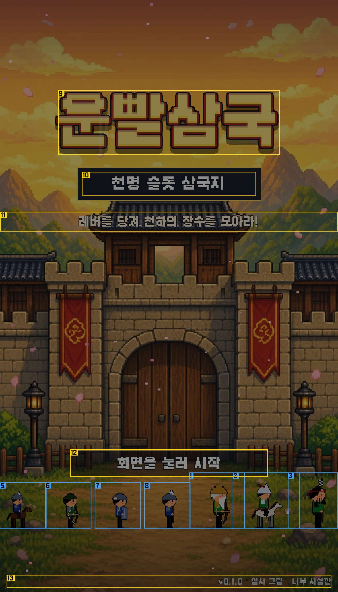

**영역 (컨테이너)**

| A | x, y | 크기 | 노드 |
|---|---|---|---|

**점검: 문제 없음**

**자리**

| # | 종류 | x, y | 크기 | 내용 |
|---|---|---|---|---|
| 배경 | 그림 | -9, -16 | 1042 × 1824 | 배경 intro_bg |
| 1 | 그림 | 572, 1430 | 170 × 170 | 캐릭터 동작 프레임 |
| 2 | 그림 | 705, 1430 | 204 × 170 | 캐릭터 동작 프레임 |
| 3 | 그림 | 872, 1430 | 170 × 170 | 캐릭터 동작 프레임 |
| 4 | 그림 | 1022, 1430 | 170 × 170 | 캐릭터 동작 프레임 |
| 5 | 그림 | -27, 1460 | 168 × 140 | 캐릭터 동작 프레임 |
| 6 | 그림 | 137, 1460 | 140 × 140 | 캐릭터 동작 프레임 |
| 7 | 그림 | 287, 1460 | 140 × 140 | 캐릭터 동작 프레임 |
| 8 | 그림 | 437, 1460 | 140 × 140 | 캐릭터 동작 프레임 |
| 9 | 글자 | 176, 273 | 672 × 196 | “운빨삼국” |
| 10 | 글자 | 248, 520 | 528 × 72 | “천명 슬롯 삼국지” |
| 11 | 글자 | 0, 641 | 1024 × 60 | “레버를 당겨 천하의 장수를 모아라!” |
| 12 | 글자 | 212, 1360 | 600 × 84 | “화면을 눌러 시작” |
| 13 | 글자 | 20, 1740 | 984 × 40 | “v0.1.0 · 임시 그림 · 내부 시험판” |

## 로비 — `02_lobby`

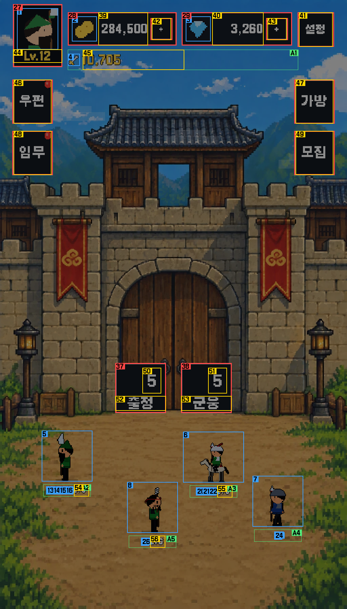

**영역 (컨테이너)**

| A | x, y | 크기 | 노드 |
|---|---|---|---|
| A1 | 200, 146 | 680 × 60 | `screen_layer/Lobby/@Control@25` |
| A2 | 128, 1425 | 140 × 36 | `screen_layer/Lobby/@Control@29` |
| A3 | 560, 1428 | 140 × 36 | `screen_layer/Lobby/@Control@35` |
| A4 | 750, 1558 | 140 × 36 | `screen_layer/Lobby/@Control@38` |
| A5 | 380, 1576 | 140 × 36 | `screen_layer/Lobby/@Control@32` |

**점검: 문제 없음**

**자리**

| # | 종류 | x, y | 크기 | 내용 |
|---|---|---|---|---|
| 배경 | 그림 | 0, 0 | 1024 × 1792 | 배경 lobby_bg |
| 1 | 그림 | 50, 24 | 122 × 122 | 얼굴 guanyu |
| 2 | 그림 | 212, 48 | 74 × 74 | 아이콘 icon_gold |
| 3 | 그림 | 548, 48 | 74 × 74 | 아이콘 icon_diamond |
| 4 | 그림 | 200, 158 | 36 × 36 | 아이콘 icon_sword |
| 5 | 그림 | 123, 1267 | 150 × 150 | 캐릭터 동작 프레임 |
| 6 | 그림 | 540, 1270 | 180 × 150 | 캐릭터 동작 프레임 |
| 7 | 그림 | 745, 1400 | 150 × 150 | 캐릭터 동작 프레임 |
| 8 | 그림 | 375, 1418 | 150 × 150 | 캐릭터 동작 프레임 |
| 9 | 그림 | 136, 1431 | 24 × 24 | 아이콘 ic_star |
| 10 | 그림 | 155, 1431 | 24 × 24 | 아이콘 ic_star |
| 11 | 그림 | 173, 1431 | 24 × 24 | 아이콘 ic_star |
| 12 | 그림 | 192, 1431 | 24 × 24 | 아이콘 ic_star |
| 13 | 그림 | 138, 1433 | 20 × 20 | 아이콘 ic_star |
| 14 | 그림 | 157, 1433 | 20 × 20 | 아이콘 ic_star |
| 15 | 그림 | 175, 1433 | 20 × 20 | 아이콘 ic_star |
| 16 | 그림 | 194, 1433 | 20 × 20 | 아이콘 ic_star |
| 17 | 그림 | 578, 1434 | 24 × 24 | 아이콘 ic_star |
| 18 | 그림 | 596, 1434 | 24 × 24 | 아이콘 ic_star |
| 19 | 그림 | 615, 1434 | 24 × 24 | 아이콘 ic_star |
| 20 | 그림 | 580, 1436 | 20 × 20 | 아이콘 ic_star |
| 21 | 그림 | 598, 1436 | 20 × 20 | 아이콘 ic_star |
| 22 | 그림 | 617, 1436 | 20 × 20 | 아이콘 ic_star |
| 23 | 그림 | 809, 1564 | 24 × 24 | 아이콘 ic_star |
| 24 | 그림 | 811, 1566 | 20 × 20 | 아이콘 ic_star |
| 25 | 그림 | 416, 1582 | 24 × 24 | 아이콘 ic_star |
| 26 | 그림 | 418, 1584 | 20 × 20 | 아이콘 ic_star |
| 27 | 버튼 | 38, 12 | 146 × 185 | frame_portrait |
| 28 | 버튼 | 200, 36 | 321 × 98 | 284,500 |
| 29 | 버튼 | 536, 36 | 326 × 98 | 3,260 |
| 30 | 버튼 | 878, 36 | 108 × 102 | btn_settings |
| 31 | 버튼 | 444, 53 | 65 × 65 | btn_plus |
| 32 | 버튼 | 785, 53 | 65 × 65 | btn_plus |
| 33 | 버튼 | 36, 234 | 120 × 130 | btn_mail |
| 34 | 버튼 | 868, 234 | 120 × 130 | btn_bag |
| 35 | 버튼 | 36, 385 | 120 × 130 | btn_mission |
| 36 | 버튼 | 868, 385 | 120 × 130 | btn_recruit |
| 37 | 버튼 | 340, 1068 | 150 × 147 | sign_battle |
| 38 | 버튼 | 534, 1068 | 150 × 147 | btn_arena |
| 39 | 글자 | 290, 36 | 147 × 98 | “284,500” |
| 40 | 글자 | 626, 36 | 152 × 98 | “3,260” |
| 41 | 글자 | 882, 36 | 100 × 102 | “설정” |
| 42 | 글자 | 448, 53 | 57 × 65 | “+” |
| 43 | 글자 | 789, 53 | 57 × 65 | “+” |
| 44 | 글자 | 38, 145 | 146 × 40 | “Lv.12” |
| 45 | 글자 | 244, 146 | 300 × 60 | “10,705” |
| 46 | 글자 | 40, 234 | 112 × 130 | “우편” |
| 47 | 글자 | 872, 234 | 112 × 130 | “가방” |
| 48 | 글자 | 40, 385 | 112 × 130 | “임무” |
| 49 | 글자 | 872, 385 | 112 × 130 | “모집” |
| 50 | 글자 | 420, 1082 | 56 × 76 | “5” |
| 51 | 글자 | 614, 1082 | 56 × 76 | “5” |
| 52 | 글자 | 340, 1165 | 150 × 44 | “출정” |
| 53 | 글자 | 534, 1165 | 150 × 44 | “군웅” |
| 54 | 글자 | 218, 1425 | 45 × 36 | “Lv5” |
| 55 | 글자 | 641, 1428 | 45 × 36 | “Lv6” |
| 56 | 글자 | 443, 1576 | 45 × 36 | “Lv6” |

판(테두리 틀): `panel_chip` 326×98, `panel_chip` 321×98, `frame_portrait` 146×185, `sign_battle` 150×147, `btn_arena` 150×147, `btn_recruit` 120×130, `btn_bag` 120×130, `btn_mission` 120×130, `btn_mail` 120×130, `btn_settings` 108×102, `btn_plus` 65×65

## 스테이지 선택 — `03_stage`

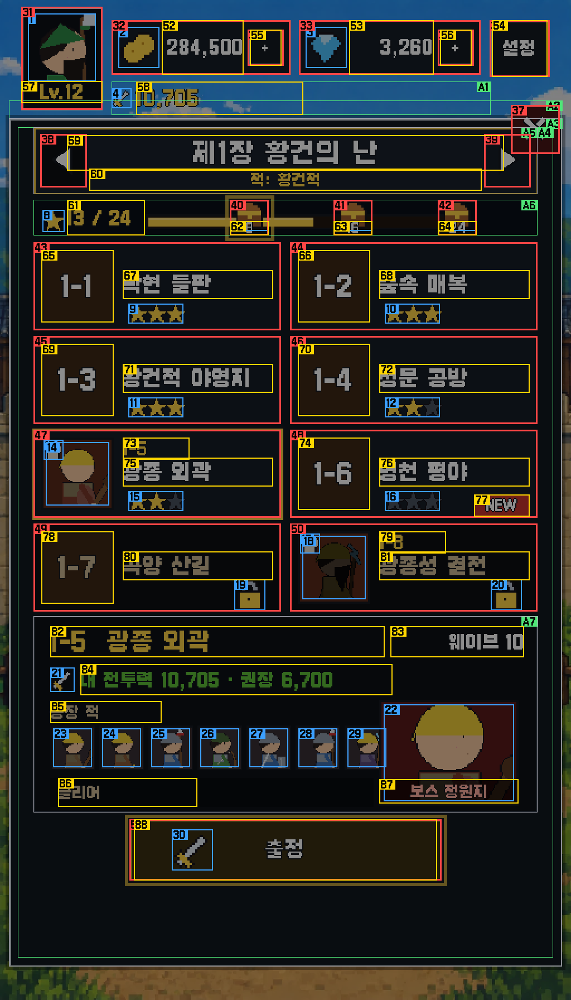

**영역 (컨테이너)**

| A | x, y | 크기 | 노드 |
|---|---|---|---|
| A1 | 200, 146 | 680 × 60 | `screen_layer/Lobby/@Control@25` |
| A2 | 16, 180 | 992 × 1552 | `dialog_layer/@Control@40` |
| A3 | 16, 212 | 992 × 1520 | `dialog_layer/@Control@40/@Control@41` |
| A4 | 32, 228 | 960 × 1488 | `dialog_layer/@Control@40/@Control@42` |
| A5 | 60, 228 | 904 × 120 | `dialog_layer/@Control@40/@Control@42/Stage/@Control@44` |
| A6 | 60, 358 | 904 × 64 | `dialog_layer/@Control@40/@Control@42/Stage/@Control@47` |
| A7 | 60, 1104 | 904 × 352 | `dialog_layer/@Control@40/@Control@42/Stage/@Control@59` |

**점검: 문제 없음**

**자리**

| # | 종류 | x, y | 크기 | 내용 |
|---|---|---|---|---|
| 1 | 그림 | 50, 24 | 122 × 122 | 얼굴 guanyu |
| 2 | 그림 | 212, 48 | 74 × 74 | 아이콘 icon_gold |
| 3 | 그림 | 548, 48 | 74 × 74 | 아이콘 icon_diamond |
| 4 | 그림 | 200, 158 | 36 × 36 | 아이콘 icon_sword |
| 5 | 그림 | 412, 358 | 70 × 56 | 아이콘 icon_chest |
| 6 | 그림 | 598, 358 | 70 × 56 | 아이콘 icon_chest |
| 7 | 그림 | 785, 358 | 70 × 56 | 아이콘 icon_chest |
| 8 | 그림 | 76, 376 | 40 × 40 | 아이콘 ic_star |
| 9 | 그림 | 230, 544 | 99 × 36 | 아이콘 ic_star |
| 10 | 그림 | 690, 544 | 99 × 36 | 아이콘 ic_star |
| 11 | 그림 | 230, 712 | 99 × 36 | 아이콘 ic_star |
| 12 | 그림 | 690, 712 | 99 × 36 | 아이콘 ic_star |
| 13 | 그림 | 78, 788 | 36 × 36 | 아이콘 ic_boss |
| 14 | 그림 | 82, 792 | 114 × 114 | 초상 enemy_brute |
| 15 | 그림 | 230, 880 | 99 × 36 | 아이콘 ic_star |
| 16 | 그림 | 690, 880 | 99 × 36 | 아이콘 ic_star |
| 17 | 그림 | 538, 956 | 36 × 36 | 아이콘 ic_boss |
| 18 | 그림 | 542, 960 | 114 × 114 | 초상 enemy_zhangjiao |
| 19 | 그림 | 420, 1038 | 56 × 56 | 아이콘 ic_lock |
| 20 | 그림 | 880, 1038 | 56 × 56 | 아이콘 ic_lock |
| 21 | 그림 | 90, 1196 | 44 × 44 | 아이콘 icon_sword |
| 22 | 그림 | 688, 1262 | 234 × 174 | 초상 enemy_brute |
| 23 | 그림 | 95, 1305 | 70 × 70 | 초상 enemy_mob |
| 24 | 그림 | 183, 1305 | 70 × 70 | 초상 enemy_sword |
| 25 | 그림 | 271, 1305 | 70 × 70 | 초상 spear |
| 26 | 그림 | 359, 1305 | 70 × 70 | 초상 archer |
| 27 | 그림 | 447, 1305 | 70 × 70 | 초상 shield |
| 28 | 그림 | 535, 1305 | 70 × 70 | 초상 rider |
| 29 | 그림 | 623, 1305 | 70 × 70 | 초상 enemy_mage |
| 30 | 그림 | 308, 1486 | 74 × 74 | 아이콘 icon_sword |
| 31 | 버튼 | 38, 12 | 146 × 185 | frame_portrait |
| 32 | 버튼 | 200, 36 | 321 × 98 | 284,500 |
| 33 | 버튼 | 536, 36 | 326 × 98 | 3,260 |
| 34 | 버튼 | 878, 36 | 108 × 102 | btn_settings |
| 35 | 버튼 | 444, 53 | 65 × 65 | btn_plus |
| 36 | 버튼 | 785, 53 | 65 × 65 | btn_plus |
| 37 | 버튼 | 916, 188 | 88 × 88 | tab_red |
| 38 | 버튼 | 72, 240 | 84 × 96 | btn_small |
| 39 | 버튼 | 868, 240 | 84 × 96 | btn_small |
| 40 | 버튼 | 412, 358 | 70 × 64 |  |
| 41 | 버튼 | 598, 358 | 70 × 64 |  |
| 42 | 버튼 | 785, 358 | 70 × 64 |  |
| 43 | 버튼 | 60, 434 | 444 × 158 | panel_small |
| 44 | 버튼 | 520, 434 | 444 × 158 | panel_small |
| 45 | 버튼 | 60, 602 | 444 × 158 | panel_small |
| 46 | 버튼 | 520, 602 | 444 × 158 | panel_small |
| 47 | 버튼 | 60, 770 | 444 × 158 | panel_small |
| 48 | 버튼 | 520, 770 | 444 × 158 | panel_small |
| 49 | 버튼 | 60, 938 | 444 × 158 | panel_small |
| 50 | 버튼 | 520, 938 | 444 × 158 | panel_small |
| 51 | 버튼 | 232, 1468 | 560 × 110 | 출정 |
| 52 | 글자 | 290, 36 | 147 × 98 | “284,500” |
| 53 | 글자 | 626, 36 | 152 × 98 | “3,260” |
| 54 | 글자 | 882, 36 | 100 × 102 | “설정” |
| 55 | 글자 | 448, 53 | 57 × 65 | “+” |
| 56 | 글자 | 789, 53 | 57 × 65 | “+” |
| 57 | 글자 | 38, 145 | 146 × 40 | “Lv.12” |
| 58 | 글자 | 244, 146 | 300 × 60 | “10,705” |
| 59 | 글자 | 120, 242 | 784 × 64 | “제1장 황건의 난” |
| 60 | 글자 | 160, 302 | 704 × 40 | “적: 황건적” |
| 61 | 글자 | 120, 358 | 140 × 64 | “13 / 24” |
| 62 | 글자 | 412, 396 | 70 × 26 | “8” |
| 63 | 글자 | 598, 396 | 70 × 26 | “16” |
| 64 | 글자 | 785, 396 | 70 × 26 | “24” |
| 65 | 글자 | 74, 448 | 130 × 130 | “1-1” |
| 66 | 글자 | 534, 448 | 130 × 130 | “1-2” |
| 67 | 글자 | 220, 484 | 270 × 52 | “탁현 들판” |
| 68 | 글자 | 680, 484 | 270 × 52 | “숲속 매복” |
| 69 | 글자 | 74, 616 | 130 × 130 | “1-3” |
| 70 | 글자 | 534, 616 | 130 × 130 | “1-4” |
| 71 | 글자 | 220, 652 | 270 × 52 | “황건적 야영지” |
| 72 | 글자 | 680, 652 | 270 × 52 | “성문 공방” |
| 73 | 글자 | 220, 784 | 120 × 40 | “1-5” |
| 74 | 글자 | 534, 784 | 130 × 130 | “1-6” |
| 75 | 글자 | 220, 820 | 270 × 52 | “광종 외곽” |
| 76 | 글자 | 680, 820 | 270 × 52 | “영천 평야” |
| 77 | 글자 | 850, 886 | 100 × 40 | “NEW” |
| 78 | 글자 | 74, 952 | 130 × 130 | “1-7” |
| 79 | 글자 | 680, 952 | 120 × 40 | “1-8” |
| 80 | 글자 | 220, 988 | 270 × 52 | “곡양 산길” |
| 81 | 글자 | 680, 988 | 270 × 52 | “광종성 결전” |
| 82 | 글자 | 90, 1122 | 600 × 56 | “1-5  광종 외곽” |
| 83 | 글자 | 700, 1122 | 240 × 56 | “웨이브 10” |
| 84 | 글자 | 144, 1190 | 560 × 56 | “내 전투력 10,705 · 권장 6,700” |
| 85 | 글자 | 90, 1256 | 200 × 40 | “등장 적” |
| 86 | 글자 | 104, 1394 | 250 × 52 | “클리어” |
| 87 | 글자 | 680, 1396 | 250 × 44 | “보스 정원지” |
| 88 | 글자 | 240, 1468 | 544 × 110 | “출정” |

판(테두리 틀): `panel_ctrl` 992×1520, `panel_slot` 904×352, `plate_title` 904×120, `panel_small` 444×158, `tab_yellow` 560×110, `panel_chip` 326×98, `panel_chip` 321×98, `frame_portrait` 146×185, `btn_settings` 108×102, `btn_small` 84×96, `tab_red` 88×88, `btn_plus` 65×65

## 팝업 — 출정 편성 — `03b_pop_lineup`

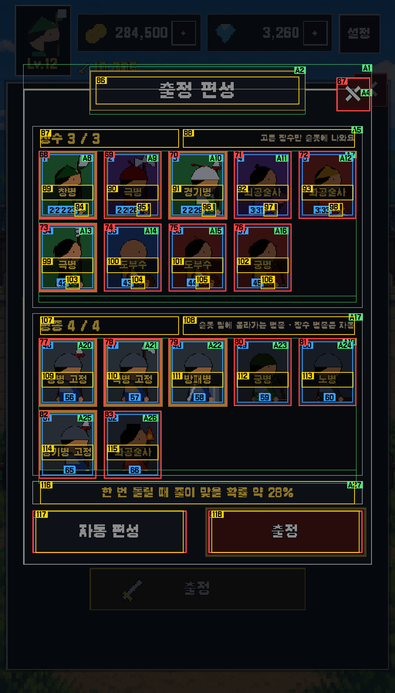

**영역 (컨테이너)**

| A | x, y | 크기 | 노드 |
|---|---|---|---|
| A1 | 60, 166 | 904 × 1294 | `popup_layer/@Control@61/@Control@63` |
| A2 | 232, 172 | 560 × 124 | `popup_layer/@Control@61/@Control@63/@Control@65` |
| A3 | 60, 230 | 904 × 1230 | `popup_layer/@Control@61/@Control@63/@Control@64` |
| A4 | 60, 230 | 904 × 1230 | `popup_layer/@Control@61/@Control@63/@Control@67` |
| A5 | 84, 326 | 856 × 470 | `popup_layer/@Control@61/@Control@63/@Control@67/@Control@68` |
| A6 | 100, 390 | 824 × 392 | `popup_layer/@Control@61/@Control@63/@Control@67/@ScrollContainer@71` |
| A7 | 100, 390 | 824 × 376 | `popup_layer/@Control@61/@Control@63/@Control@67/@ScrollContainer@71/@Control@72` |
| A8 | 109, 399 | 132 × 158 | `popup_layer/@Control@61/@Control@63/@Control@67/@ScrollContainer@71/@Control@72/@BaseButton@76/@Control@74` |
| A9 | 278, 399 | 132 × 158 | `popup_layer/@Control@61/@Control@63/@Control@67/@ScrollContainer@71/@Control@72/@BaseButton@80/@Control@78` |
| A10 | 446, 399 | 132 × 158 | `popup_layer/@Control@61/@Control@63/@Control@67/@ScrollContainer@71/@Control@72/@BaseButton@84/@Control@82` |
| A11 | 615, 399 | 132 × 158 | `popup_layer/@Control@61/@Control@63/@Control@67/@ScrollContainer@71/@Control@72/@BaseButton@88/@Control@86` |
| A12 | 783, 399 | 132 × 158 | `popup_layer/@Control@61/@Control@63/@Control@67/@ScrollContainer@71/@Control@72/@BaseButton@92/@Control@90` |
| A13 | 109, 587 | 132 × 158 | `popup_layer/@Control@61/@Control@63/@Control@67/@ScrollContainer@71/@Control@72/@BaseButton@96/@Control@94` |
| A14 | 278, 587 | 132 × 158 | `popup_layer/@Control@61/@Control@63/@Control@67/@ScrollContainer@71/@Control@72/@BaseButton@100/@Control@98` |
| A15 | 446, 587 | 132 × 158 | `popup_layer/@Control@61/@Control@63/@Control@67/@ScrollContainer@71/@Control@72/@BaseButton@104/@Control@102` |
| A16 | 615, 587 | 132 × 158 | `popup_layer/@Control@61/@Control@63/@Control@67/@ScrollContainer@71/@Control@72/@BaseButton@108/@Control@106` |
| A17 | 84, 810 | 856 × 420 | `popup_layer/@Control@61/@Control@63/@Control@67/@Control@109` |
| A18 | 100, 874 | 824 × 342 | `popup_layer/@Control@61/@Control@63/@Control@67/@ScrollContainer@112` |
| A19 | 100, 874 | 824 × 376 | `popup_layer/@Control@61/@Control@63/@Control@67/@ScrollContainer@112/@Control@113` |
| A20 | 109, 883 | 132 × 158 | `popup_layer/@Control@61/@Control@63/@Control@67/@ScrollContainer@112/@Control@113/@BaseButton@117/@Control@115` |
| A21 | 278, 883 | 132 × 158 | `popup_layer/@Control@61/@Control@63/@Control@67/@ScrollContainer@112/@Control@113/@BaseButton@121/@Control@119` |
| A22 | 446, 883 | 132 × 158 | `popup_layer/@Control@61/@Control@63/@Control@67/@ScrollContainer@112/@Control@113/@BaseButton@125/@Control@123` |
| A23 | 615, 883 | 132 × 158 | `popup_layer/@Control@61/@Control@63/@Control@67/@ScrollContainer@112/@Control@113/@BaseButton@129/@Control@127` |
| A24 | 783, 883 | 132 × 158 | `popup_layer/@Control@61/@Control@63/@Control@67/@ScrollContainer@112/@Control@113/@BaseButton@133/@Control@131` |
| A25 | 109, 1071 | 132 × 158 | `popup_layer/@Control@61/@Control@63/@Control@67/@ScrollContainer@112/@Control@113/@BaseButton@137/@Control@135` |
| A26 | 278, 1071 | 132 × 158 | `popup_layer/@Control@61/@Control@63/@Control@67/@ScrollContainer@112/@Control@113/@BaseButton@141/@Control@139` |
| A27 | 84, 1244 | 856 × 60 | `popup_layer/@Control@61/@Control@63/@Control@67/@Control@142` |

**점검: 문제 없음**

**자리**

| # | 종류 | x, y | 크기 | 내용 |
|---|---|---|---|---|
| 1 | 그림 | 109, 399 | 132 × 158 | 초상 guanyu |
| 2 | 그림 | 278, 399 | 132 × 158 | 초상 lvbu |
| 3 | 그림 | 446, 399 | 132 × 158 | 초상 zhaoyun |
| 4 | 그림 | 615, 399 | 132 × 158 | 초상 diaochan |
| 5 | 그림 | 783, 399 | 132 × 158 | 초상 zhouyu |
| 6 | 그림 | 124, 532 | 21 × 21 | 아이콘 ic_star |
| 7 | 그림 | 139, 532 | 21 × 21 | 아이콘 ic_star |
| 8 | 그림 | 155, 532 | 21 × 21 | 아이콘 ic_star |
| 9 | 그림 | 170, 532 | 21 × 21 | 아이콘 ic_star |
| 10 | 그림 | 300, 532 | 21 × 21 | 아이콘 ic_star |
| 11 | 그림 | 315, 532 | 21 × 21 | 아이콘 ic_star |
| 12 | 그림 | 331, 532 | 21 × 21 | 아이콘 ic_star |
| 13 | 그림 | 469, 532 | 21 × 21 | 아이콘 ic_star |
| 14 | 그림 | 484, 532 | 21 × 21 | 아이콘 ic_star |
| 15 | 그림 | 499, 532 | 21 × 21 | 아이콘 ic_star |
| 16 | 그림 | 645, 532 | 21 × 21 | 아이콘 ic_star |
| 17 | 그림 | 660, 532 | 21 × 21 | 아이콘 ic_star |
| 18 | 그림 | 813, 532 | 21 × 21 | 아이콘 ic_star |
| 19 | 그림 | 829, 532 | 21 × 21 | 아이콘 ic_star |
| 20 | 그림 | 126, 534 | 17 × 17 | 아이콘 ic_star |
| 21 | 그림 | 141, 534 | 17 × 17 | 아이콘 ic_star |
| 22 | 그림 | 157, 534 | 17 × 17 | 아이콘 ic_star |
| 23 | 그림 | 172, 534 | 17 × 17 | 아이콘 ic_star |
| 24 | 그림 | 302, 534 | 17 × 17 | 아이콘 ic_star |
| 25 | 그림 | 317, 534 | 17 × 17 | 아이콘 ic_star |
| 26 | 그림 | 333, 534 | 17 × 17 | 아이콘 ic_star |
| 27 | 그림 | 471, 534 | 17 × 17 | 아이콘 ic_star |
| 28 | 그림 | 486, 534 | 17 × 17 | 아이콘 ic_star |
| 29 | 그림 | 501, 534 | 17 × 17 | 아이콘 ic_star |
| 30 | 그림 | 647, 534 | 17 × 17 | 아이콘 ic_star |
| 31 | 그림 | 662, 534 | 17 × 17 | 아이콘 ic_star |
| 32 | 그림 | 815, 534 | 17 × 17 | 아이콘 ic_star |
| 33 | 그림 | 831, 534 | 17 × 17 | 아이콘 ic_star |
| 34 | 그림 | 109, 587 | 132 × 158 | 초상 zhangfei |
| 35 | 그림 | 278, 587 | 132 × 158 | 초상 xuchu |
| 36 | 그림 | 446, 587 | 132 × 158 | 초상 ganning |
| 37 | 그림 | 615, 587 | 132 × 158 | 초상 taishici |
| 38 | 그림 | 147, 720 | 21 × 21 | 아이콘 ic_star |
| 39 | 그림 | 315, 720 | 21 × 21 | 아이콘 ic_star |
| 40 | 그림 | 484, 720 | 21 × 21 | 아이콘 ic_star |
| 41 | 그림 | 652, 720 | 21 × 21 | 아이콘 ic_star |
| 42 | 그림 | 149, 722 | 17 × 17 | 아이콘 ic_star |
| 43 | 그림 | 317, 722 | 17 × 17 | 아이콘 ic_star |
| 44 | 그림 | 486, 722 | 17 × 17 | 아이콘 ic_star |
| 45 | 그림 | 654, 722 | 17 × 17 | 아이콘 ic_star |
| 46 | 그림 | 109, 883 | 132 × 158 | 초상 spear |
| 47 | 그림 | 278, 883 | 132 × 158 | 초상 halberd |
| 48 | 그림 | 446, 883 | 132 × 158 | 초상 shield |
| 49 | 그림 | 615, 883 | 132 × 158 | 초상 archer |
| 50 | 그림 | 783, 883 | 132 × 158 | 초상 crossbow |
| 51 | 그림 | 165, 1016 | 21 × 21 | 아이콘 ic_star |
| 52 | 그림 | 334, 1016 | 21 × 21 | 아이콘 ic_star |
| 53 | 그림 | 502, 1016 | 21 × 21 | 아이콘 ic_star |
| 54 | 그림 | 671, 1016 | 21 × 21 | 아이콘 ic_star |
| 55 | 그림 | 839, 1016 | 21 × 21 | 아이콘 ic_star |
| 56 | 그림 | 167, 1018 | 17 × 17 | 아이콘 ic_star |
| 57 | 그림 | 336, 1018 | 17 × 17 | 아이콘 ic_star |
| 58 | 그림 | 504, 1018 | 17 × 17 | 아이콘 ic_star |
| 59 | 그림 | 673, 1018 | 17 × 17 | 아이콘 ic_star |
| 60 | 그림 | 841, 1018 | 17 × 17 | 아이콘 ic_star |
| 61 | 그림 | 109, 1071 | 132 × 158 | 초상 rider |
| 62 | 그림 | 278, 1071 | 132 × 158 | 초상 fire |
| 63 | 그림 | 165, 1204 | 21 × 21 | 아이콘 ic_star |
| 64 | 그림 | 334, 1204 | 21 × 21 | 아이콘 ic_star |
| 65 | 그림 | 167, 1206 | 17 × 17 | 아이콘 ic_star |
| 66 | 그림 | 336, 1206 | 17 × 17 | 아이콘 ic_star |
| 67 | 버튼 | 872, 200 | 88 × 88 | tab_red |
| 68 | 버튼 | 100, 390 | 150 × 176 |  |
| 69 | 버튼 | 269, 390 | 150 × 176 |  |
| 70 | 버튼 | 437, 390 | 150 × 176 |  |
| 71 | 버튼 | 606, 390 | 150 × 176 |  |
| 72 | 버튼 | 774, 390 | 150 × 176 |  |
| 73 | 버튼 | 100, 578 | 150 × 176 |  |
| 74 | 버튼 | 269, 578 | 150 × 176 |  |
| 75 | 버튼 | 437, 578 | 150 × 176 |  |
| 76 | 버튼 | 606, 578 | 150 × 176 |  |
| 77 | 버튼 | 100, 874 | 150 × 176 |  |
| 78 | 버튼 | 269, 874 | 150 × 176 |  |
| 79 | 버튼 | 437, 874 | 150 × 176 |  |
| 80 | 버튼 | 606, 874 | 150 × 176 |  |
| 81 | 버튼 | 774, 874 | 150 × 176 |  |
| 82 | 버튼 | 100, 1062 | 150 × 176 |  |
| 83 | 버튼 | 269, 1062 | 150 × 176 |  |
| 84 | 버튼 | 84, 1320 | 400 × 110 | 자동 편성 |
| 85 | 버튼 | 540, 1320 | 400 × 110 | 출정 |
| 86 | 글자 | 248, 198 | 528 × 72 | “출정 편성” |
| 87 | 글자 | 104, 334 | 360 × 48 | “장수 3 / 3” |
| 88 | 글자 | 474, 334 | 446 × 48 | “고른 장수만 슬롯에 나와요” |
| 89 | 글자 | 108, 478 | 134 × 40 | “창병” |
| 90 | 글자 | 277, 478 | 134 × 40 | “극병” |
| 91 | 글자 | 445, 478 | 134 × 40 | “경기병” |
| 92 | 글자 | 614, 478 | 134 × 40 | “뇌공술사” |
| 93 | 글자 | 782, 478 | 134 × 40 | “화공술사” |
| 94 | 글자 | 193, 525 | 37 × 35 | “Lv5” |
| 95 | 글자 | 354, 525 | 37 × 35 | “Lv7” |
| 96 | 글자 | 523, 525 | 37 × 35 | “Lv6” |
| 97 | 글자 | 683, 525 | 37 × 35 | “Lv6” |
| 98 | 글자 | 852, 525 | 37 × 35 | “Lv5” |
| 99 | 글자 | 108, 666 | 134 × 40 | “극병” |
| 100 | 글자 | 277, 666 | 134 × 40 | “도부수” |
| 101 | 글자 | 445, 666 | 134 × 40 | “도부수” |
| 102 | 글자 | 614, 666 | 134 × 40 | “궁병” |
| 103 | 글자 | 170, 713 | 37 × 35 | “Lv6” |
| 104 | 글자 | 339, 713 | 37 × 35 | “Lv6” |
| 105 | 글자 | 507, 713 | 37 × 35 | “Lv6” |
| 106 | 글자 | 676, 713 | 37 × 35 | “Lv6” |
| 107 | 글자 | 104, 818 | 360 × 48 | “병종 4 / 4” |
| 108 | 글자 | 474, 818 | 446 × 48 | “슬롯 릴에 올라가는 병종 · 장수 병종은 자동” |
| 109 | 글자 | 108, 962 | 134 × 40 | “창병 고정” |
| 110 | 글자 | 277, 962 | 134 × 40 | “극병 고정” |
| 111 | 글자 | 445, 962 | 134 × 40 | “방패병” |
| 112 | 글자 | 614, 962 | 134 × 40 | “궁병” |
| 113 | 글자 | 782, 962 | 134 × 40 | “노병” |
| 114 | 글자 | 108, 1150 | 134 × 40 | “경기병 고정” |
| 115 | 글자 | 277, 1150 | 134 × 40 | “화공술사” |
| 116 | 글자 | 104, 1244 | 816 × 60 | “한 번 돌릴 때 줄이 맞을 확률 약 28%” |
| 117 | 글자 | 92, 1320 | 384 × 110 | “자동 편성” |
| 118 | 글자 | 548, 1320 | 384 × 110 | “출정” |

판(테두리 틀): `panel_ctrl` 904×1230, `panel_slot` 856×470, `panel_slot` 856×420, `panel_small` 856×60, `tab_wood` 400×110, `tab_red` 400×110, `tab_red` 88×88

## 팝업 — 출정 편성 (장수 없음) — `03c_pop_lineup_new`

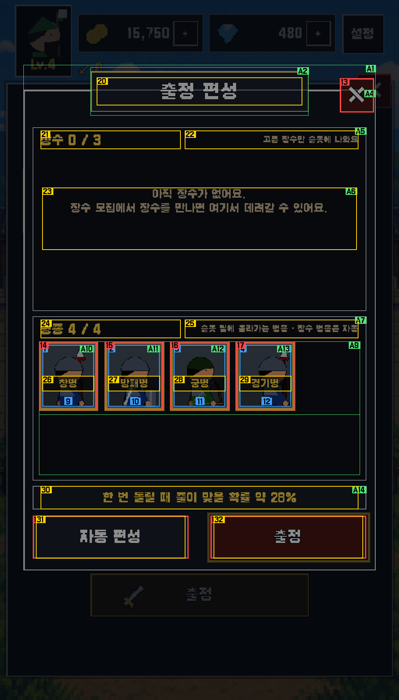

**영역 (컨테이너)**

| A | x, y | 크기 | 노드 |
|---|---|---|---|
| A1 | 60, 166 | 904 × 1294 | `popup_layer/@Control@61/@Control@63` |
| A2 | 232, 172 | 560 × 124 | `popup_layer/@Control@61/@Control@63/@Control@65` |
| A3 | 60, 230 | 904 × 1230 | `popup_layer/@Control@61/@Control@63/@Control@64` |
| A4 | 60, 230 | 904 × 1230 | `popup_layer/@Control@61/@Control@63/@Control@67` |
| A5 | 84, 326 | 856 × 470 | `popup_layer/@Control@61/@Control@63/@Control@67/@Control@68` |
| A6 | 108, 480 | 808 × 160 | `popup_layer/@Control@61/@Control@63/@Control@67/@Control@69` |
| A7 | 84, 810 | 856 × 420 | `popup_layer/@Control@61/@Control@63/@Control@67/@Control@70` |
| A8 | 100, 874 | 824 × 342 | `popup_layer/@Control@61/@Control@63/@Control@67/@ScrollContainer@73` |
| A9 | 100, 874 | 824 × 188 | `popup_layer/@Control@61/@Control@63/@Control@67/@ScrollContainer@73/@Control@74` |
| A10 | 109, 883 | 132 × 158 | `popup_layer/@Control@61/@Control@63/@Control@67/@ScrollContainer@73/@Control@74/@BaseButton@78/@Control@76` |
| A11 | 278, 883 | 132 × 158 | `popup_layer/@Control@61/@Control@63/@Control@67/@ScrollContainer@73/@Control@74/@BaseButton@82/@Control@80` |
| A12 | 446, 883 | 132 × 158 | `popup_layer/@Control@61/@Control@63/@Control@67/@ScrollContainer@73/@Control@74/@BaseButton@86/@Control@84` |
| A13 | 615, 883 | 132 × 158 | `popup_layer/@Control@61/@Control@63/@Control@67/@ScrollContainer@73/@Control@74/@BaseButton@90/@Control@88` |
| A14 | 84, 1244 | 856 × 60 | `popup_layer/@Control@61/@Control@63/@Control@67/@Control@91` |

**점검: 문제 없음**

**자리**

| # | 종류 | x, y | 크기 | 내용 |
|---|---|---|---|---|
| 1 | 그림 | 109, 883 | 132 × 158 | 초상 spear |
| 2 | 그림 | 278, 883 | 132 × 158 | 초상 shield |
| 3 | 그림 | 446, 883 | 132 × 158 | 초상 archer |
| 4 | 그림 | 615, 883 | 132 × 158 | 초상 rider |
| 5 | 그림 | 165, 1016 | 21 × 21 | 아이콘 ic_star |
| 6 | 그림 | 334, 1016 | 21 × 21 | 아이콘 ic_star |
| 7 | 그림 | 502, 1016 | 21 × 21 | 아이콘 ic_star |
| 8 | 그림 | 671, 1016 | 21 × 21 | 아이콘 ic_star |
| 9 | 그림 | 167, 1018 | 17 × 17 | 아이콘 ic_star |
| 10 | 그림 | 336, 1018 | 17 × 17 | 아이콘 ic_star |
| 11 | 그림 | 504, 1018 | 17 × 17 | 아이콘 ic_star |
| 12 | 그림 | 673, 1018 | 17 × 17 | 아이콘 ic_star |
| 13 | 버튼 | 872, 200 | 88 × 88 | tab_red |
| 14 | 버튼 | 100, 874 | 150 × 176 |  |
| 15 | 버튼 | 269, 874 | 150 × 176 |  |
| 16 | 버튼 | 437, 874 | 150 × 176 |  |
| 17 | 버튼 | 606, 874 | 150 × 176 |  |
| 18 | 버튼 | 84, 1320 | 400 × 110 | 자동 편성 |
| 19 | 버튼 | 540, 1320 | 400 × 110 | 출정 |
| 20 | 글자 | 248, 198 | 528 × 72 | “출정 편성” |
| 21 | 글자 | 104, 334 | 360 × 48 | “장수 0 / 3” |
| 22 | 글자 | 474, 334 | 446 × 48 | “고른 장수만 슬롯에 나와요” |
| 23 | 글자 | 108, 480 | 808 × 160 | “아직 장수가 없어요. 장수 모집에서 장수를 만나면 …” |
| 24 | 글자 | 104, 818 | 360 × 48 | “병종 4 / 4” |
| 25 | 글자 | 474, 818 | 446 × 48 | “슬롯 릴에 올라가는 병종 · 장수 병종은 자동” |
| 26 | 글자 | 108, 962 | 134 × 40 | “창병” |
| 27 | 글자 | 277, 962 | 134 × 40 | “방패병” |
| 28 | 글자 | 445, 962 | 134 × 40 | “궁병” |
| 29 | 글자 | 614, 962 | 134 × 40 | “경기병” |
| 30 | 글자 | 104, 1244 | 816 × 60 | “한 번 돌릴 때 줄이 맞을 확률 약 28%” |
| 31 | 글자 | 92, 1320 | 384 × 110 | “자동 편성” |
| 32 | 글자 | 548, 1320 | 384 × 110 | “출정” |

판(테두리 틀): `panel_ctrl` 904×1230, `panel_slot` 856×470, `panel_slot` 856×420, `panel_small` 856×60, `tab_wood` 400×110, `tab_red` 400×110, `tab_red` 88×88

## 전투 — 준비 — `04_battle_prep`

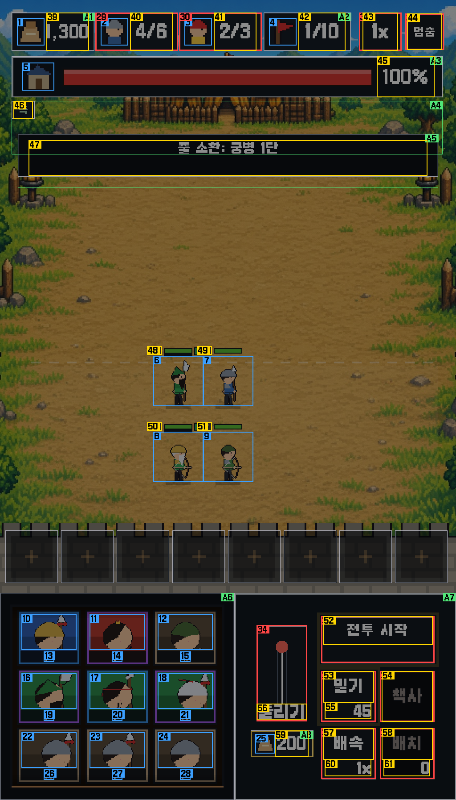

**영역 (컨테이너)**

| A | x, y | 크기 | 노드 |
|---|---|---|---|
| A1 | 26, 28 | 186 × 86 | `screen_layer/Battle/@BaseButton@27` |
| A2 | 592, 28 | 196 × 86 | `screen_layer/Battle/@BaseButton@30` |
| A3 | 26, 126 | 968 × 92 | `screen_layer/Battle/@Control@33` |
| A4 | 26, 226 | 968 × 120 | `screen_layer/Battle/@Control@34` |
| A5 | 40, 300 | 944 × 120 | `screen_layer/Battle/@Control@36` |
| A6 | 0, 1328 | 526 × 464 | `screen_layer/Battle/@Control@18` |
| A7 | 526, 1328 | 498 × 464 | `screen_layer/Battle/@Control@19` |
| A8 | 563, 1636 | 140 × 60 | `screen_layer/Battle/@Control@20` |

**점검: 문제 없음**

**자리**

| # | 종류 | x, y | 크기 | 내용 |
|---|---|---|---|---|
| 배경 | 그림 | 0, 0 | 1024 × 1200 | 배경 battle_field |
| 1 | 그림 | 38, 40 | 62 × 62 | 아이콘 icon_rice |
| 2 | 그림 | 226, 40 | 62 × 62 | 아이콘 icon_soldier |
| 3 | 그림 | 414, 40 | 62 × 62 | 아이콘 icon_hero |
| 4 | 그림 | 604, 40 | 62 × 62 | 아이콘 icon_flag |
| 5 | 그림 | 50, 140 | 72 × 63 | 아이콘 icon_castle |
| 6 | 그림 | 344, 797 | 113 × 113 | 캐릭터 동작 프레임 |
| 7 | 그림 | 456, 797 | 113 × 113 | 캐릭터 동작 프레임 |
| 8 | 그림 | 344, 967 | 113 × 113 | 캐릭터 동작 프레임 |
| 9 | 그림 | 456, 967 | 113 × 113 | 캐릭터 동작 프레임 |
| 10 | 그림 | 48, 1376 | 124 × 80 | 초상 reel_cell |
| 11 | 그림 | 201, 1376 | 124 × 80 | 초상 reel_cell |
| 12 | 그림 | 354, 1376 | 124 × 80 | 초상 reel_cell |
| 13 | 그림 | 98, 1459 | 24 × 24 | 아이콘 class_inf |
| 14 | 그림 | 251, 1459 | 24 × 24 | 아이콘 class_inf |
| 15 | 그림 | 404, 1459 | 24 × 24 | 아이콘 class_arc |
| 16 | 그림 | 48, 1508 | 124 × 80 | 초상 reel_cell |
| 17 | 그림 | 201, 1508 | 124 × 80 | 초상 reel_cell |
| 18 | 그림 | 354, 1508 | 124 × 80 | 초상 reel_cell |
| 19 | 그림 | 98, 1591 | 24 × 24 | 아이콘 class_inf |
| 20 | 그림 | 251, 1591 | 24 × 24 | 아이콘 class_inf |
| 21 | 그림 | 404, 1591 | 24 × 24 | 아이콘 class_cav |
| 22 | 그림 | 48, 1640 | 124 × 80 | 초상 reel_cell |
| 23 | 그림 | 201, 1640 | 124 × 80 | 초상 reel_cell |
| 24 | 그림 | 354, 1640 | 124 × 80 | 초상 reel_cell |
| 25 | 그림 | 573, 1644 | 44 × 44 | 아이콘 icon_rice |
| 26 | 그림 | 98, 1723 | 24 × 24 | 아이콘 class_cav |
| 27 | 그림 | 251, 1723 | 24 × 24 | 아이콘 class_inf |
| 28 | 그림 | 404, 1723 | 24 × 24 | 아이콘 class_inf |
| 29 | 버튼 | 214, 28 | 186 × 86 | 4/6 |
| 30 | 버튼 | 402, 28 | 186 × 86 | 2/3 |
| 31 | 버튼 | 806, 28 | 96 × 86 | 1x |
| 32 | 버튼 | 910, 30 | 87 × 82 | btn_pause |
| 33 | 버튼 | 721, 1380 | 255 × 105 | btn_battle |
| 34 | 버튼 | 576, 1400 | 114 × 216 | lever |
| 35 | 버튼 | 721, 1503 | 123 × 114 | btn_nudge |
| 36 | 버튼 | 853, 1503 | 123 × 114 | btn_advisor |
| 37 | 버튼 | 721, 1631 | 123 × 114 | btn_speed |
| 38 | 버튼 | 853, 1631 | 123 × 114 | btn_bench |
| 39 | 글자 | 104, 28 | 96 × 86 | “1,300” |
| 40 | 글자 | 292, 28 | 96 × 86 | “4/6” |
| 41 | 글자 | 480, 28 | 96 × 86 | “2/3” |
| 42 | 글자 | 670, 28 | 106 × 86 | “1/10” |
| 43 | 글자 | 814, 28 | 80 × 86 | “1x” |
| 44 | 글자 | 914, 30 | 79 × 82 | “멈춤” |
| 45 | 글자 | 846, 126 | 130 × 92 | “100%” |
| 46 | 글자 | 30, 226 | 44 × 40 | “촉” |
| 47 | 글자 | 64, 314 | 896 × 80 | “줄 소환: 궁병 1단” |
| 48 | 글자 | 330, 775 | 34 × 20 | “1단” |
| 49 | 글자 | 442, 775 | 34 × 20 | “1단” |
| 50 | 글자 | 330, 945 | 34 × 20 | “1단” |
| 51 | 글자 | 442, 945 | 34 × 20 | “1단” |
| 52 | 글자 | 725, 1380 | 247 × 65 | “전투 시작” |
| 53 | 글자 | 725, 1503 | 115 × 71 | “밀기” |
| 54 | 글자 | 857, 1503 | 115 × 114 | “책사” |
| 55 | 글자 | 729, 1573 | 105 × 38 | “45” |
| 56 | 글자 | 576, 1576 | 114 × 36 | “돌리기” |
| 57 | 글자 | 725, 1631 | 115 × 71 | “배속” |
| 58 | 글자 | 857, 1631 | 115 × 71 | “배치” |
| 59 | 글자 | 617, 1636 | 76 × 60 | “200” |
| 60 | 글자 | 729, 1701 | 105 × 38 | “1x” |
| 61 | 글자 | 861, 1701 | 105 × 38 | “0” |

판(테두리 틀): `panel_slot` 526×464, `panel_ctrl` 498×464, `panel_slot` 944×96, `panel_wide` 968×92, `btn_battle` 255×105, `lever` 114×216, `panel_small` 196×86, `panel_small` 186×86, `btn_advisor` 123×114, `btn_bench` 123×114, `btn_speed` 123×114, `btn_nudge` 123×114, `tile` 118×118, `plate_lever` 140×60 …

## 전투 — 싸움 — `05_battle_fight`

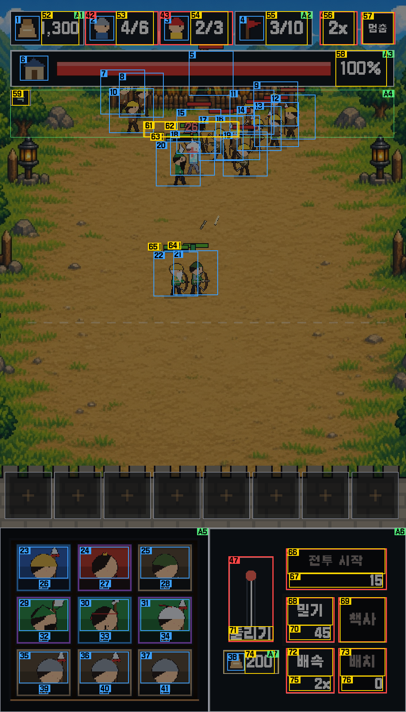

**영역 (컨테이너)**

| A | x, y | 크기 | 노드 |
|---|---|---|---|
| A1 | 26, 28 | 186 × 86 | `screen_layer/Battle/@BaseButton@27` |
| A2 | 592, 28 | 196 × 86 | `screen_layer/Battle/@BaseButton@30` |
| A3 | 26, 126 | 968 × 92 | `screen_layer/Battle/@Control@33` |
| A4 | 26, 226 | 968 × 120 | `screen_layer/Battle/@Control@34` |
| A5 | 0, 1328 | 526 × 464 | `screen_layer/Battle/@Control@18` |
| A6 | 526, 1328 | 498 × 464 | `screen_layer/Battle/@Control@19` |
| A7 | 563, 1636 | 140 × 60 | `screen_layer/Battle/@Control@20` |

**점검: 문제 없음**

**자리**

| # | 종류 | x, y | 크기 | 내용 |
|---|---|---|---|---|
| 배경 | 그림 | 0, 0 | 1024 × 1200 | 배경 battle_field |
| 1 | 그림 | 38, 40 | 62 × 62 | 아이콘 icon_rice |
| 2 | 그림 | 226, 40 | 62 × 62 | 아이콘 icon_soldier |
| 3 | 그림 | 414, 40 | 62 × 62 | 아이콘 icon_hero |
| 4 | 그림 | 604, 40 | 62 × 62 | 아이콘 icon_flag |
| 5 | 그림 | 476, 128 | 113 × 113 | 캐릭터 동작 프레임 |
| 6 | 그림 | 50, 140 | 72 × 63 | 아이콘 icon_castle |
| 7 | 그림 | 253, 175 | 113 × 113 | 캐릭터 동작 프레임 |
| 8 | 그림 | 300, 183 | 113 × 113 | 캐릭터 동작 프레임 |
| 9 | 그림 | 639, 205 | 113 × 113 | 캐릭터 동작 프레임 |
| 10 | 그림 | 275, 222 | 113 × 113 | 캐릭터 동작 프레임 |
| 11 | 그림 | 579, 226 | 113 × 113 | 캐릭터 동작 프레임 |
| 12 | 그림 | 683, 238 | 113 × 113 | 캐릭터 동작 프레임 |
| 13 | 그림 | 641, 257 | 113 × 113 | 캐릭터 동작 프레임 |
| 14 | 그림 | 597, 267 | 113 × 113 | 캐릭터 동작 프레임 |
| 15 | 그림 | 445, 274 | 113 × 113 | 캐릭터 동작 프레임 |
| 16 | 그림 | 543, 290 | 113 × 113 | 캐릭터 동작 프레임 |
| 17 | 그림 | 501, 292 | 113 × 113 | 캐릭터 동작 프레임 |
| 18 | 그림 | 429, 329 | 113 × 113 | 캐릭터 동작 프레임 |
| 19 | 그림 | 562, 331 | 113 × 113 | 캐릭터 동작 프레임 |
| 20 | 그림 | 393, 356 | 113 × 113 | 캐릭터 동작 프레임 |
| 21 | 그림 | 437, 630 | 113 × 113 | 캐릭터 동작 프레임 |
| 22 | 그림 | 387, 633 | 113 × 113 | 캐릭터 동작 프레임 |
| 23 | 그림 | 48, 1376 | 124 × 80 | 초상 reel_cell |
| 24 | 그림 | 201, 1376 | 124 × 80 | 초상 reel_cell |
| 25 | 그림 | 354, 1376 | 124 × 80 | 초상 reel_cell |
| 26 | 그림 | 98, 1459 | 24 × 24 | 아이콘 class_inf |
| 27 | 그림 | 251, 1459 | 24 × 24 | 아이콘 class_inf |
| 28 | 그림 | 404, 1459 | 24 × 24 | 아이콘 class_arc |
| 29 | 그림 | 48, 1508 | 124 × 80 | 초상 reel_cell |
| 30 | 그림 | 201, 1508 | 124 × 80 | 초상 reel_cell |
| 31 | 그림 | 354, 1508 | 124 × 80 | 초상 reel_cell |
| 32 | 그림 | 98, 1591 | 24 × 24 | 아이콘 class_inf |
| 33 | 그림 | 251, 1591 | 24 × 24 | 아이콘 class_inf |
| 34 | 그림 | 404, 1591 | 24 × 24 | 아이콘 class_cav |
| 35 | 그림 | 48, 1640 | 124 × 80 | 초상 reel_cell |
| 36 | 그림 | 201, 1640 | 124 × 80 | 초상 reel_cell |
| 37 | 그림 | 354, 1640 | 124 × 80 | 초상 reel_cell |
| 38 | 그림 | 573, 1644 | 44 × 44 | 아이콘 icon_rice |
| 39 | 그림 | 98, 1723 | 24 × 24 | 아이콘 class_cav |
| 40 | 그림 | 251, 1723 | 24 × 24 | 아이콘 class_inf |
| 41 | 그림 | 404, 1723 | 24 × 24 | 아이콘 class_inf |
| 42 | 버튼 | 214, 28 | 186 × 86 | 4/6 |
| 43 | 버튼 | 402, 28 | 186 × 86 | 2/3 |
| 44 | 버튼 | 806, 28 | 96 × 86 | 2x |
| 45 | 버튼 | 910, 30 | 87 × 82 | btn_pause |
| 46 | 버튼 | 721, 1380 | 255 × 105 | btn_battle |
| 47 | 버튼 | 576, 1400 | 114 × 216 | lever |
| 48 | 버튼 | 721, 1503 | 123 × 114 | btn_nudge |
| 49 | 버튼 | 853, 1503 | 123 × 114 | btn_advisor |
| 50 | 버튼 | 721, 1631 | 123 × 114 | btn_speed |
| 51 | 버튼 | 853, 1631 | 123 × 114 | btn_bench |
| 52 | 글자 | 104, 28 | 96 × 86 | “1,300” |
| 53 | 글자 | 292, 28 | 96 × 86 | “4/6” |
| 54 | 글자 | 480, 28 | 96 × 86 | “2/3” |
| 55 | 글자 | 670, 28 | 106 × 86 | “3/10” |
| 56 | 글자 | 814, 28 | 80 × 86 | “2x” |
| 57 | 글자 | 914, 30 | 79 × 82 | “멈춤” |
| 58 | 글자 | 846, 126 | 130 × 92 | “100%” |
| 59 | 글자 | 30, 226 | 44 × 40 | “촉” |
| 60 | 글자 | 361, 305 | 240 × 40 | “26” |
| 61 | 글자 | 364, 306 | 240 × 40 | “26” |
| 62 | 글자 | 415, 307 | 34 × 20 | “1단” |
| 63 | 글자 | 379, 334 | 34 × 20 | “1단” |
| 64 | 글자 | 423, 608 | 34 × 20 | “1단” |
| 65 | 글자 | 373, 611 | 34 × 20 | “1단” |
| 66 | 글자 | 725, 1380 | 247 × 65 | “전투 시작” |
| 67 | 글자 | 729, 1441 | 237 × 38 | “15” |
| 68 | 글자 | 725, 1503 | 115 × 71 | “밀기” |
| 69 | 글자 | 857, 1503 | 115 × 114 | “책사” |
| 70 | 글자 | 729, 1573 | 105 × 38 | “45” |
| 71 | 글자 | 576, 1576 | 114 × 36 | “돌리기” |
| 72 | 글자 | 725, 1631 | 115 × 71 | “배속” |
| 73 | 글자 | 857, 1631 | 115 × 71 | “배치” |
| 74 | 글자 | 617, 1636 | 76 × 60 | “200” |
| 75 | 글자 | 729, 1701 | 105 × 38 | “2x” |
| 76 | 글자 | 861, 1701 | 105 × 38 | “0” |

판(테두리 틀): `panel_slot` 526×464, `panel_ctrl` 498×464, `panel_wide` 968×92, `btn_battle` 255×105, `lever` 114×216, `panel_small` 196×86, `panel_small` 186×86, `btn_advisor` 123×114, `btn_bench` 123×114, `btn_speed` 123×114, `btn_nudge` 123×114, `tile` 118×118, `plate_lever` 140×60, `btn_small` 96×86 …

## 가방 — 장수 — `06_heroes_hero`

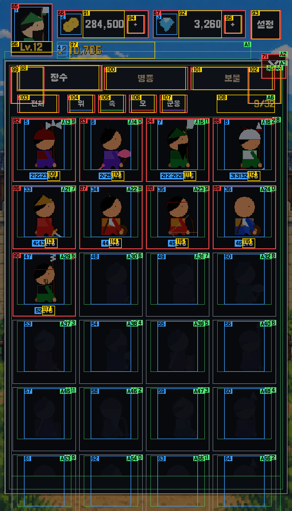

**영역 (컨테이너)**

| A | x, y | 크기 | 노드 |
|---|---|---|---|
| A1 | 200, 146 | 680 × 60 | `screen_layer/Lobby/@Control@25` |
| A2 | 16, 180 | 992 × 1552 | `dialog_layer/@Control@40` |
| A3 | 16, 212 | 992 × 1520 | `dialog_layer/@Control@40/@Control@41` |
| A4 | 32, 228 | 960 × 1488 | `dialog_layer/@Control@40/@Control@42` |
| A5 | 60, 228 | 904 × 88 | `dialog_layer/@Control@40/@Control@42/Heroes/@Control@47` |
| A6 | 760, 332 | 204 × 64 | `dialog_layer/@Control@40/@Control@42/Heroes/@Control@53` |
| A7 | 40, 410 | 944 × 1260 | `dialog_layer/@Control@40/@Control@42/Heroes/@ScrollContainer@57` |
| A8 | 40, 410 | 944 × 1896 | `dialog_layer/@Control@40/@Control@42/Heroes/@ScrollContainer@57/@Control@56` |
| A9 | 44, 414 | 222 × 224 | `dialog_layer/@Control@40/@Control@42/Heroes/@ScrollContainer@57/@Control@56/@BaseButton@60/@Control@59` |
| A10 | 278, 414 | 222 × 224 | `dialog_layer/@Control@40/@Control@42/Heroes/@ScrollContainer@57/@Control@56/@BaseButton@63/@Control@62` |
| A11 | 512, 414 | 222 × 224 | `dialog_layer/@Control@40/@Control@42/Heroes/@ScrollContainer@57/@Control@56/@BaseButton@66/@Control@65` |
| A12 | 746, 414 | 222 × 224 | `dialog_layer/@Control@40/@Control@42/Heroes/@ScrollContainer@57/@Control@56/@BaseButton@69/@Control@68` |
| A13 | 60, 418 | 190 × 178 | `dialog_layer/@Control@40/@Control@42/Heroes/@ScrollContainer@57/@Control@56/@BaseButton@60/@Control@58` |
| A14 | 294, 418 | 190 × 178 | `dialog_layer/@Control@40/@Control@42/Heroes/@ScrollContainer@57/@Control@56/@BaseButton@63/@Control@61` |
| A15 | 528, 418 | 190 × 178 | `dialog_layer/@Control@40/@Control@42/Heroes/@ScrollContainer@57/@Control@56/@BaseButton@66/@Control@64` |
| A16 | 762, 418 | 190 × 178 | `dialog_layer/@Control@40/@Control@42/Heroes/@ScrollContainer@57/@Control@56/@BaseButton@69/@Control@67` |
| A17 | 44, 650 | 222 × 224 | `dialog_layer/@Control@40/@Control@42/Heroes/@ScrollContainer@57/@Control@56/@BaseButton@72/@Control@71` |
| A18 | 278, 650 | 222 × 224 | `dialog_layer/@Control@40/@Control@42/Heroes/@ScrollContainer@57/@Control@56/@BaseButton@75/@Control@74` |
| A19 | 512, 650 | 222 × 224 | `dialog_layer/@Control@40/@Control@42/Heroes/@ScrollContainer@57/@Control@56/@BaseButton@78/@Control@77` |
| A20 | 746, 650 | 222 × 224 | `dialog_layer/@Control@40/@Control@42/Heroes/@ScrollContainer@57/@Control@56/@BaseButton@81/@Control@80` |
| A21 | 60, 654 | 190 × 178 | `dialog_layer/@Control@40/@Control@42/Heroes/@ScrollContainer@57/@Control@56/@BaseButton@72/@Control@70` |
| A22 | 294, 654 | 190 × 178 | `dialog_layer/@Control@40/@Control@42/Heroes/@ScrollContainer@57/@Control@56/@BaseButton@75/@Control@73` |
| A23 | 528, 654 | 190 × 178 | `dialog_layer/@Control@40/@Control@42/Heroes/@ScrollContainer@57/@Control@56/@BaseButton@78/@Control@76` |
| A24 | 762, 654 | 190 × 178 | `dialog_layer/@Control@40/@Control@42/Heroes/@ScrollContainer@57/@Control@56/@BaseButton@81/@Control@79` |
| A25 | 44, 886 | 222 × 224 | `dialog_layer/@Control@40/@Control@42/Heroes/@ScrollContainer@57/@Control@56/@BaseButton@84/@Control@83` |
| A26 | 278, 886 | 222 × 224 | `dialog_layer/@Control@40/@Control@42/Heroes/@ScrollContainer@57/@Control@56/@BaseButton@86` |
| A27 | 512, 886 | 222 × 224 | `dialog_layer/@Control@40/@Control@42/Heroes/@ScrollContainer@57/@Control@56/@BaseButton@88` |
| A28 | 746, 886 | 222 × 224 | `dialog_layer/@Control@40/@Control@42/Heroes/@ScrollContainer@57/@Control@56/@BaseButton@90` |
| A29 | 60, 890 | 190 × 178 | `dialog_layer/@Control@40/@Control@42/Heroes/@ScrollContainer@57/@Control@56/@BaseButton@84/@Control@82` |
| A30 | 294, 890 | 190 × 178 | `dialog_layer/@Control@40/@Control@42/Heroes/@ScrollContainer@57/@Control@56/@BaseButton@86/@Control@85` |
| A31 | 528, 890 | 190 × 178 | `dialog_layer/@Control@40/@Control@42/Heroes/@ScrollContainer@57/@Control@56/@BaseButton@88/@Control@87` |
| A32 | 762, 890 | 190 × 178 | `dialog_layer/@Control@40/@Control@42/Heroes/@ScrollContainer@57/@Control@56/@BaseButton@90/@Control@89` |
| A33 | 44, 1122 | 222 × 224 | `dialog_layer/@Control@40/@Control@42/Heroes/@ScrollContainer@57/@Control@56/@BaseButton@92` |
| A34 | 278, 1122 | 222 × 224 | `dialog_layer/@Control@40/@Control@42/Heroes/@ScrollContainer@57/@Control@56/@BaseButton@94` |
| A35 | 512, 1122 | 222 × 224 | `dialog_layer/@Control@40/@Control@42/Heroes/@ScrollContainer@57/@Control@56/@BaseButton@96` |
| A36 | 746, 1122 | 222 × 224 | `dialog_layer/@Control@40/@Control@42/Heroes/@ScrollContainer@57/@Control@56/@BaseButton@98` |
| A37 | 60, 1126 | 190 × 178 | `dialog_layer/@Control@40/@Control@42/Heroes/@ScrollContainer@57/@Control@56/@BaseButton@92/@Control@91` |
| A38 | 294, 1126 | 190 × 178 | `dialog_layer/@Control@40/@Control@42/Heroes/@ScrollContainer@57/@Control@56/@BaseButton@94/@Control@93` |
| A39 | 528, 1126 | 190 × 178 | `dialog_layer/@Control@40/@Control@42/Heroes/@ScrollContainer@57/@Control@56/@BaseButton@96/@Control@95` |
| A40 | 762, 1126 | 190 × 178 | `dialog_layer/@Control@40/@Control@42/Heroes/@ScrollContainer@57/@Control@56/@BaseButton@98/@Control@97` |
| A41 | 44, 1358 | 222 × 224 | `dialog_layer/@Control@40/@Control@42/Heroes/@ScrollContainer@57/@Control@56/@BaseButton@100` |
| A42 | 278, 1358 | 222 × 224 | `dialog_layer/@Control@40/@Control@42/Heroes/@ScrollContainer@57/@Control@56/@BaseButton@102` |
| A43 | 512, 1358 | 222 × 224 | `dialog_layer/@Control@40/@Control@42/Heroes/@ScrollContainer@57/@Control@56/@BaseButton@104` |
| A44 | 746, 1358 | 222 × 224 | `dialog_layer/@Control@40/@Control@42/Heroes/@ScrollContainer@57/@Control@56/@BaseButton@106` |
| A45 | 60, 1362 | 190 × 178 | `dialog_layer/@Control@40/@Control@42/Heroes/@ScrollContainer@57/@Control@56/@BaseButton@100/@Control@99` |
| A46 | 294, 1362 | 190 × 178 | `dialog_layer/@Control@40/@Control@42/Heroes/@ScrollContainer@57/@Control@56/@BaseButton@102/@Control@101` |
| A47 | 528, 1362 | 190 × 178 | `dialog_layer/@Control@40/@Control@42/Heroes/@ScrollContainer@57/@Control@56/@BaseButton@104/@Control@103` |
| A48 | 762, 1362 | 190 × 178 | `dialog_layer/@Control@40/@Control@42/Heroes/@ScrollContainer@57/@Control@56/@BaseButton@106/@Control@105` |
| A49 | 44, 1594 | 222 × 224 | `dialog_layer/@Control@40/@Control@42/Heroes/@ScrollContainer@57/@Control@56/@BaseButton@108` |
| A50 | 278, 1594 | 222 × 224 | `dialog_layer/@Control@40/@Control@42/Heroes/@ScrollContainer@57/@Control@56/@BaseButton@110` |
| A51 | 512, 1594 | 222 × 224 | `dialog_layer/@Control@40/@Control@42/Heroes/@ScrollContainer@57/@Control@56/@BaseButton@112` |
| A52 | 746, 1594 | 222 × 224 | `dialog_layer/@Control@40/@Control@42/Heroes/@ScrollContainer@57/@Control@56/@BaseButton@114` |
| A53 | 60, 1598 | 190 × 178 | `dialog_layer/@Control@40/@Control@42/Heroes/@ScrollContainer@57/@Control@56/@BaseButton@108/@Control@107` |
| A54 | 294, 1598 | 190 × 178 | `dialog_layer/@Control@40/@Control@42/Heroes/@ScrollContainer@57/@Control@56/@BaseButton@110/@Control@109` |
| A55 | 528, 1598 | 190 × 178 | `dialog_layer/@Control@40/@Control@42/Heroes/@ScrollContainer@57/@Control@56/@BaseButton@112/@Control@111` |
| A56 | 762, 1598 | 190 × 178 | `dialog_layer/@Control@40/@Control@42/Heroes/@ScrollContainer@57/@Control@56/@BaseButton@114/@Control@113` |

**점검: 문제 없음**

**자리**

| # | 종류 | x, y | 크기 | 내용 |
|---|---|---|---|---|
| 1 | 그림 | 50, 24 | 122 × 122 | 얼굴 guanyu |
| 2 | 그림 | 212, 48 | 74 × 74 | 아이콘 icon_gold |
| 3 | 그림 | 548, 48 | 74 × 74 | 아이콘 icon_diamond |
| 4 | 그림 | 200, 158 | 36 × 36 | 아이콘 icon_sword |
| 5 | 그림 | 84, 418 | 142 × 178 | 초상 lvbu |
| 6 | 그림 | 318, 418 | 142 × 178 | 초상 diaochan |
| 7 | 그림 | 552, 418 | 142 × 178 | 초상 guanyu |
| 8 | 그림 | 786, 418 | 142 × 178 | 초상 zhaoyun |
| 9 | 그림 | 103, 605 | 24 × 24 | 아이콘 ic_star |
| 10 | 그림 | 121, 605 | 24 × 24 | 아이콘 ic_star |
| 11 | 그림 | 140, 605 | 24 × 24 | 아이콘 ic_star |
| 12 | 그림 | 346, 605 | 24 × 24 | 아이콘 ic_star |
| 13 | 그림 | 365, 605 | 24 × 24 | 아이콘 ic_star |
| 14 | 그림 | 562, 605 | 24 × 24 | 아이콘 ic_star |
| 15 | 그림 | 580, 605 | 24 × 24 | 아이콘 ic_star |
| 16 | 그림 | 599, 605 | 24 × 24 | 아이콘 ic_star |
| 17 | 그림 | 617, 605 | 24 × 24 | 아이콘 ic_star |
| 18 | 그림 | 805, 605 | 24 × 24 | 아이콘 ic_star |
| 19 | 그림 | 823, 605 | 24 × 24 | 아이콘 ic_star |
| 20 | 그림 | 842, 605 | 24 × 24 | 아이콘 ic_star |
| 21 | 그림 | 105, 607 | 20 × 20 | 아이콘 ic_star |
| 22 | 그림 | 123, 607 | 20 × 20 | 아이콘 ic_star |
| 23 | 그림 | 142, 607 | 20 × 20 | 아이콘 ic_star |
| 24 | 그림 | 348, 607 | 20 × 20 | 아이콘 ic_star |
| 25 | 그림 | 367, 607 | 20 × 20 | 아이콘 ic_star |
| 26 | 그림 | 564, 607 | 20 × 20 | 아이콘 ic_star |
| 27 | 그림 | 582, 607 | 20 × 20 | 아이콘 ic_star |
| 28 | 그림 | 601, 607 | 20 × 20 | 아이콘 ic_star |
| 29 | 그림 | 619, 607 | 20 × 20 | 아이콘 ic_star |
| 30 | 그림 | 807, 607 | 20 × 20 | 아이콘 ic_star |
| 31 | 그림 | 825, 607 | 20 × 20 | 아이콘 ic_star |
| 32 | 그림 | 844, 607 | 20 × 20 | 아이콘 ic_star |
| 33 | 그림 | 84, 654 | 142 × 178 | 초상 zhouyu |
| 34 | 그림 | 318, 654 | 142 × 178 | 초상 ganning |
| 35 | 그림 | 552, 654 | 142 × 178 | 초상 taishici |
| 36 | 그림 | 786, 654 | 142 × 178 | 초상 xuchu |
| 37 | 그림 | 112, 841 | 24 × 24 | 아이콘 ic_star |
| 38 | 그림 | 131, 841 | 24 × 24 | 아이콘 ic_star |
| 39 | 그림 | 355, 841 | 24 × 24 | 아이콘 ic_star |
| 40 | 그림 | 589, 841 | 24 × 24 | 아이콘 ic_star |
| 41 | 그림 | 823, 841 | 24 × 24 | 아이콘 ic_star |
| 42 | 그림 | 114, 843 | 20 × 20 | 아이콘 ic_star |
| 43 | 그림 | 133, 843 | 20 × 20 | 아이콘 ic_star |
| 44 | 그림 | 357, 843 | 20 × 20 | 아이콘 ic_star |
| 45 | 그림 | 591, 843 | 20 × 20 | 아이콘 ic_star |
| 46 | 그림 | 825, 843 | 20 × 20 | 아이콘 ic_star |
| 47 | 그림 | 84, 890 | 142 × 178 | 초상 zhangfei |
| 48 | 그림 | 318, 890 | 142 × 178 | 초상 caocao |
| 49 | 그림 | 552, 890 | 142 × 178 | 초상 sunce |
| 50 | 그림 | 786, 890 | 142 × 178 | 초상 zhugeliang |
| 51 | 그림 | 121, 1077 | 24 × 24 | 아이콘 ic_star |
| 52 | 그림 | 123, 1079 | 20 × 20 | 아이콘 ic_star |
| 53 | 그림 | 84, 1126 | 142 × 178 | 초상 luxun |
| 54 | 그림 | 318, 1126 | 142 × 178 | 초상 simayi |
| 55 | 그림 | 552, 1126 | 142 × 178 | 초상 sunquan |
| 56 | 그림 | 786, 1126 | 142 × 178 | 초상 zhangliao |
| 57 | 그림 | 84, 1362 | 142 × 178 | 초상 dongzhuo |
| 58 | 그림 | 318, 1362 | 142 × 178 | 초상 huangzhong |
| 59 | 그림 | 552, 1362 | 142 × 178 | 초상 liubei |
| 60 | 그림 | 786, 1362 | 142 × 178 | 초상 xiahoudun |
| 61 | 그림 | 84, 1598 | 142 × 178 | 초상 xiahouyuan |
| 62 | 그림 | 318, 1598 | 142 × 178 | 초상 yuanshao |
| 63 | 그림 | 552, 1598 | 142 × 178 | 초상 caoren |
| 64 | 그림 | 786, 1598 | 142 × 178 | 초상 guanping |
| 65 | 버튼 | 38, 12 | 146 × 185 | frame_portrait |
| 66 | 버튼 | 200, 36 | 321 × 98 | 284,500 |
| 67 | 버튼 | 536, 36 | 326 × 98 | 3,260 |
| 68 | 버튼 | 878, 36 | 108 × 102 | btn_settings |
| 69 | 버튼 | 444, 53 | 65 × 65 | btn_plus |
| 70 | 버튼 | 785, 53 | 65 × 65 | btn_plus |
| 71 | 버튼 | 916, 188 | 88 × 88 | tab_red |
| 72 | 버튼 | 60, 228 | 296 × 88 | 장수 |
| 73 | 버튼 | 36, 234 | 120 × 130 | btn_mail |
| 74 | 버튼 | 364, 234 | 296 × 82 | 병종 |
| 75 | 버튼 | 668, 234 | 296 × 82 | 보물 |
| 76 | 버튼 | 868, 234 | 120 × 130 | btn_bag |
| 77 | 버튼 | 60, 332 | 148 × 64 | 전체 |
| 78 | 버튼 | 236, 332 | 98 × 64 | 위 |
| 79 | 버튼 | 344, 332 | 98 × 64 | 촉 |
| 80 | 버튼 | 452, 332 | 98 × 64 | 오 |
| 81 | 버튼 | 560, 332 | 98 × 64 | 군웅 |
| 82 | 버튼 | 44, 414 | 222 × 224 | panel_slot |
| 83 | 버튼 | 278, 414 | 222 × 224 | panel_slot |
| 84 | 버튼 | 512, 414 | 222 × 224 | panel_slot |
| 85 | 버튼 | 746, 414 | 222 × 224 | panel_slot |
| 86 | 버튼 | 44, 650 | 222 × 224 | panel_slot |
| 87 | 버튼 | 278, 650 | 222 × 224 | panel_slot |
| 88 | 버튼 | 512, 650 | 222 × 224 | panel_slot |
| 89 | 버튼 | 746, 650 | 222 × 224 | panel_slot |
| 90 | 버튼 | 44, 886 | 222 × 224 | panel_slot |
| 91 | 글자 | 290, 36 | 147 × 98 | “284,500” |
| 92 | 글자 | 626, 36 | 152 × 98 | “3,260” |
| 93 | 글자 | 882, 36 | 100 × 102 | “설정” |
| 94 | 글자 | 448, 53 | 57 × 65 | “+” |
| 95 | 글자 | 789, 53 | 57 × 65 | “+” |
| 96 | 글자 | 38, 145 | 146 × 40 | “Lv.12” |
| 97 | 글자 | 244, 146 | 300 × 60 | “10,705” |
| 98 | 글자 | 68, 228 | 280 × 88 | “장수” |
| 99 | 글자 | 40, 234 | 112 × 130 | “우편” |
| 100 | 글자 | 372, 234 | 280 × 82 | “병종” |
| 101 | 글자 | 676, 234 | 280 × 82 | “보물” |
| 102 | 글자 | 872, 234 | 112 × 130 | “가방” |
| 103 | 글자 | 68, 332 | 132 × 64 | “전체” |
| 104 | 글자 | 244, 332 | 82 × 64 | “위” |
| 105 | 글자 | 352, 332 | 82 × 64 | “촉” |
| 106 | 글자 | 460, 332 | 82 × 64 | “오” |
| 107 | 글자 | 568, 332 | 82 × 64 | “군웅” |
| 108 | 글자 | 760, 332 | 204 × 64 | “9/32” |
| 109 | 글자 | 166, 600 | 45 × 34 | “Lv7” |
| 110 | 글자 | 391, 600 | 45 × 34 | “Lv6” |
| 111 | 글자 | 643, 600 | 45 × 34 | “Lv5” |
| 112 | 글자 | 868, 600 | 45 × 34 | “Lv6” |
| 113 | 글자 | 157, 836 | 45 × 34 | “Lv5” |
| 114 | 글자 | 382, 836 | 45 × 34 | “Lv6” |
| 115 | 글자 | 616, 836 | 45 × 34 | “Lv6” |
| 116 | 글자 | 850, 836 | 45 × 34 | “Lv6” |
| 117 | 글자 | 148, 1072 | 45 × 34 | “Lv6” |

판(테두리 틀): `panel_ctrl` 992×1520, `panel_slot` 222×224, `panel_chip` 326×98, `panel_chip` 321×98, `frame_portrait` 146×185, `tab_wood_on` 296×88, `tab_wood` 296×82, `btn_bag` 120×130, `btn_mail` 120×130, `btn_settings` 108×102, `btn_small` 148×64, `tab_red` 88×88, `btn_small` 98×64, `btn_plus` 65×65

## 가방 — 병종 — `07_heroes_troop`

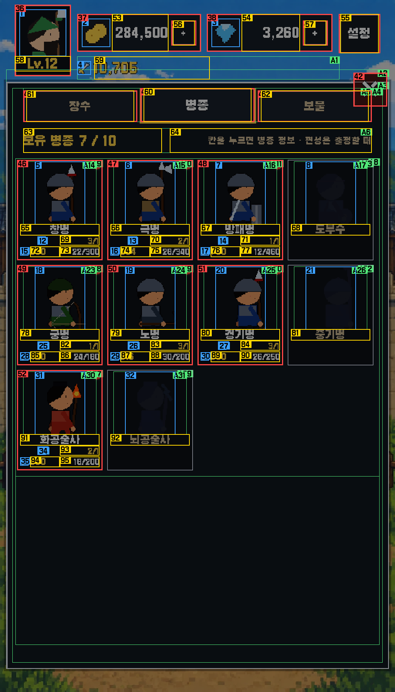

**영역 (컨테이너)**

| A | x, y | 크기 | 노드 |
|---|---|---|---|
| A1 | 200, 146 | 680 × 60 | `screen_layer/Lobby/@Control@25` |
| A2 | 16, 180 | 992 × 1552 | `dialog_layer/@Control@40` |
| A3 | 16, 212 | 992 × 1520 | `dialog_layer/@Control@40/@Control@41` |
| A4 | 32, 228 | 960 × 1488 | `dialog_layer/@Control@40/@Control@42` |
| A5 | 60, 228 | 904 × 88 | `dialog_layer/@Control@40/@Control@42/Heroes/@Control@47` |
| A6 | 60, 332 | 904 × 64 | `dialog_layer/@Control@40/@Control@42/Heroes/@Control@48` |
| A7 | 40, 410 | 944 × 1260 | `dialog_layer/@Control@40/@Control@42/Heroes/@ScrollContainer@52` |
| A8 | 40, 410 | 944 × 824 | `dialog_layer/@Control@40/@Control@42/Heroes/@ScrollContainer@52/@Control@51` |
| A9 | 44, 414 | 222 × 260 | `dialog_layer/@Control@40/@Control@42/Heroes/@ScrollContainer@52/@Control@51/@BaseButton@55/@Control@54` |
| A10 | 278, 414 | 222 × 260 | `dialog_layer/@Control@40/@Control@42/Heroes/@ScrollContainer@52/@Control@51/@BaseButton@58/@Control@57` |
| A11 | 512, 414 | 222 × 260 | `dialog_layer/@Control@40/@Control@42/Heroes/@ScrollContainer@52/@Control@51/@BaseButton@61/@Control@60` |
| A12 | 746, 414 | 222 × 260 | `dialog_layer/@Control@40/@Control@42/Heroes/@ScrollContainer@52/@Control@51/@BaseButton@64` |
| A13 | 746, 414 | 222 × 260 | `dialog_layer/@Control@40/@Control@42/Heroes/@ScrollContainer@52/@Control@51/@BaseButton@64/@Control@63` |
| A14 | 60, 418 | 190 × 164 | `dialog_layer/@Control@40/@Control@42/Heroes/@ScrollContainer@52/@Control@51/@BaseButton@55/@Control@53` |
| A15 | 294, 418 | 190 × 164 | `dialog_layer/@Control@40/@Control@42/Heroes/@ScrollContainer@52/@Control@51/@BaseButton@58/@Control@56` |
| A16 | 528, 418 | 190 × 164 | `dialog_layer/@Control@40/@Control@42/Heroes/@ScrollContainer@52/@Control@51/@BaseButton@61/@Control@59` |
| A17 | 762, 418 | 190 × 164 | `dialog_layer/@Control@40/@Control@42/Heroes/@ScrollContainer@52/@Control@51/@BaseButton@64/@Control@62` |
| A18 | 44, 686 | 222 × 260 | `dialog_layer/@Control@40/@Control@42/Heroes/@ScrollContainer@52/@Control@51/@BaseButton@67/@Control@66` |
| A19 | 278, 686 | 222 × 260 | `dialog_layer/@Control@40/@Control@42/Heroes/@ScrollContainer@52/@Control@51/@BaseButton@70/@Control@69` |
| A20 | 512, 686 | 222 × 260 | `dialog_layer/@Control@40/@Control@42/Heroes/@ScrollContainer@52/@Control@51/@BaseButton@73/@Control@72` |
| A21 | 746, 686 | 222 × 260 | `dialog_layer/@Control@40/@Control@42/Heroes/@ScrollContainer@52/@Control@51/@BaseButton@76` |
| A22 | 746, 686 | 222 × 260 | `dialog_layer/@Control@40/@Control@42/Heroes/@ScrollContainer@52/@Control@51/@BaseButton@76/@Control@75` |
| A23 | 60, 690 | 190 × 164 | `dialog_layer/@Control@40/@Control@42/Heroes/@ScrollContainer@52/@Control@51/@BaseButton@67/@Control@65` |
| A24 | 294, 690 | 190 × 164 | `dialog_layer/@Control@40/@Control@42/Heroes/@ScrollContainer@52/@Control@51/@BaseButton@70/@Control@68` |
| A25 | 528, 690 | 190 × 164 | `dialog_layer/@Control@40/@Control@42/Heroes/@ScrollContainer@52/@Control@51/@BaseButton@73/@Control@71` |
| A26 | 762, 690 | 190 × 164 | `dialog_layer/@Control@40/@Control@42/Heroes/@ScrollContainer@52/@Control@51/@BaseButton@76/@Control@74` |
| A27 | 44, 958 | 222 × 260 | `dialog_layer/@Control@40/@Control@42/Heroes/@ScrollContainer@52/@Control@51/@BaseButton@79/@Control@78` |
| A28 | 278, 958 | 222 × 260 | `dialog_layer/@Control@40/@Control@42/Heroes/@ScrollContainer@52/@Control@51/@BaseButton@82` |
| A29 | 278, 958 | 222 × 260 | `dialog_layer/@Control@40/@Control@42/Heroes/@ScrollContainer@52/@Control@51/@BaseButton@82/@Control@81` |
| A30 | 60, 962 | 190 × 164 | `dialog_layer/@Control@40/@Control@42/Heroes/@ScrollContainer@52/@Control@51/@BaseButton@79/@Control@77` |
| A31 | 294, 962 | 190 × 164 | `dialog_layer/@Control@40/@Control@42/Heroes/@ScrollContainer@52/@Control@51/@BaseButton@82/@Control@80` |

**점검: 문제 없음**

**자리**

| # | 종류 | x, y | 크기 | 내용 |
|---|---|---|---|---|
| 1 | 그림 | 50, 24 | 122 × 122 | 얼굴 guanyu |
| 2 | 그림 | 212, 48 | 74 × 74 | 아이콘 icon_gold |
| 3 | 그림 | 548, 48 | 74 × 74 | 아이콘 icon_diamond |
| 4 | 그림 | 200, 158 | 36 × 36 | 아이콘 icon_sword |
| 5 | 그림 | 90, 418 | 131 × 164 | 초상 spear |
| 6 | 그림 | 324, 418 | 131 × 164 | 초상 halberd |
| 7 | 그림 | 558, 418 | 131 × 164 | 초상 shield |
| 8 | 그림 | 792, 418 | 131 × 164 | 초상 axe |
| 9 | 그림 | 97, 612 | 22 × 22 | 아이콘 ic_star |
| 10 | 그림 | 331, 612 | 22 × 22 | 아이콘 ic_star |
| 11 | 그림 | 565, 612 | 22 × 22 | 아이콘 ic_star |
| 12 | 그림 | 99, 614 | 18 × 18 | 아이콘 ic_star |
| 13 | 그림 | 333, 614 | 18 × 18 | 아이콘 ic_star |
| 14 | 그림 | 567, 614 | 18 × 18 | 아이콘 ic_star |
| 15 | 그림 | 52, 640 | 22 × 22 | 아이콘 ic_sword |
| 16 | 그림 | 286, 640 | 22 × 22 | 아이콘 ic_sword |
| 17 | 그림 | 520, 640 | 22 × 22 | 아이콘 ic_sword |
| 18 | 그림 | 90, 690 | 131 × 164 | 초상 archer |
| 19 | 그림 | 324, 690 | 131 × 164 | 초상 crossbow |
| 20 | 그림 | 558, 690 | 131 × 164 | 초상 rider |
| 21 | 그림 | 792, 690 | 131 × 164 | 초상 heavy |
| 22 | 그림 | 97, 884 | 22 × 22 | 아이콘 ic_star |
| 23 | 그림 | 331, 884 | 22 × 22 | 아이콘 ic_star |
| 24 | 그림 | 565, 884 | 22 × 22 | 아이콘 ic_star |
| 25 | 그림 | 99, 886 | 18 × 18 | 아이콘 ic_star |
| 26 | 그림 | 333, 886 | 18 × 18 | 아이콘 ic_star |
| 27 | 그림 | 567, 886 | 18 × 18 | 아이콘 ic_star |
| 28 | 그림 | 52, 912 | 22 × 22 | 아이콘 ic_sword |
| 29 | 그림 | 286, 912 | 22 × 22 | 아이콘 ic_sword |
| 30 | 그림 | 520, 912 | 22 × 22 | 아이콘 ic_sword |
| 31 | 그림 | 90, 962 | 131 × 164 | 초상 fire |
| 32 | 그림 | 324, 962 | 131 × 164 | 초상 thunder |
| 33 | 그림 | 97, 1156 | 22 × 22 | 아이콘 ic_star |
| 34 | 그림 | 99, 1158 | 18 × 18 | 아이콘 ic_star |
| 35 | 그림 | 52, 1184 | 22 × 22 | 아이콘 ic_sword |
| 36 | 버튼 | 38, 12 | 146 × 185 | frame_portrait |
| 37 | 버튼 | 200, 36 | 321 × 98 | 284,500 |
| 38 | 버튼 | 536, 36 | 326 × 98 | 3,260 |
| 39 | 버튼 | 878, 36 | 108 × 102 | btn_settings |
| 40 | 버튼 | 444, 53 | 65 × 65 | btn_plus |
| 41 | 버튼 | 785, 53 | 65 × 65 | btn_plus |
| 42 | 버튼 | 916, 188 | 88 × 88 | tab_red |
| 43 | 버튼 | 364, 228 | 296 × 88 | 병종 |
| 44 | 버튼 | 60, 234 | 296 × 82 | 장수 |
| 45 | 버튼 | 668, 234 | 296 × 82 | 보물 |
| 46 | 버튼 | 44, 414 | 222 × 260 | panel_slot |
| 47 | 버튼 | 278, 414 | 222 × 260 | panel_slot |
| 48 | 버튼 | 512, 414 | 222 × 260 | panel_slot |
| 49 | 버튼 | 44, 686 | 222 × 260 | panel_slot |
| 50 | 버튼 | 278, 686 | 222 × 260 | panel_slot |
| 51 | 버튼 | 512, 686 | 222 × 260 | panel_slot |
| 52 | 버튼 | 44, 958 | 222 × 260 | panel_slot |
| 53 | 글자 | 290, 36 | 147 × 98 | “284,500” |
| 54 | 글자 | 626, 36 | 152 × 98 | “3,260” |
| 55 | 글자 | 882, 36 | 100 × 102 | “설정” |
| 56 | 글자 | 448, 53 | 57 × 65 | “+” |
| 57 | 글자 | 789, 53 | 57 × 65 | “+” |
| 58 | 글자 | 38, 145 | 146 × 40 | “Lv.12” |
| 59 | 글자 | 244, 146 | 300 × 60 | “10,705” |
| 60 | 글자 | 372, 228 | 280 × 88 | “병종” |
| 61 | 글자 | 68, 234 | 280 × 82 | “장수” |
| 62 | 글자 | 676, 234 | 280 × 82 | “보물” |
| 63 | 글자 | 60, 332 | 360 × 64 | “보유 병종 7 / 10” |
| 64 | 글자 | 440, 332 | 524 × 64 | “칸을 누르면 병종 정보 · 편성은 출정할 때” |
| 65 | 글자 | 52, 580 | 206 × 30 | “창병” |
| 66 | 글자 | 286, 580 | 206 × 30 | “극병” |
| 67 | 글자 | 520, 580 | 206 × 30 | “방패병” |
| 68 | 글자 | 754, 580 | 206 × 30 | “도부수” |
| 69 | 글자 | 155, 610 | 103 × 26 | “3/1” |
| 70 | 글자 | 389, 610 | 103 × 26 | “2/1” |
| 71 | 글자 | 623, 610 | 103 × 26 | “1/1” |
| 72 | 글자 | 78, 638 | 77 × 28 | “560” |
| 73 | 글자 | 155, 638 | 103 × 28 | “22/300” |
| 74 | 글자 | 312, 638 | 77 × 28 | “684” |
| 75 | 글자 | 389, 638 | 103 × 28 | “28/340” |
| 76 | 글자 | 546, 638 | 77 × 28 | “780” |
| 77 | 글자 | 623, 638 | 103 × 28 | “12/460” |
| 78 | 글자 | 52, 852 | 206 × 30 | “궁병” |
| 79 | 글자 | 286, 852 | 206 × 30 | “노병” |
| 80 | 글자 | 520, 852 | 206 × 30 | “경기병” |
| 81 | 글자 | 754, 852 | 206 × 30 | “중기병” |
| 82 | 글자 | 155, 882 | 103 × 26 | “1/1” |
| 83 | 글자 | 389, 882 | 103 × 26 | “3/1” |
| 84 | 글자 | 623, 882 | 103 × 26 | “3/1” |
| 85 | 글자 | 78, 910 | 77 × 28 | “420” |
| 86 | 글자 | 155, 910 | 103 × 28 | “24/180” |
| 87 | 글자 | 312, 910 | 77 × 28 | “516” |
| 88 | 글자 | 389, 910 | 103 × 28 | “30/200” |
| 89 | 글자 | 546, 910 | 77 × 28 | “550” |
| 90 | 글자 | 623, 910 | 103 × 28 | “26/250” |
| 91 | 글자 | 52, 1124 | 206 × 30 | “화공술사” |
| 92 | 글자 | 286, 1124 | 206 × 30 | “뇌공술사” |
| 93 | 글자 | 155, 1154 | 103 × 26 | “2/1” |
| 94 | 글자 | 78, 1182 | 77 × 28 | “380” |
| 95 | 글자 | 155, 1182 | 103 × 28 | “18/200” |

판(테두리 틀): `panel_ctrl` 992×1520, `panel_slot` 222×260, `panel_chip` 326×98, `panel_chip` 321×98, `frame_portrait` 146×185, `tab_wood_on` 296×88, `tab_wood` 296×82, `btn_settings` 108×102, `tab_red` 88×88, `btn_plus` 65×65

## 가방 — 보물 — `08_heroes_treasure`

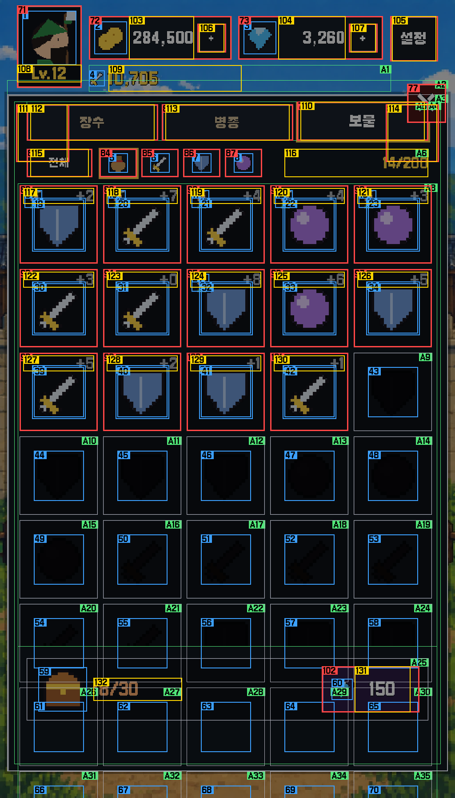

**영역 (컨테이너)**

| A | x, y | 크기 | 노드 |
|---|---|---|---|
| A1 | 200, 146 | 680 × 60 | `screen_layer/Lobby/@Control@25` |
| A2 | 16, 180 | 992 × 1552 | `dialog_layer/@Control@40` |
| A3 | 16, 212 | 992 × 1520 | `dialog_layer/@Control@40/@Control@41` |
| A4 | 32, 228 | 960 × 1488 | `dialog_layer/@Control@40/@Control@42` |
| A5 | 60, 228 | 904 × 88 | `dialog_layer/@Control@40/@Control@42/Heroes/@Control@47` |
| A6 | 640, 334 | 324 × 64 | `dialog_layer/@Control@40/@Control@42/Heroes/@Control@53` |
| A7 | 40, 412 | 944 × 1040 | `dialog_layer/@Control@40/@Control@42/Heroes/@ScrollContainer@57` |
| A8 | 40, 412 | 944 × 2264 | `dialog_layer/@Control@40/@Control@42/Heroes/@ScrollContainer@57/@Control@56` |
| A9 | 796, 792 | 176 × 176 | `dialog_layer/@Control@40/@Control@42/Heroes/@ScrollContainer@57/@Control@56/@BaseButton@72` |
| A10 | 44, 980 | 176 × 176 | `dialog_layer/@Control@40/@Control@42/Heroes/@ScrollContainer@57/@Control@56/@BaseButton@73` |
| A11 | 232, 980 | 176 × 176 | `dialog_layer/@Control@40/@Control@42/Heroes/@ScrollContainer@57/@Control@56/@BaseButton@74` |
| A12 | 420, 980 | 176 × 176 | `dialog_layer/@Control@40/@Control@42/Heroes/@ScrollContainer@57/@Control@56/@BaseButton@75` |
| A13 | 608, 980 | 176 × 176 | `dialog_layer/@Control@40/@Control@42/Heroes/@ScrollContainer@57/@Control@56/@BaseButton@76` |
| A14 | 796, 980 | 176 × 176 | `dialog_layer/@Control@40/@Control@42/Heroes/@ScrollContainer@57/@Control@56/@BaseButton@77` |
| A15 | 44, 1168 | 176 × 176 | `dialog_layer/@Control@40/@Control@42/Heroes/@ScrollContainer@57/@Control@56/@BaseButton@78` |
| A16 | 232, 1168 | 176 × 176 | `dialog_layer/@Control@40/@Control@42/Heroes/@ScrollContainer@57/@Control@56/@BaseButton@79` |
| A17 | 420, 1168 | 176 × 176 | `dialog_layer/@Control@40/@Control@42/Heroes/@ScrollContainer@57/@Control@56/@BaseButton@80` |
| A18 | 608, 1168 | 176 × 176 | `dialog_layer/@Control@40/@Control@42/Heroes/@ScrollContainer@57/@Control@56/@BaseButton@81` |
| A19 | 796, 1168 | 176 × 176 | `dialog_layer/@Control@40/@Control@42/Heroes/@ScrollContainer@57/@Control@56/@BaseButton@82` |
| A20 | 44, 1356 | 176 × 176 | `dialog_layer/@Control@40/@Control@42/Heroes/@ScrollContainer@57/@Control@56/@BaseButton@83` |
| A21 | 232, 1356 | 176 × 176 | `dialog_layer/@Control@40/@Control@42/Heroes/@ScrollContainer@57/@Control@56/@BaseButton@84` |
| A22 | 420, 1356 | 176 × 176 | `dialog_layer/@Control@40/@Control@42/Heroes/@ScrollContainer@57/@Control@56/@BaseButton@85` |
| A23 | 608, 1356 | 176 × 176 | `dialog_layer/@Control@40/@Control@42/Heroes/@ScrollContainer@57/@Control@56/@BaseButton@86` |
| A24 | 796, 1356 | 176 × 176 | `dialog_layer/@Control@40/@Control@42/Heroes/@ScrollContainer@57/@Control@56/@BaseButton@87` |
| A25 | 60, 1478 | 904 × 140 | `dialog_layer/@Control@40/@Control@42/Heroes/@Control@116` |
| A26 | 44, 1544 | 176 × 176 | `dialog_layer/@Control@40/@Control@42/Heroes/@ScrollContainer@57/@Control@56/@BaseButton@88` |
| A27 | 232, 1544 | 176 × 176 | `dialog_layer/@Control@40/@Control@42/Heroes/@ScrollContainer@57/@Control@56/@BaseButton@89` |
| A28 | 420, 1544 | 176 × 176 | `dialog_layer/@Control@40/@Control@42/Heroes/@ScrollContainer@57/@Control@56/@BaseButton@90` |
| A29 | 608, 1544 | 176 × 176 | `dialog_layer/@Control@40/@Control@42/Heroes/@ScrollContainer@57/@Control@56/@BaseButton@91` |
| A30 | 796, 1544 | 176 × 176 | `dialog_layer/@Control@40/@Control@42/Heroes/@ScrollContainer@57/@Control@56/@BaseButton@92` |
| A31 | 44, 1732 | 176 × 176 | `dialog_layer/@Control@40/@Control@42/Heroes/@ScrollContainer@57/@Control@56/@BaseButton@93` |
| A32 | 232, 1732 | 176 × 176 | `dialog_layer/@Control@40/@Control@42/Heroes/@ScrollContainer@57/@Control@56/@BaseButton@94` |
| A33 | 420, 1732 | 176 × 176 | `dialog_layer/@Control@40/@Control@42/Heroes/@ScrollContainer@57/@Control@56/@BaseButton@95` |
| A34 | 608, 1732 | 176 × 176 | `dialog_layer/@Control@40/@Control@42/Heroes/@ScrollContainer@57/@Control@56/@BaseButton@96` |
| A35 | 796, 1732 | 176 × 176 | `dialog_layer/@Control@40/@Control@42/Heroes/@ScrollContainer@57/@Control@56/@BaseButton@97` |

**점검: 문제 없음**

**자리**

| # | 종류 | x, y | 크기 | 내용 |
|---|---|---|---|---|
| 1 | 그림 | 50, 24 | 122 × 122 | 얼굴 guanyu |
| 2 | 그림 | 212, 48 | 74 × 74 | 아이콘 icon_gold |
| 3 | 그림 | 548, 48 | 74 × 74 | 아이콘 icon_diamond |
| 4 | 그림 | 200, 158 | 36 × 36 | 아이콘 icon_sword |
| 5 | 그림 | 244, 344 | 44 × 44 | 아이콘 icon_bag |
| 6 | 그림 | 338, 344 | 44 × 44 | 아이콘 ic_sword |
| 7 | 그림 | 432, 344 | 44 × 44 | 아이콘 ic_shield |
| 8 | 그림 | 526, 344 | 44 × 44 | 아이콘 ic_orb |
| 9 | 그림 | 55, 427 | 40 × 40 | 초상 guanyu |
| 10 | 그림 | 243, 427 | 40 × 40 | 초상 guanyu |
| 11 | 그림 | 431, 427 | 40 × 40 | 초상 zhangfei |
| 12 | 그림 | 619, 427 | 40 × 40 | 초상 guanyu |
| 13 | 그림 | 807, 427 | 40 × 40 | 초상 zhangfei |
| 14 | 그림 | 72, 444 | 121 × 121 | 아이콘 ic_shield |
| 15 | 그림 | 260, 444 | 121 × 121 | 아이콘 ic_sword |
| 16 | 그림 | 448, 444 | 121 × 121 | 아이콘 ic_sword |
| 17 | 그림 | 636, 444 | 121 × 121 | 아이콘 ic_orb |
| 18 | 그림 | 824, 444 | 121 × 121 | 아이콘 ic_orb |
| 19 | 그림 | 76, 448 | 113 × 113 | 아이콘 ic_shield |
| 20 | 그림 | 264, 448 | 113 × 113 | 아이콘 ic_sword |
| 21 | 그림 | 452, 448 | 113 × 113 | 아이콘 ic_sword |
| 22 | 그림 | 640, 448 | 113 × 113 | 아이콘 ic_orb |
| 23 | 그림 | 828, 448 | 113 × 113 | 아이콘 ic_orb |
| 24 | 그림 | 431, 615 | 40 × 40 | 초상 zhangfei |
| 25 | 그림 | 72, 632 | 121 × 121 | 아이콘 ic_sword |
| 26 | 그림 | 260, 632 | 121 × 121 | 아이콘 ic_sword |
| 27 | 그림 | 448, 632 | 121 × 121 | 아이콘 ic_shield |
| 28 | 그림 | 636, 632 | 121 × 121 | 아이콘 ic_orb |
| 29 | 그림 | 824, 632 | 121 × 121 | 아이콘 ic_shield |
| 30 | 그림 | 76, 636 | 113 × 113 | 아이콘 ic_sword |
| 31 | 그림 | 264, 636 | 113 × 113 | 아이콘 ic_sword |
| 32 | 그림 | 452, 636 | 113 × 113 | 아이콘 ic_shield |
| 33 | 그림 | 640, 636 | 113 × 113 | 아이콘 ic_orb |
| 34 | 그림 | 828, 636 | 113 × 113 | 아이콘 ic_shield |
| 35 | 그림 | 72, 820 | 121 × 121 | 아이콘 ic_sword |
| 36 | 그림 | 260, 820 | 121 × 121 | 아이콘 ic_shield |
| 37 | 그림 | 448, 820 | 121 × 121 | 아이콘 ic_shield |
| 38 | 그림 | 636, 820 | 121 × 121 | 아이콘 ic_sword |
| 39 | 그림 | 76, 824 | 113 × 113 | 아이콘 ic_sword |
| 40 | 그림 | 264, 824 | 113 × 113 | 아이콘 ic_shield |
| 41 | 그림 | 452, 824 | 113 × 113 | 아이콘 ic_shield |
| 42 | 그림 | 640, 824 | 113 × 113 | 아이콘 ic_sword |
| 43 | 그림 | 828, 824 | 113 × 113 | 아이콘 ic_shield |
| 44 | 그림 | 76, 1012 | 113 × 113 | 아이콘 ic_shield |
| 45 | 그림 | 264, 1012 | 113 × 113 | 아이콘 ic_shield |
| 46 | 그림 | 452, 1012 | 113 × 113 | 아이콘 ic_shield |
| 47 | 그림 | 640, 1012 | 113 × 113 | 아이콘 ic_orb |
| 48 | 그림 | 828, 1012 | 113 × 113 | 아이콘 ic_orb |
| 49 | 그림 | 76, 1200 | 113 × 113 | 아이콘 ic_orb |
| 50 | 그림 | 264, 1200 | 113 × 113 | 아이콘 ic_sword |
| 51 | 그림 | 452, 1200 | 113 × 113 | 아이콘 ic_sword |
| 52 | 그림 | 640, 1200 | 113 × 113 | 아이콘 ic_sword |
| 53 | 그림 | 828, 1200 | 113 × 113 | 아이콘 ic_sword |
| 54 | 그림 | 76, 1388 | 113 × 113 | 아이콘 ic_sword |
| 55 | 그림 | 264, 1388 | 113 × 113 | 아이콘 ic_sword |
| 56 | 그림 | 452, 1388 | 113 × 113 | 아이콘 ic_shield |
| 57 | 그림 | 640, 1388 | 113 × 113 | 아이콘 ic_shield |
| 58 | 그림 | 828, 1388 | 113 × 113 | 아이콘 ic_shield |
| 59 | 그림 | 86, 1498 | 110 × 100 | 아이콘 icon_chest |
| 60 | 그림 | 746, 1524 | 48 × 48 | 아이콘 icon_diamond |
| 61 | 그림 | 76, 1576 | 113 × 113 | 아이콘 ic_shield |
| 62 | 그림 | 264, 1576 | 113 × 113 | 아이콘 ic_orb |
| 63 | 그림 | 452, 1576 | 113 × 113 | 아이콘 ic_orb |
| 64 | 그림 | 640, 1576 | 113 × 113 | 아이콘 ic_orb |
| 65 | 그림 | 828, 1576 | 113 × 113 | 아이콘 ic_orb |
| 66 | 그림 | 76, 1764 | 113 × 113 | 아이콘 ic_orb |
| 67 | 그림 | 264, 1764 | 113 × 113 | 아이콘 ic_sword |
| 68 | 그림 | 452, 1764 | 113 × 113 | 아이콘 ic_sword |
| 69 | 그림 | 640, 1764 | 113 × 113 | 아이콘 ic_sword |
| 70 | 그림 | 828, 1764 | 113 × 113 | 아이콘 ic_sword |
| 71 | 버튼 | 38, 12 | 146 × 185 | frame_portrait |
| 72 | 버튼 | 200, 36 | 321 × 98 | 284,500 |
| 73 | 버튼 | 536, 36 | 326 × 98 | 3,260 |
| 74 | 버튼 | 878, 36 | 108 × 102 | btn_settings |
| 75 | 버튼 | 444, 53 | 65 × 65 | btn_plus |
| 76 | 버튼 | 785, 53 | 65 × 65 | btn_plus |
| 77 | 버튼 | 916, 188 | 88 × 88 | tab_red |
| 78 | 버튼 | 668, 228 | 296 × 88 | 보물 |
| 79 | 버튼 | 36, 234 | 120 × 130 | btn_mail |
| 80 | 버튼 | 60, 234 | 296 × 82 | 장수 |
| 81 | 버튼 | 364, 234 | 296 × 82 | 병종 |
| 82 | 버튼 | 868, 234 | 120 × 130 | btn_bag |
| 83 | 버튼 | 60, 334 | 148 × 64 | 전체 |
| 84 | 버튼 | 224, 334 | 84 × 64 | btn_small |
| 85 | 버튼 | 318, 334 | 84 × 64 | btn_small |
| 86 | 버튼 | 412, 334 | 84 × 64 | btn_small |
| 87 | 버튼 | 506, 334 | 84 × 64 | btn_small |
| 88 | 버튼 | 44, 416 | 176 × 176 | panel_slot |
| 89 | 버튼 | 232, 416 | 176 × 176 | panel_slot |
| 90 | 버튼 | 420, 416 | 176 × 176 | panel_slot |
| 91 | 버튼 | 608, 416 | 176 × 176 | panel_slot |
| 92 | 버튼 | 796, 416 | 176 × 176 | panel_slot |
| 93 | 버튼 | 44, 604 | 176 × 176 | panel_slot |
| 94 | 버튼 | 232, 604 | 176 × 176 | panel_slot |
| 95 | 버튼 | 420, 604 | 176 × 176 | panel_slot |
| 96 | 버튼 | 608, 604 | 176 × 176 | panel_slot |
| 97 | 버튼 | 796, 604 | 176 × 176 | panel_slot |
| 98 | 버튼 | 44, 792 | 176 × 176 | panel_slot |
| 99 | 버튼 | 232, 792 | 176 × 176 | panel_slot |
| 100 | 버튼 | 420, 792 | 176 × 176 | panel_slot |
| 101 | 버튼 | 608, 792 | 176 × 176 | panel_slot |
| 102 | 버튼 | 724, 1496 | 220 × 104 | 150 |
| 103 | 글자 | 290, 36 | 147 × 98 | “284,500” |
| 104 | 글자 | 626, 36 | 152 × 98 | “3,260” |
| 105 | 글자 | 882, 36 | 100 × 102 | “설정” |
| 106 | 글자 | 448, 53 | 57 × 65 | “+” |
| 107 | 글자 | 789, 53 | 57 × 65 | “+” |
| 108 | 글자 | 38, 145 | 146 × 40 | “Lv.12” |
| 109 | 글자 | 244, 146 | 300 × 60 | “10,705” |
| 110 | 글자 | 676, 228 | 280 × 88 | “보물” |
| 111 | 글자 | 40, 234 | 112 × 130 | “우편” |
| 112 | 글자 | 68, 234 | 280 × 82 | “장수” |
| 113 | 글자 | 372, 234 | 280 × 82 | “병종” |
| 114 | 글자 | 872, 234 | 112 × 130 | “가방” |
| 115 | 글자 | 68, 334 | 132 × 64 | “전체” |
| 116 | 글자 | 640, 334 | 324 × 64 | “14/200” |
| 117 | 글자 | 52, 422 | 160 × 36 | “+2” |
| 118 | 글자 | 240, 422 | 160 × 36 | “+7” |
| 119 | 글자 | 428, 422 | 160 × 36 | “+4” |
| 120 | 글자 | 616, 422 | 160 × 36 | “+4” |
| 121 | 글자 | 804, 422 | 160 × 36 | “+3” |
| 122 | 글자 | 52, 610 | 160 × 36 | “+3” |
| 123 | 글자 | 240, 610 | 160 × 36 | “+0” |
| 124 | 글자 | 428, 610 | 160 × 36 | “+8” |
| 125 | 글자 | 616, 610 | 160 × 36 | “+6” |
| 126 | 글자 | 804, 610 | 160 × 36 | “+5” |
| 127 | 글자 | 52, 798 | 160 × 36 | “+5” |
| 128 | 글자 | 240, 798 | 160 × 36 | “+2” |
| 129 | 글자 | 428, 798 | 160 × 36 | “+1” |
| 130 | 글자 | 616, 798 | 160 × 36 | “+1” |
| 131 | 글자 | 798, 1496 | 126 × 104 | “150” |
| 132 | 글자 | 210, 1522 | 200 × 52 | “18/30” |

판(테두리 틀): `panel_ctrl` 992×1520, `panel_slot` 904×140, `panel_chip` 326×98, `panel_chip` 321×98, `panel_slot` 176×176, `frame_portrait` 146×185, `tab_wood_on` 296×88, `tab_wood` 296×82, `tab_purple` 220×104, `btn_bag` 120×130, `btn_mail` 120×130, `btn_settings` 108×102, `btn_small` 148×64, `tab_red` 88×88 …

## 병종 상세 — 강화 — `08b_troop_up`

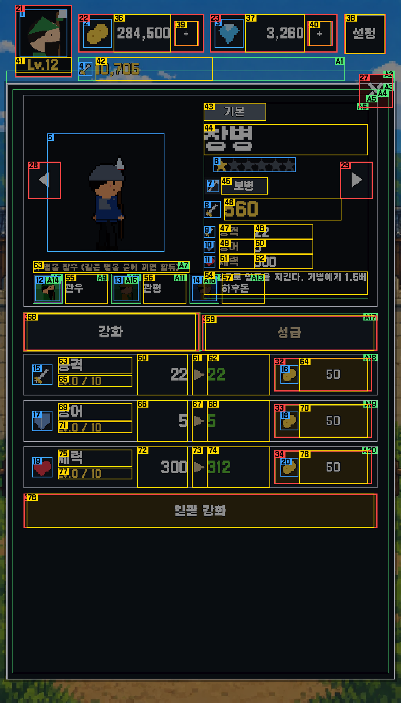

**영역 (컨테이너)**

| A | x, y | 크기 | 노드 |
|---|---|---|---|
| A1 | 200, 146 | 680 × 60 | `screen_layer/Lobby/@Control@25` |
| A2 | 16, 180 | 992 × 1552 | `dialog_layer/@Control@40` |
| A3 | 16, 212 | 992 × 1520 | `dialog_layer/@Control@40/@Control@41` |
| A4 | 32, 228 | 960 × 1488 | `dialog_layer/@Control@40/@Control@42` |
| A5 | 60, 242 | 904 × 540 | `dialog_layer/@Control@40/@Control@42/Troop/@Control@44` |
| A6 | 520, 262 | 420 × 500 | `dialog_layer/@Control@40/@Control@42/Troop/@Control@46` |
| A7 | 84, 666 | 400 × 30 | `dialog_layer/@Control@40/@Control@42/Troop/@Control@47` |
| A8 | 84, 698 | 76 × 76 | `dialog_layer/@Control@40/@Control@42/Troop/@Control@51` |
| A9 | 166, 698 | 110 × 76 | `dialog_layer/@Control@40/@Control@42/Troop/@Control@52` |
| A10 | 284, 698 | 76 × 76 | `dialog_layer/@Control@40/@Control@42/Troop/@Control@56` |
| A11 | 366, 698 | 110 × 76 | `dialog_layer/@Control@40/@Control@42/Troop/@Control@57` |
| A12 | 484, 698 | 76 × 76 | `dialog_layer/@Control@40/@Control@42/Troop/@Control@61` |
| A13 | 566, 698 | 110 × 76 | `dialog_layer/@Control@40/@Control@42/Troop/@Control@62` |
| A14 | 90, 704 | 64 × 64 | `dialog_layer/@Control@40/@Control@42/Troop/@Control@51/@Control@49` |
| A15 | 290, 704 | 64 × 64 | `dialog_layer/@Control@40/@Control@42/Troop/@Control@56/@Control@54` |
| A16 | 490, 704 | 64 × 64 | `dialog_layer/@Control@40/@Control@42/Troop/@Control@61/@Control@59` |
| A17 | 60, 798 | 904 × 96 | `dialog_layer/@Control@40/@Control@42/Troop/@Control@67` |
| A18 | 60, 902 | 904 × 106 | `dialog_layer/@Control@40/@Control@42/Troop/@Control@68` |
| A19 | 60, 1020 | 904 × 106 | `dialog_layer/@Control@40/@Control@42/Troop/@Control@70` |
| A20 | 60, 1138 | 904 × 106 | `dialog_layer/@Control@40/@Control@42/Troop/@Control@72` |

**점검: 문제 없음**

**자리**

| # | 종류 | x, y | 크기 | 내용 |
|---|---|---|---|---|
| 1 | 그림 | 50, 24 | 122 × 122 | 얼굴 guanyu |
| 2 | 그림 | 212, 48 | 74 × 74 | 아이콘 icon_gold |
| 3 | 그림 | 548, 48 | 74 × 74 | 아이콘 icon_diamond |
| 4 | 그림 | 200, 158 | 36 × 36 | 아이콘 icon_sword |
| 5 | 그림 | 120, 340 | 300 × 302 | 캐릭터 동작 프레임 |
| 6 | 그림 | 545, 401 | 210 × 38 | 아이콘 ic_star |
| 7 | 그림 | 528, 458 | 32 × 32 | 아이콘 class_inf |
| 8 | 그림 | 520, 512 | 44 × 44 | 아이콘 icon_sword |
| 9 | 그림 | 520, 576 | 30 × 30 | 아이콘 ic_sword |
| 10 | 그림 | 520, 614 | 30 × 30 | 아이콘 ic_shield |
| 11 | 그림 | 520, 652 | 30 × 30 | 아이콘 ic_heart |
| 12 | 그림 | 90, 704 | 64 × 64 | 초상 guanyu |
| 13 | 그림 | 290, 704 | 64 × 64 | 초상 guanping |
| 14 | 그림 | 490, 704 | 64 × 64 | 초상 xiahoudun |
| 15 | 그림 | 82, 929 | 52 × 52 | 아이콘 ic_sword |
| 16 | 그림 | 716, 931 | 46 × 48 | 아이콘 icon_gold |
| 17 | 그림 | 82, 1047 | 52 × 52 | 아이콘 ic_shield |
| 18 | 그림 | 716, 1049 | 46 × 48 | 아이콘 icon_gold |
| 19 | 그림 | 82, 1165 | 52 × 52 | 아이콘 ic_heart |
| 20 | 그림 | 716, 1167 | 46 × 48 | 아이콘 icon_gold |
| 21 | 버튼 | 38, 12 | 146 × 185 | frame_portrait |
| 22 | 버튼 | 200, 36 | 321 × 98 | 284,500 |
| 23 | 버튼 | 536, 36 | 326 × 98 | 3,260 |
| 24 | 버튼 | 878, 36 | 108 × 102 | btn_settings |
| 25 | 버튼 | 444, 53 | 65 × 65 | btn_plus |
| 26 | 버튼 | 785, 53 | 65 × 65 | btn_plus |
| 27 | 버튼 | 916, 188 | 88 × 88 | tab_red |
| 28 | 버튼 | 72, 412 | 84 × 96 | btn_small |
| 29 | 버튼 | 868, 412 | 84 × 96 | btn_small |
| 30 | 버튼 | 60, 798 | 448 × 96 | 강화 |
| 31 | 버튼 | 516, 804 | 448 × 90 | 성급 |
| 32 | 버튼 | 700, 912 | 250 × 86 | 50 |
| 33 | 버튼 | 700, 1030 | 250 × 86 | 50 |
| 34 | 버튼 | 700, 1148 | 250 × 86 | 50 |
| 35 | 버튼 | 60, 1258 | 904 × 88 | 일괄 강화 |
| 36 | 글자 | 290, 36 | 147 × 98 | “284,500” |
| 37 | 글자 | 626, 36 | 152 × 98 | “3,260” |
| 38 | 글자 | 882, 36 | 100 × 102 | “설정” |
| 39 | 글자 | 448, 53 | 57 × 65 | “+” |
| 40 | 글자 | 789, 53 | 57 × 65 | “+” |
| 41 | 글자 | 38, 145 | 146 × 40 | “Lv.12” |
| 42 | 글자 | 244, 146 | 300 × 60 | “10,705” |
| 43 | 글자 | 520, 262 | 160 × 46 | “기본” |
| 44 | 글자 | 520, 316 | 420 × 80 | “창병” |
| 45 | 글자 | 564, 452 | 120 × 44 | “보병” |
| 46 | 글자 | 572, 506 | 300 × 56 | “560” |
| 47 | 글자 | 560, 572 | 90 × 38 | “공격” |
| 48 | 글자 | 650, 572 | 150 × 38 | “22” |
| 49 | 글자 | 560, 610 | 90 × 38 | “방어” |
| 50 | 글자 | 650, 610 | 150 × 38 | “5” |
| 51 | 글자 | 560, 648 | 90 × 38 | “체력” |
| 52 | 글자 | 650, 648 | 150 × 38 | “300” |
| 53 | 글자 | 84, 666 | 400 × 30 | “이 병종 장수 (같은 병종 줄에 끼면 합류)” |
| 54 | 글자 | 520, 692 | 420 × 60 | “긴 창으로 앞줄을 지킨다. 기병에게 1.5배.” |
| 55 | 글자 | 166, 698 | 110 × 76 | “관우” |
| 56 | 글자 | 366, 698 | 110 × 76 | “관평” |
| 57 | 글자 | 566, 698 | 110 × 76 | “하후돈” |
| 58 | 글자 | 68, 798 | 432 × 96 | “강화” |
| 59 | 글자 | 524, 804 | 432 × 90 | “성급” |
| 60 | 글자 | 350, 902 | 130 × 106 | “22” |
| 61 | 글자 | 490, 902 | 40 × 106 | “▶” |
| 62 | 글자 | 530, 902 | 160 × 106 | “22” |
| 63 | 글자 | 148, 910 | 190 × 44 | “공격” |
| 64 | 글자 | 764, 912 | 176 × 86 | “50” |
| 65 | 글자 | 148, 956 | 190 × 30 | “Lv.0 / 10” |
| 66 | 글자 | 350, 1020 | 130 × 106 | “5” |
| 67 | 글자 | 490, 1020 | 40 × 106 | “▶” |
| 68 | 글자 | 530, 1020 | 160 × 106 | “5” |
| 69 | 글자 | 148, 1028 | 190 × 44 | “방어” |
| 70 | 글자 | 764, 1030 | 176 × 86 | “50” |
| 71 | 글자 | 148, 1074 | 190 × 30 | “Lv.0 / 10” |
| 72 | 글자 | 350, 1138 | 130 × 106 | “300” |
| 73 | 글자 | 490, 1138 | 40 × 106 | “▶” |
| 74 | 글자 | 530, 1138 | 160 × 106 | “312” |
| 75 | 글자 | 148, 1146 | 190 × 44 | “체력” |
| 76 | 글자 | 764, 1148 | 176 × 86 | “50” |
| 77 | 글자 | 148, 1192 | 190 × 30 | “Lv.0 / 10” |
| 78 | 글자 | 68, 1258 | 888 × 88 | “일괄 강화” |

판(테두리 틀): `panel_ctrl` 992×1520, `panel_slot` 904×540, `panel_small` 904×106, `tab_yellow` 904×88, `tab_wood_on` 448×96, `tab_wood` 448×90, `panel_chip` 326×98, `panel_chip` 321×98, `frame_portrait` 146×185, `tab_yellow` 250×86, `btn_settings` 108×102, `btn_small` 84×96, `tab_red` 88×88, `btn_plus` 65×65

## 병종 상세 — 성급 — `08c_troop_star`

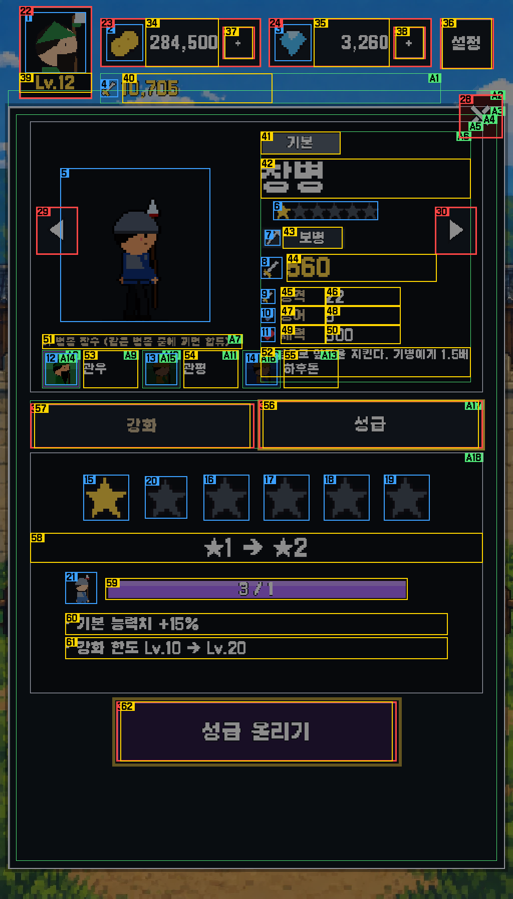

**영역 (컨테이너)**

| A | x, y | 크기 | 노드 |
|---|---|---|---|
| A1 | 200, 146 | 680 × 60 | `screen_layer/Lobby/@Control@25` |
| A2 | 16, 180 | 992 × 1552 | `dialog_layer/@Control@40` |
| A3 | 16, 212 | 992 × 1520 | `dialog_layer/@Control@40/@Control@41` |
| A4 | 32, 228 | 960 × 1488 | `dialog_layer/@Control@40/@Control@42` |
| A5 | 60, 242 | 904 × 540 | `dialog_layer/@Control@40/@Control@42/Troop/@Control@44` |
| A6 | 520, 262 | 420 × 500 | `dialog_layer/@Control@40/@Control@42/Troop/@Control@46` |
| A7 | 84, 666 | 400 × 30 | `dialog_layer/@Control@40/@Control@42/Troop/@Control@47` |
| A8 | 84, 698 | 76 × 76 | `dialog_layer/@Control@40/@Control@42/Troop/@Control@51` |
| A9 | 166, 698 | 110 × 76 | `dialog_layer/@Control@40/@Control@42/Troop/@Control@52` |
| A10 | 284, 698 | 76 × 76 | `dialog_layer/@Control@40/@Control@42/Troop/@Control@56` |
| A11 | 366, 698 | 110 × 76 | `dialog_layer/@Control@40/@Control@42/Troop/@Control@57` |
| A12 | 484, 698 | 76 × 76 | `dialog_layer/@Control@40/@Control@42/Troop/@Control@61` |
| A13 | 566, 698 | 110 × 76 | `dialog_layer/@Control@40/@Control@42/Troop/@Control@62` |
| A14 | 90, 704 | 64 × 64 | `dialog_layer/@Control@40/@Control@42/Troop/@Control@51/@Control@49` |
| A15 | 290, 704 | 64 × 64 | `dialog_layer/@Control@40/@Control@42/Troop/@Control@56/@Control@54` |
| A16 | 490, 704 | 64 × 64 | `dialog_layer/@Control@40/@Control@42/Troop/@Control@61/@Control@59` |
| A17 | 60, 798 | 904 × 96 | `dialog_layer/@Control@40/@Control@42/Troop/@Control@67` |
| A18 | 60, 902 | 904 × 480 | `dialog_layer/@Control@40/@Control@42/Troop/@Control@68` |

**점검: 문제 없음**

**자리**

| # | 종류 | x, y | 크기 | 내용 |
|---|---|---|---|---|
| 1 | 그림 | 50, 24 | 122 × 122 | 얼굴 guanyu |
| 2 | 그림 | 212, 48 | 74 × 74 | 아이콘 icon_gold |
| 3 | 그림 | 548, 48 | 74 × 74 | 아이콘 icon_diamond |
| 4 | 그림 | 200, 158 | 36 × 36 | 아이콘 icon_sword |
| 5 | 그림 | 120, 335 | 300 × 307 | 캐릭터 동작 프레임 |
| 6 | 그림 | 545, 401 | 210 × 38 | 아이콘 ic_star |
| 7 | 그림 | 528, 458 | 32 × 32 | 아이콘 class_inf |
| 8 | 그림 | 520, 512 | 44 × 44 | 아이콘 icon_sword |
| 9 | 그림 | 520, 576 | 30 × 30 | 아이콘 ic_sword |
| 10 | 그림 | 520, 614 | 30 × 30 | 아이콘 ic_shield |
| 11 | 그림 | 520, 652 | 30 × 30 | 아이콘 ic_heart |
| 12 | 그림 | 90, 704 | 64 × 64 | 초상 guanyu |
| 13 | 그림 | 290, 704 | 64 × 64 | 초상 guanping |
| 14 | 그림 | 490, 704 | 64 × 64 | 초상 xiahoudun |
| 15 | 그림 | 166, 946 | 92 × 92 | 아이콘 ic_star |
| 16 | 그림 | 406, 946 | 92 × 92 | 아이콘 ic_star_off |
| 17 | 그림 | 526, 946 | 92 × 92 | 아이콘 ic_star_off |
| 18 | 그림 | 646, 946 | 92 × 92 | 아이콘 ic_star_off |
| 19 | 그림 | 766, 946 | 92 × 92 | 아이콘 ic_star_off |
| 20 | 그림 | 289, 949 | 85 × 85 | 아이콘 ic_star_off |
| 21 | 그림 | 130, 1140 | 64 × 64 | 초상 spear |
| 22 | 버튼 | 38, 12 | 146 × 185 | frame_portrait |
| 23 | 버튼 | 200, 36 | 321 × 98 | 284,500 |
| 24 | 버튼 | 536, 36 | 326 × 98 | 3,260 |
| 25 | 버튼 | 878, 36 | 108 × 102 | btn_settings |
| 26 | 버튼 | 444, 53 | 65 × 65 | btn_plus |
| 27 | 버튼 | 785, 53 | 65 × 65 | btn_plus |
| 28 | 버튼 | 916, 188 | 88 × 88 | tab_red |
| 29 | 버튼 | 72, 412 | 84 × 96 | btn_small |
| 30 | 버튼 | 868, 412 | 84 × 96 | btn_small |
| 31 | 버튼 | 516, 798 | 448 × 96 | 성급 |
| 32 | 버튼 | 60, 804 | 448 × 90 | 강화 |
| 33 | 버튼 | 232, 1398 | 560 × 120 | 성급 올리기 |
| 34 | 글자 | 290, 36 | 147 × 98 | “284,500” |
| 35 | 글자 | 626, 36 | 152 × 98 | “3,260” |
| 36 | 글자 | 882, 36 | 100 × 102 | “설정” |
| 37 | 글자 | 448, 53 | 57 × 65 | “+” |
| 38 | 글자 | 789, 53 | 57 × 65 | “+” |
| 39 | 글자 | 38, 145 | 146 × 40 | “Lv.12” |
| 40 | 글자 | 244, 146 | 300 × 60 | “10,705” |
| 41 | 글자 | 520, 262 | 160 × 46 | “기본” |
| 42 | 글자 | 520, 316 | 420 × 80 | “창병” |
| 43 | 글자 | 564, 452 | 120 × 44 | “보병” |
| 44 | 글자 | 572, 506 | 300 × 56 | “560” |
| 45 | 글자 | 560, 572 | 90 × 38 | “공격” |
| 46 | 글자 | 650, 572 | 150 × 38 | “22” |
| 47 | 글자 | 560, 610 | 90 × 38 | “방어” |
| 48 | 글자 | 650, 610 | 150 × 38 | “5” |
| 49 | 글자 | 560, 648 | 90 × 38 | “체력” |
| 50 | 글자 | 650, 648 | 150 × 38 | “300” |
| 51 | 글자 | 84, 666 | 400 × 30 | “이 병종 장수 (같은 병종 줄에 끼면 합류)” |
| 52 | 글자 | 520, 692 | 420 × 60 | “긴 창으로 앞줄을 지킨다. 기병에게 1.5배.” |
| 53 | 글자 | 166, 698 | 110 × 76 | “관우” |
| 54 | 글자 | 366, 698 | 110 × 76 | “관평” |
| 55 | 글자 | 566, 698 | 110 × 76 | “하후돈” |
| 56 | 글자 | 524, 798 | 432 × 96 | “성급” |
| 57 | 글자 | 68, 804 | 432 × 90 | “강화” |
| 58 | 글자 | 60, 1062 | 904 × 60 | “★1 → ★2” |
| 59 | 글자 | 210, 1152 | 604 × 44 | “3 / 1” |
| 60 | 글자 | 130, 1222 | 764 × 44 | “· 기본 능력치 +15%” |
| 61 | 글자 | 130, 1270 | 764 × 44 | “· 강화 한도 Lv.10 → Lv.20” |
| 62 | 글자 | 240, 1398 | 544 × 120 | “성급 올리기” |

판(테두리 틀): `panel_ctrl` 992×1520, `panel_slot` 904×540, `panel_slot` 904×480, `tab_purple` 560×120, `tab_wood_on` 448×96, `tab_wood` 448×90, `panel_chip` 326×98, `panel_chip` 321×98, `frame_portrait` 146×185, `btn_settings` 108×102, `btn_small` 84×96, `tab_red` 88×88, `btn_plus` 65×65

## 장수 상세 — 강화 — `09_hero_up`

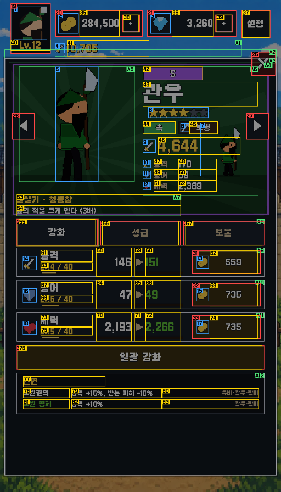

**영역 (컨테이너)**

| A | x, y | 크기 | 노드 |
|---|---|---|---|
| A1 | 200, 146 | 680 × 60 | `screen_layer/Lobby/@Control@25` |
| A2 | 16, 180 | 992 × 1552 | `dialog_layer/@Control@40` |
| A3 | 16, 212 | 992 × 1520 | `dialog_layer/@Control@40/@Control@41` |
| A4 | 32, 228 | 960 × 1488 | `dialog_layer/@Control@40/@Control@42` |
| A5 | 70, 242 | 420 × 420 | `dialog_layer/@Control@40/@Control@42/Hero/@Control@45` |
| A6 | 520, 242 | 420 × 470 | `dialog_layer/@Control@40/@Control@42/Hero/@Control@47` |
| A7 | 60, 708 | 600 × 78 | `dialog_layer/@Control@40/@Control@42/Hero/@Control@50` |
| A8 | 60, 798 | 904 × 96 | `dialog_layer/@Control@40/@Control@42/Hero/@Control@54` |
| A9 | 60, 902 | 904 × 106 | `dialog_layer/@Control@40/@Control@42/Hero/@Control@55` |
| A10 | 60, 1020 | 904 × 106 | `dialog_layer/@Control@40/@Control@42/Hero/@Control@57` |
| A11 | 60, 1138 | 904 × 106 | `dialog_layer/@Control@40/@Control@42/Hero/@Control@59` |
| A12 | 60, 1358 | 904 × 150 | `dialog_layer/@Control@40/@Control@42/Hero/@Control@62` |

**점검: 문제 없음**

**자리**

| # | 종류 | x, y | 크기 | 내용 |
|---|---|---|---|---|
| 1 | 그림 | 50, 24 | 122 × 122 | 얼굴 guanyu |
| 2 | 그림 | 212, 48 | 74 × 74 | 아이콘 icon_gold |
| 3 | 그림 | 548, 48 | 74 × 74 | 아이콘 icon_diamond |
| 4 | 그림 | 200, 158 | 36 × 36 | 아이콘 icon_sword |
| 5 | 그림 | 201, 242 | 158 × 420 | 큰 그림 guanyu |
| 6 | 그림 | 540, 390 | 221 × 40 | 아이콘 ic_star |
| 7 | 그림 | 730, 447 | 200 × 195 | 캐릭터 동작 프레임 |
| 8 | 그림 | 658, 449 | 32 × 32 | 아이콘 class_inf |
| 9 | 그림 | 520, 508 | 48 × 48 | 아이콘 icon_sword |
| 10 | 그림 | 520, 582 | 30 × 30 | 아이콘 ic_sword |
| 11 | 그림 | 520, 622 | 30 × 30 | 아이콘 ic_shield |
| 12 | 그림 | 520, 662 | 30 × 30 | 아이콘 ic_heart |
| 13 | 그림 | 716, 931 | 46 × 48 | 아이콘 icon_gold |
| 14 | 그림 | 82, 932 | 52 × 52 | 아이콘 ic_sword |
| 15 | 그림 | 716, 1049 | 46 × 48 | 아이콘 icon_gold |
| 16 | 그림 | 82, 1050 | 52 × 52 | 아이콘 ic_shield |
| 17 | 그림 | 716, 1167 | 46 × 48 | 아이콘 icon_gold |
| 18 | 그림 | 82, 1168 | 52 × 52 | 아이콘 ic_heart |
| 19 | 버튼 | 38, 12 | 146 × 185 | frame_portrait |
| 20 | 버튼 | 200, 36 | 321 × 98 | 284,500 |
| 21 | 버튼 | 536, 36 | 326 × 98 | 3,260 |
| 22 | 버튼 | 878, 36 | 108 × 102 | btn_settings |
| 23 | 버튼 | 444, 53 | 65 × 65 | btn_plus |
| 24 | 버튼 | 785, 53 | 65 × 65 | btn_plus |
| 25 | 버튼 | 916, 188 | 88 × 88 | tab_red |
| 26 | 버튼 | 44, 412 | 84 × 96 | btn_small |
| 27 | 버튼 | 896, 412 | 84 × 96 | btn_small |
| 28 | 버튼 | 60, 798 | 296 × 96 | 강화 |
| 29 | 버튼 | 364, 804 | 296 × 90 | 성급 |
| 30 | 버튼 | 668, 804 | 296 × 90 | 보물 |
| 31 | 버튼 | 700, 912 | 250 × 86 | 559 |
| 32 | 버튼 | 700, 1030 | 250 × 86 | 735 |
| 33 | 버튼 | 700, 1148 | 250 × 86 | 735 |
| 34 | 버튼 | 60, 1258 | 904 × 88 | 일괄 강화 |
| 35 | 글자 | 290, 36 | 147 × 98 | “284,500” |
| 36 | 글자 | 626, 36 | 152 × 98 | “3,260” |
| 37 | 글자 | 882, 36 | 100 × 102 | “설정” |
| 38 | 글자 | 448, 53 | 57 × 65 | “+” |
| 39 | 글자 | 789, 53 | 57 × 65 | “+” |
| 40 | 글자 | 38, 145 | 146 × 40 | “Lv.12” |
| 41 | 글자 | 244, 146 | 300 × 60 | “10,705” |
| 42 | 글자 | 520, 242 | 220 × 50 | “S” |
| 43 | 글자 | 520, 298 | 420 × 90 | “관우” |
| 44 | 글자 | 520, 442 | 120 × 46 | “촉” |
| 45 | 글자 | 690, 442 | 104 × 46 | “보병” |
| 46 | 글자 | 576, 500 | 300 × 64 | “4,644” |
| 47 | 글자 | 560, 578 | 90 × 40 | “공격” |
| 48 | 글자 | 650, 578 | 140 × 40 | “170” |
| 49 | 글자 | 560, 618 | 90 × 40 | “방어” |
| 50 | 글자 | 650, 618 | 140 × 40 | “69” |
| 51 | 글자 | 560, 658 | 90 × 40 | “체력” |
| 52 | 글자 | 650, 658 | 140 × 40 | “2,389” |
| 53 | 글자 | 60, 708 | 600 × 40 | “필살기 · 청룡참” |
| 54 | 글자 | 60, 748 | 600 × 40 | “앞의 적을 크게 벤다 (3배)” |
| 55 | 글자 | 68, 798 | 280 × 96 | “강화” |
| 56 | 글자 | 372, 804 | 280 × 90 | “성급” |
| 57 | 글자 | 676, 804 | 280 × 90 | “보물” |
| 58 | 글자 | 350, 902 | 130 × 106 | “146” |
| 59 | 글자 | 490, 902 | 40 × 106 | “▶” |
| 60 | 글자 | 530, 902 | 130 × 106 | “151” |
| 61 | 글자 | 148, 910 | 190 × 44 | “공격” |
| 62 | 글자 | 764, 912 | 176 × 86 | “559” |
| 63 | 글자 | 148, 956 | 190 × 30 | “Lv.4 / 40” |
| 64 | 글자 | 350, 1020 | 130 × 106 | “47” |
| 65 | 글자 | 490, 1020 | 40 × 106 | “▶” |
| 66 | 글자 | 530, 1020 | 130 × 106 | “49” |
| 67 | 글자 | 148, 1028 | 190 × 44 | “방어” |
| 68 | 글자 | 764, 1030 | 176 × 86 | “735” |
| 69 | 글자 | 148, 1074 | 190 × 30 | “Lv.5 / 40” |
| 70 | 글자 | 350, 1138 | 130 × 106 | “2,193” |
| 71 | 글자 | 490, 1138 | 40 × 106 | “▶” |
| 72 | 글자 | 530, 1138 | 130 × 106 | “2,266” |
| 73 | 글자 | 148, 1146 | 190 × 44 | “체력” |
| 74 | 글자 | 764, 1148 | 176 × 86 | “735” |
| 75 | 글자 | 148, 1192 | 190 × 30 | “Lv.5 / 40” |
| 76 | 글자 | 68, 1258 | 888 × 88 | “일괄 강화” |
| 77 | 글자 | 84, 1370 | 300 × 40 | “인연” |
| 78 | 글자 | 84, 1414 | 170 × 36 | “도원결의” |
| 79 | 글자 | 260, 1414 | 330 × 36 | “공격 +15%, 받는 피해 -10%” |
| 80 | 글자 | 590, 1414 | 354 × 36 | “유비·관우·장비” |
| 81 | 글자 | 84, 1454 | 170 × 36 | “도원 형제” |
| 82 | 글자 | 260, 1454 | 330 × 36 | “공격 +10%” |
| 83 | 글자 | 590, 1454 | 354 × 36 | “관우·장비” |

판(테두리 틀): `panel_ctrl` 992×1520, `panel_slot` 904×150, `panel_small` 904×106, `tab_yellow` 904×88, `panel_chip` 326×98, `panel_chip` 321×98, `tab_wood_on` 296×96, `frame_portrait` 146×185, `tab_wood` 296×90, `tab_yellow` 250×86, `btn_settings` 108×102, `btn_small` 84×96, `tab_red` 88×88, `btn_plus` 65×65

## 장수 상세 — 성급 — `10_hero_star`

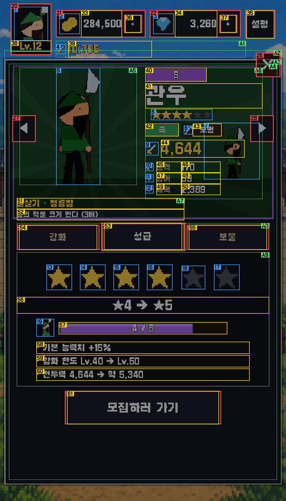

**영역 (컨테이너)**

| A | x, y | 크기 | 노드 |
|---|---|---|---|
| A1 | 200, 146 | 680 × 60 | `screen_layer/Lobby/@Control@25` |
| A2 | 16, 180 | 992 × 1552 | `dialog_layer/@Control@40` |
| A3 | 16, 212 | 992 × 1520 | `dialog_layer/@Control@40/@Control@41` |
| A4 | 32, 228 | 960 × 1488 | `dialog_layer/@Control@40/@Control@42` |
| A5 | 70, 242 | 420 × 420 | `dialog_layer/@Control@40/@Control@42/Hero/@Control@45` |
| A6 | 520, 242 | 420 × 470 | `dialog_layer/@Control@40/@Control@42/Hero/@Control@47` |
| A7 | 60, 708 | 600 × 78 | `dialog_layer/@Control@40/@Control@42/Hero/@Control@50` |
| A8 | 60, 798 | 904 × 96 | `dialog_layer/@Control@40/@Control@42/Hero/@Control@54` |
| A9 | 60, 902 | 904 × 480 | `dialog_layer/@Control@40/@Control@42/Hero/@Control@55` |

**점검: 문제 없음**

**자리**

| # | 종류 | x, y | 크기 | 내용 |
|---|---|---|---|---|
| 1 | 그림 | 50, 24 | 122 × 122 | 얼굴 guanyu |
| 2 | 그림 | 212, 48 | 74 × 74 | 아이콘 icon_gold |
| 3 | 그림 | 548, 48 | 74 × 74 | 아이콘 icon_diamond |
| 4 | 그림 | 200, 158 | 36 × 36 | 아이콘 icon_sword |
| 5 | 그림 | 201, 242 | 158 × 420 | 큰 그림 guanyu |
| 6 | 그림 | 540, 390 | 221 × 40 | 아이콘 ic_star |
| 7 | 그림 | 730, 439 | 200 × 203 | 캐릭터 동작 프레임 |
| 8 | 그림 | 658, 449 | 32 × 32 | 아이콘 class_inf |
| 9 | 그림 | 520, 508 | 48 × 48 | 아이콘 icon_sword |
| 10 | 그림 | 520, 582 | 30 × 30 | 아이콘 ic_sword |
| 11 | 그림 | 520, 622 | 30 × 30 | 아이콘 ic_shield |
| 12 | 그림 | 520, 662 | 30 × 30 | 아이콘 ic_heart |
| 13 | 그림 | 166, 946 | 92 × 92 | 아이콘 ic_star |
| 14 | 그림 | 286, 946 | 92 × 92 | 아이콘 ic_star |
| 15 | 그림 | 406, 946 | 92 × 92 | 아이콘 ic_star |
| 16 | 그림 | 526, 946 | 92 × 92 | 아이콘 ic_star |
| 17 | 그림 | 766, 946 | 92 × 92 | 아이콘 ic_star_off |
| 18 | 그림 | 650, 950 | 85 × 85 | 아이콘 ic_star_off |
| 19 | 그림 | 130, 1140 | 64 × 64 | 초상 guanyu |
| 20 | 버튼 | 38, 12 | 146 × 185 | frame_portrait |
| 21 | 버튼 | 200, 36 | 321 × 98 | 284,500 |
| 22 | 버튼 | 536, 36 | 326 × 98 | 3,260 |
| 23 | 버튼 | 878, 36 | 108 × 102 | btn_settings |
| 24 | 버튼 | 444, 53 | 65 × 65 | btn_plus |
| 25 | 버튼 | 785, 53 | 65 × 65 | btn_plus |
| 26 | 버튼 | 916, 188 | 88 × 88 | tab_red |
| 27 | 버튼 | 44, 412 | 84 × 96 | btn_small |
| 28 | 버튼 | 896, 412 | 84 × 96 | btn_small |
| 29 | 버튼 | 364, 798 | 296 × 96 | 성급 |
| 30 | 버튼 | 60, 804 | 296 × 90 | 강화 |
| 31 | 버튼 | 668, 804 | 296 × 90 | 보물 |
| 32 | 버튼 | 232, 1398 | 560 × 120 | 모집하러 가기 |
| 33 | 글자 | 290, 36 | 147 × 98 | “284,500” |
| 34 | 글자 | 626, 36 | 152 × 98 | “3,260” |
| 35 | 글자 | 882, 36 | 100 × 102 | “설정” |
| 36 | 글자 | 448, 53 | 57 × 65 | “+” |
| 37 | 글자 | 789, 53 | 57 × 65 | “+” |
| 38 | 글자 | 38, 145 | 146 × 40 | “Lv.12” |
| 39 | 글자 | 244, 146 | 300 × 60 | “10,705” |
| 40 | 글자 | 520, 242 | 220 × 50 | “S” |
| 41 | 글자 | 520, 298 | 420 × 90 | “관우” |
| 42 | 글자 | 520, 442 | 120 × 46 | “촉” |
| 43 | 글자 | 690, 442 | 104 × 46 | “보병” |
| 44 | 글자 | 576, 500 | 300 × 64 | “4,644” |
| 45 | 글자 | 560, 578 | 90 × 40 | “공격” |
| 46 | 글자 | 650, 578 | 140 × 40 | “170” |
| 47 | 글자 | 560, 618 | 90 × 40 | “방어” |
| 48 | 글자 | 650, 618 | 140 × 40 | “69” |
| 49 | 글자 | 560, 658 | 90 × 40 | “체력” |
| 50 | 글자 | 650, 658 | 140 × 40 | “2,389” |
| 51 | 글자 | 60, 708 | 600 × 40 | “필살기 · 청룡참” |
| 52 | 글자 | 60, 748 | 600 × 40 | “앞의 적을 크게 벤다 (3배)” |
| 53 | 글자 | 372, 798 | 280 × 96 | “성급” |
| 54 | 글자 | 68, 804 | 280 × 90 | “강화” |
| 55 | 글자 | 676, 804 | 280 × 90 | “보물” |
| 56 | 글자 | 60, 1062 | 904 × 60 | “★4 → ★5” |
| 57 | 글자 | 210, 1152 | 604 × 44 | “4 / 5” |
| 58 | 글자 | 130, 1222 | 764 × 44 | “· 기본 능력치 +15%” |
| 59 | 글자 | 130, 1270 | 764 × 44 | “· 강화 한도 Lv.40 → Lv.50” |
| 60 | 글자 | 130, 1318 | 764 × 44 | “· 전투력 4,644 → 약 5,340” |
| 61 | 글자 | 240, 1398 | 544 × 120 | “모집하러 가기” |

판(테두리 틀): `panel_ctrl` 992×1520, `panel_slot` 904×480, `tab_wood` 560×120, `panel_chip` 326×98, `panel_chip` 321×98, `tab_wood_on` 296×96, `frame_portrait` 146×185, `tab_wood` 296×90, `btn_settings` 108×102, `btn_small` 84×96, `tab_red` 88×88, `btn_plus` 65×65

## 장수 상세 — 보물 — `11_hero_treasure`

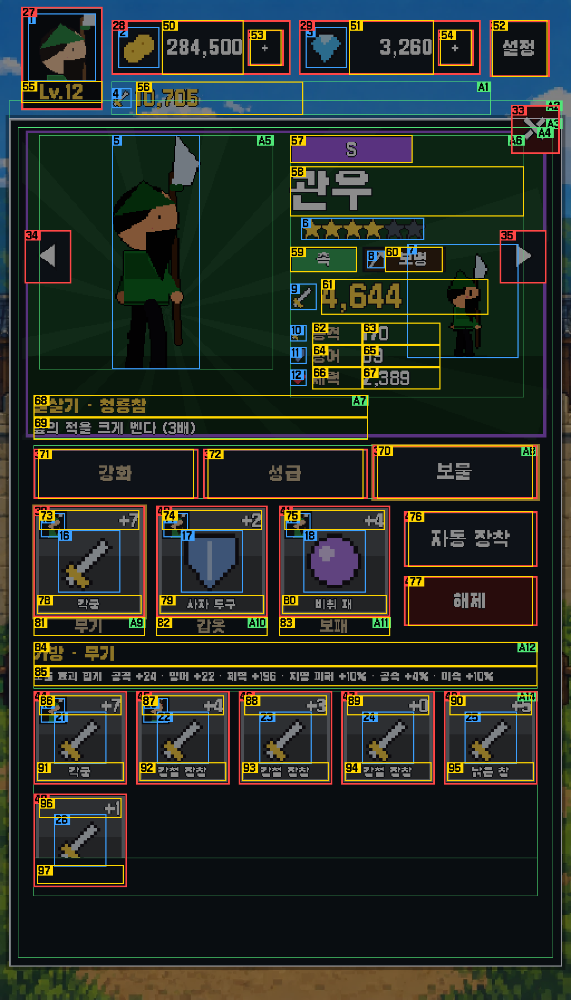

**영역 (컨테이너)**

| A | x, y | 크기 | 노드 |
|---|---|---|---|
| A1 | 200, 146 | 680 × 60 | `screen_layer/Lobby/@Control@25` |
| A2 | 16, 180 | 992 × 1552 | `dialog_layer/@Control@40` |
| A3 | 16, 212 | 992 × 1520 | `dialog_layer/@Control@40/@Control@41` |
| A4 | 32, 228 | 960 × 1488 | `dialog_layer/@Control@40/@Control@42` |
| A5 | 70, 242 | 420 × 420 | `dialog_layer/@Control@40/@Control@42/Hero/@Control@45` |
| A6 | 520, 242 | 420 × 470 | `dialog_layer/@Control@40/@Control@42/Hero/@Control@47` |
| A7 | 60, 708 | 600 × 78 | `dialog_layer/@Control@40/@Control@42/Hero/@Control@50` |
| A8 | 60, 798 | 904 × 96 | `dialog_layer/@Control@40/@Control@42/Hero/@Control@54` |
| A9 | 60, 1106 | 200 × 34 | `dialog_layer/@Control@40/@Control@42/Hero/@Control@56` |
| A10 | 280, 1106 | 200 × 34 | `dialog_layer/@Control@40/@Control@42/Hero/@Control@58` |
| A11 | 500, 1106 | 200 × 34 | `dialog_layer/@Control@40/@Control@42/Hero/@Control@60` |
| A12 | 60, 1150 | 904 × 84 | `dialog_layer/@Control@40/@Control@42/Hero/@Control@63` |
| A13 | 60, 1238 | 904 × 300 | `dialog_layer/@Control@40/@Control@42/Hero/@ScrollContainer@67` |
| A14 | 60, 1238 | 904 × 368 | `dialog_layer/@Control@40/@Control@42/Hero/@ScrollContainer@67/@Control@66` |

**점검: 문제 없음**

**자리**

| # | 종류 | x, y | 크기 | 내용 |
|---|---|---|---|---|
| 1 | 그림 | 50, 24 | 122 × 122 | 얼굴 guanyu |
| 2 | 그림 | 212, 48 | 74 × 74 | 아이콘 icon_gold |
| 3 | 그림 | 548, 48 | 74 × 74 | 아이콘 icon_diamond |
| 4 | 그림 | 200, 158 | 36 × 36 | 아이콘 icon_sword |
| 5 | 그림 | 201, 242 | 158 × 420 | 큰 그림 guanyu |
| 6 | 그림 | 540, 390 | 221 × 40 | 아이콘 ic_star |
| 7 | 그림 | 730, 437 | 200 × 205 | 캐릭터 동작 프레임 |
| 8 | 그림 | 658, 449 | 32 × 32 | 아이콘 class_inf |
| 9 | 그림 | 520, 508 | 48 × 48 | 아이콘 icon_sword |
| 10 | 그림 | 520, 582 | 30 × 30 | 아이콘 ic_sword |
| 11 | 그림 | 520, 622 | 30 × 30 | 아이콘 ic_shield |
| 12 | 그림 | 520, 662 | 30 × 30 | 아이콘 ic_heart |
| 13 | 그림 | 73, 919 | 44 × 44 | 초상 guanyu |
| 14 | 그림 | 293, 919 | 44 × 44 | 초상 guanyu |
| 15 | 그림 | 513, 919 | 44 × 44 | 초상 guanyu |
| 16 | 그림 | 104, 950 | 112 × 112 | 아이콘 ic_sword |
| 17 | 그림 | 324, 950 | 112 × 112 | 아이콘 ic_shield |
| 18 | 그림 | 544, 950 | 112 × 112 | 아이콘 ic_orb |
| 19 | 그림 | 73, 1251 | 44 × 44 | 초상 guanyu |
| 20 | 그림 | 257, 1251 | 44 × 44 | 초상 zhangfei |
| 21 | 그림 | 97, 1275 | 94 × 94 | 아이콘 ic_sword |
| 22 | 그림 | 281, 1275 | 94 × 94 | 아이콘 ic_sword |
| 23 | 그림 | 465, 1275 | 94 × 94 | 아이콘 ic_sword |
| 24 | 그림 | 649, 1275 | 94 × 94 | 아이콘 ic_sword |
| 25 | 그림 | 833, 1275 | 94 × 94 | 아이콘 ic_sword |
| 26 | 그림 | 97, 1459 | 94 × 94 | 아이콘 ic_sword |
| 27 | 버튼 | 38, 12 | 146 × 185 | frame_portrait |
| 28 | 버튼 | 200, 36 | 321 × 98 | 284,500 |
| 29 | 버튼 | 536, 36 | 326 × 98 | 3,260 |
| 30 | 버튼 | 878, 36 | 108 × 102 | btn_settings |
| 31 | 버튼 | 444, 53 | 65 × 65 | btn_plus |
| 32 | 버튼 | 785, 53 | 65 × 65 | btn_plus |
| 33 | 버튼 | 916, 188 | 88 × 88 | tab_red |
| 34 | 버튼 | 44, 412 | 84 × 96 | btn_small |
| 35 | 버튼 | 896, 412 | 84 × 96 | btn_small |
| 36 | 버튼 | 668, 798 | 296 × 96 | 보물 |
| 37 | 버튼 | 60, 804 | 296 × 90 | 강화 |
| 38 | 버튼 | 364, 804 | 296 × 90 | 성급 |
| 39 | 버튼 | 60, 906 | 200 × 200 |  |
| 40 | 버튼 | 280, 906 | 200 × 200 |  |
| 41 | 버튼 | 500, 906 | 200 × 200 |  |
| 42 | 버튼 | 724, 916 | 240 × 100 | 자동 장착 |
| 43 | 버튼 | 724, 1032 | 240 × 90 | 해제 |
| 44 | 버튼 | 60, 1238 | 168 × 168 |  |
| 45 | 버튼 | 244, 1238 | 168 × 168 |  |
| 46 | 버튼 | 428, 1238 | 168 × 168 |  |
| 47 | 버튼 | 612, 1238 | 168 × 168 |  |
| 48 | 버튼 | 796, 1238 | 168 × 168 |  |
| 49 | 버튼 | 60, 1422 | 168 × 168 |  |
| 50 | 글자 | 290, 36 | 147 × 98 | “284,500” |
| 51 | 글자 | 626, 36 | 152 × 98 | “3,260” |
| 52 | 글자 | 882, 36 | 100 × 102 | “설정” |
| 53 | 글자 | 448, 53 | 57 × 65 | “+” |
| 54 | 글자 | 789, 53 | 57 × 65 | “+” |
| 55 | 글자 | 38, 145 | 146 × 40 | “Lv.12” |
| 56 | 글자 | 244, 146 | 300 × 60 | “10,705” |
| 57 | 글자 | 520, 242 | 220 × 50 | “S” |
| 58 | 글자 | 520, 298 | 420 × 90 | “관우” |
| 59 | 글자 | 520, 442 | 120 × 46 | “촉” |
| 60 | 글자 | 690, 442 | 104 × 46 | “보병” |
| 61 | 글자 | 576, 500 | 300 × 64 | “4,644” |
| 62 | 글자 | 560, 578 | 90 × 40 | “공격” |
| 63 | 글자 | 650, 578 | 140 × 40 | “170” |
| 64 | 글자 | 560, 618 | 90 × 40 | “방어” |
| 65 | 글자 | 650, 618 | 140 × 40 | “69” |
| 66 | 글자 | 560, 658 | 90 × 40 | “체력” |
| 67 | 글자 | 650, 658 | 140 × 40 | “2,389” |
| 68 | 글자 | 60, 708 | 600 × 40 | “필살기 · 청룡참” |
| 69 | 글자 | 60, 748 | 600 × 40 | “앞의 적을 크게 벤다 (3배)” |
| 70 | 글자 | 676, 798 | 280 × 96 | “보물” |
| 71 | 글자 | 68, 804 | 280 × 90 | “강화” |
| 72 | 글자 | 372, 804 | 280 × 90 | “성급” |
| 73 | 글자 | 70, 914 | 180 × 36 | “+7” |
| 74 | 글자 | 290, 914 | 180 × 36 | “+2” |
| 75 | 글자 | 510, 914 | 180 × 36 | “+4” |
| 76 | 글자 | 732, 916 | 224 × 100 | “자동 장착” |
| 77 | 글자 | 732, 1032 | 224 × 90 | “해제” |
| 78 | 글자 | 66, 1066 | 188 × 34 | “각궁” |
| 79 | 글자 | 286, 1066 | 188 × 34 | “사자 투구” |
| 80 | 글자 | 506, 1066 | 188 × 34 | “비취 패” |
| 81 | 글자 | 60, 1106 | 200 × 34 | “무기” |
| 82 | 글자 | 280, 1106 | 200 × 34 | “갑옷” |
| 83 | 글자 | 500, 1106 | 200 × 34 | “보패” |
| 84 | 글자 | 60, 1150 | 904 × 44 | “가방 · 무기” |
| 85 | 글자 | 60, 1194 | 904 × 36 | “보물 효과 합계  공격 +24 · 방어 +22 · …” |
| 86 | 글자 | 70, 1246 | 148 × 36 | “+7” |
| 87 | 글자 | 254, 1246 | 148 × 36 | “+4” |
| 88 | 글자 | 438, 1246 | 148 × 36 | “+3” |
| 89 | 글자 | 622, 1246 | 148 × 36 | “+0” |
| 90 | 글자 | 806, 1246 | 148 × 36 | “+5” |
| 91 | 글자 | 66, 1366 | 156 × 34 | “각궁” |
| 92 | 글자 | 250, 1366 | 156 × 34 | “강철 장창” |
| 93 | 글자 | 434, 1366 | 156 × 34 | “강철 장창” |
| 94 | 글자 | 618, 1366 | 156 × 34 | “강철 장창” |
| 95 | 글자 | 802, 1366 | 156 × 34 | “낡은 창” |
| 96 | 글자 | 70, 1430 | 148 × 36 | “+1” |
| 97 | 글자 | 66, 1550 | 156 × 34 | “나무 방망이” |

판(테두리 틀): `panel_ctrl` 992×1520, `panel_chip` 326×98, `panel_chip` 321×98, `tab_wood_on` 296×96, `frame_portrait` 146×185, `tab_wood` 296×90, `tab_wood` 240×100, `tab_red` 240×90, `btn_settings` 108×102, `btn_small` 84×96, `tab_red` 88×88, `btn_plus` 65×65

## 모집 — 병사 — `12_recruit_soldier`

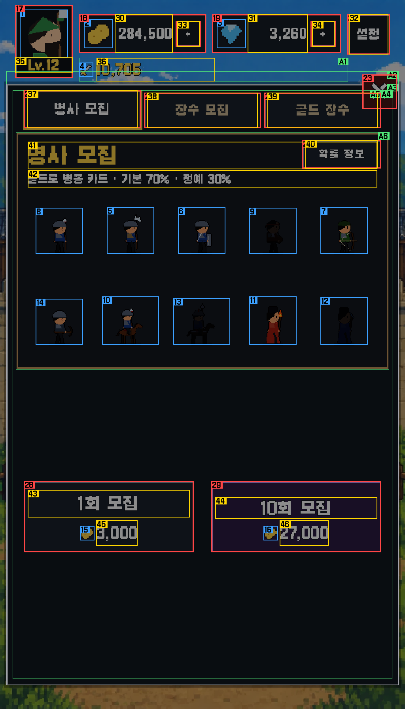

**영역 (컨테이너)**

| A | x, y | 크기 | 노드 |
|---|---|---|---|
| A1 | 200, 146 | 680 × 60 | `screen_layer/Lobby/@Control@25` |
| A2 | 16, 180 | 992 × 1552 | `dialog_layer/@Control@40` |
| A3 | 16, 212 | 992 × 1520 | `dialog_layer/@Control@40/@Control@41` |
| A4 | 32, 228 | 960 × 1488 | `dialog_layer/@Control@40/@Control@42` |
| A5 | 60, 228 | 904 × 96 | `dialog_layer/@Control@40/@Control@42/Recruit/@Control@47` |
| A6 | 40, 334 | 944 × 600 | `dialog_layer/@Control@40/@Control@42/Recruit/@Control@48` |

**점검: 문제 없음**

**자리**

| # | 종류 | x, y | 크기 | 내용 |
|---|---|---|---|---|
| 1 | 그림 | 50, 24 | 122 × 122 | 얼굴 guanyu |
| 2 | 그림 | 212, 48 | 74 × 74 | 아이콘 icon_gold |
| 3 | 그림 | 548, 48 | 74 × 74 | 아이콘 icon_diamond |
| 4 | 그림 | 200, 158 | 36 × 36 | 아이콘 icon_sword |
| 5 | 그림 | 270, 523 | 120 × 119 | 캐릭터 동작 프레임 |
| 6 | 그림 | 450, 524 | 120 × 118 | 캐릭터 동작 프레임 |
| 7 | 그림 | 810, 524 | 120 × 118 | 캐릭터 동작 프레임 |
| 8 | 그림 | 90, 525 | 120 × 117 | 캐릭터 동작 프레임 |
| 9 | 그림 | 630, 525 | 120 × 117 | 캐릭터 동작 프레임 |
| 10 | 그림 | 258, 749 | 144 × 123 | 캐릭터 동작 프레임 |
| 11 | 그림 | 630, 749 | 120 × 123 | 캐릭터 동작 프레임 |
| 12 | 그림 | 810, 751 | 120 × 121 | 캐릭터 동작 프레임 |
| 13 | 그림 | 438, 753 | 144 × 119 | 캐릭터 동작 프레임 |
| 14 | 그림 | 90, 755 | 120 × 117 | 캐릭터 동작 프레임 |
| 15 | 그림 | 202, 1329 | 37 × 37 | 아이콘 icon_gold |
| 16 | 그림 | 666, 1329 | 37 × 37 | 아이콘 icon_gold |
| 17 | 버튼 | 38, 12 | 146 × 185 | frame_portrait |
| 18 | 버튼 | 200, 36 | 321 × 98 | 284,500 |
| 19 | 버튼 | 536, 36 | 326 × 98 | 3,260 |
| 20 | 버튼 | 878, 36 | 108 × 102 | btn_settings |
| 21 | 버튼 | 444, 53 | 65 × 65 | btn_plus |
| 22 | 버튼 | 785, 53 | 65 × 65 | btn_plus |
| 23 | 버튼 | 916, 188 | 88 × 88 | tab_red |
| 24 | 버튼 | 60, 228 | 296 × 96 | 병사 모집 |
| 25 | 버튼 | 364, 234 | 296 × 90 | 장수 모집 |
| 26 | 버튼 | 668, 234 | 296 × 90 | 골드 장수 |
| 27 | 버튼 | 764, 354 | 200 × 72 | 확률 정보 |
| 28 | 버튼 | 60, 1216 | 430 × 180 | 1회 모집 |
| 29 | 버튼 | 534, 1216 | 430 × 180 | 10회 모집 |
| 30 | 글자 | 290, 36 | 147 × 98 | “284,500” |
| 31 | 글자 | 626, 36 | 152 × 98 | “3,260” |
| 32 | 글자 | 882, 36 | 100 × 102 | “설정” |
| 33 | 글자 | 448, 53 | 57 × 65 | “+” |
| 34 | 글자 | 789, 53 | 57 × 65 | “+” |
| 35 | 글자 | 38, 145 | 146 × 40 | “Lv.12” |
| 36 | 글자 | 244, 146 | 300 × 60 | “10,705” |
| 37 | 글자 | 68, 228 | 280 × 96 | “병사 모집” |
| 38 | 글자 | 372, 234 | 280 × 90 | “장수 모집” |
| 39 | 글자 | 676, 234 | 280 × 90 | “골드 장수” |
| 40 | 글자 | 772, 354 | 184 × 72 | “확률 정보” |
| 41 | 글자 | 70, 358 | 884 × 70 | “병사 모집” |
| 42 | 글자 | 70, 430 | 884 × 44 | “골드로 병종 카드 · 기본 70% · 정예 30%” |
| 43 | 글자 | 70, 1238 | 410 × 70 | “1회 모집” |
| 44 | 글자 | 544, 1256 | 410 × 56 | “10회 모집” |
| 45 | 글자 | 243, 1315 | 105 × 65 | “3,000” |
| 46 | 글자 | 707, 1315 | 125 × 65 | “27,000” |

판(테두리 틀): `panel_ctrl` 992×1520, `tab_purple` 430×180, `tab_wood` 430×180, `panel_chip` 326×98, `panel_chip` 321×98, `tab_wood_on` 296×96, `frame_portrait` 146×185, `tab_wood` 296×90, `tab_wood` 200×72, `btn_settings` 108×102, `tab_red` 88×88, `btn_plus` 65×65

## 모집 — 장수 — `13_recruit_hero`

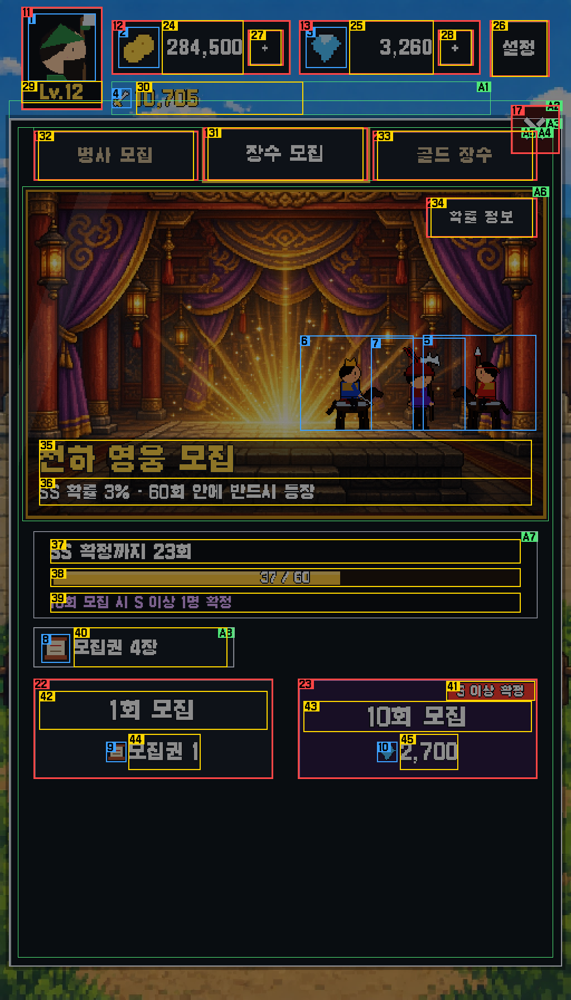

**영역 (컨테이너)**

| A | x, y | 크기 | 노드 |
|---|---|---|---|
| A1 | 200, 146 | 680 × 60 | `screen_layer/Lobby/@Control@25` |
| A2 | 16, 180 | 992 × 1552 | `dialog_layer/@Control@40` |
| A3 | 16, 212 | 992 × 1520 | `dialog_layer/@Control@40/@Control@41` |
| A4 | 32, 228 | 960 × 1488 | `dialog_layer/@Control@40/@Control@42` |
| A5 | 60, 228 | 904 × 96 | `dialog_layer/@Control@40/@Control@42/Recruit/@Control@47` |
| A6 | 40, 334 | 944 × 600 | `dialog_layer/@Control@40/@Control@42/Recruit/@Control@48` |
| A7 | 60, 952 | 904 × 156 | `dialog_layer/@Control@40/@Control@42/Recruit/@Control@53` |
| A8 | 60, 1124 | 360 × 72 | `dialog_layer/@Control@40/@Control@42/Recruit/@Control@54` |

**점검: 문제 없음**

**자리**

| # | 종류 | x, y | 크기 | 내용 |
|---|---|---|---|---|
| 1 | 그림 | 50, 24 | 122 × 122 | 얼굴 guanyu |
| 2 | 그림 | 212, 48 | 74 × 74 | 아이콘 icon_gold |
| 3 | 그림 | 548, 48 | 74 × 74 | 아이콘 icon_diamond |
| 4 | 그림 | 200, 158 | 36 × 36 | 아이콘 icon_sword |
| 배경 | 그림 | 50, 344 | 924 × 580 | 배경 recruit_banner |
| 5 | 그림 | 758, 600 | 204 × 172 | 캐릭터 동작 프레임 |
| 6 | 그림 | 538, 601 | 204 × 171 | 캐릭터 동작 프레임 |
| 7 | 그림 | 665, 605 | 170 × 167 | 캐릭터 동작 프레임 |
| 8 | 그림 | 74, 1136 | 52 × 52 | 아이콘 ic_scroll |
| 9 | 그림 | 190, 1329 | 37 × 37 | 아이콘 ic_scroll |
| 10 | 그림 | 676, 1329 | 37 × 37 | 아이콘 icon_diamond |
| 11 | 버튼 | 38, 12 | 146 × 185 | frame_portrait |
| 12 | 버튼 | 200, 36 | 321 × 98 | 284,500 |
| 13 | 버튼 | 536, 36 | 326 × 98 | 3,260 |
| 14 | 버튼 | 878, 36 | 108 × 102 | btn_settings |
| 15 | 버튼 | 444, 53 | 65 × 65 | btn_plus |
| 16 | 버튼 | 785, 53 | 65 × 65 | btn_plus |
| 17 | 버튼 | 916, 188 | 88 × 88 | tab_red |
| 18 | 버튼 | 364, 228 | 296 × 96 | 장수 모집 |
| 19 | 버튼 | 60, 234 | 296 × 90 | 병사 모집 |
| 20 | 버튼 | 668, 234 | 296 × 90 | 골드 장수 |
| 21 | 버튼 | 764, 354 | 200 × 72 | 확률 정보 |
| 22 | 버튼 | 60, 1216 | 430 × 180 | 1회 모집 |
| 23 | 버튼 | 534, 1216 | 430 × 180 | 10회 모집 |
| 24 | 글자 | 290, 36 | 147 × 98 | “284,500” |
| 25 | 글자 | 626, 36 | 152 × 98 | “3,260” |
| 26 | 글자 | 882, 36 | 100 × 102 | “설정” |
| 27 | 글자 | 448, 53 | 57 × 65 | “+” |
| 28 | 글자 | 789, 53 | 57 × 65 | “+” |
| 29 | 글자 | 38, 145 | 146 × 40 | “Lv.12” |
| 30 | 글자 | 244, 146 | 300 × 60 | “10,705” |
| 31 | 글자 | 372, 228 | 280 × 96 | “장수 모집” |
| 32 | 글자 | 68, 234 | 280 × 90 | “병사 모집” |
| 33 | 글자 | 676, 234 | 280 × 90 | “골드 장수” |
| 34 | 글자 | 772, 354 | 184 × 72 | “확률 정보” |
| 35 | 글자 | 70, 788 | 884 × 70 | “천하 영웅 모집” |
| 36 | 글자 | 70, 856 | 884 × 50 | “SS 확률 3% · 60회 안에 반드시 등장” |
| 37 | 글자 | 90, 966 | 844 × 44 | “SS 확정까지 23회” |
| 38 | 글자 | 90, 1018 | 844 × 34 | “37 / 60” |
| 39 | 글자 | 90, 1062 | 844 × 36 | “10회 모집 시 S 이상 1명 확정” |
| 40 | 글자 | 132, 1124 | 276 × 72 | “모집권 4장” |
| 41 | 글자 | 800, 1220 | 160 × 36 | “S 이상 확정” |
| 42 | 글자 | 70, 1238 | 410 × 70 | “1회 모집” |
| 43 | 글자 | 544, 1256 | 410 × 56 | “10회 모집” |
| 44 | 글자 | 230, 1315 | 130 × 65 | “모집권 1” |
| 45 | 글자 | 717, 1315 | 105 × 65 | “2,700” |

판(테두리 틀): `panel_ctrl` 992×1520, `panel_slot` 904×156, `tab_purple` 430×180, `tab_wood` 430×180, `panel_chip` 326×98, `panel_chip` 321×98, `tab_wood_on` 296×96, `frame_portrait` 146×185, `tab_wood` 296×90, `panel_chip` 360×72, `tab_wood` 200×72, `btn_settings` 108×102, `tab_red` 88×88, `btn_plus` 65×65

## 모집 — 골드 장수 — `13b_recruit_gold`

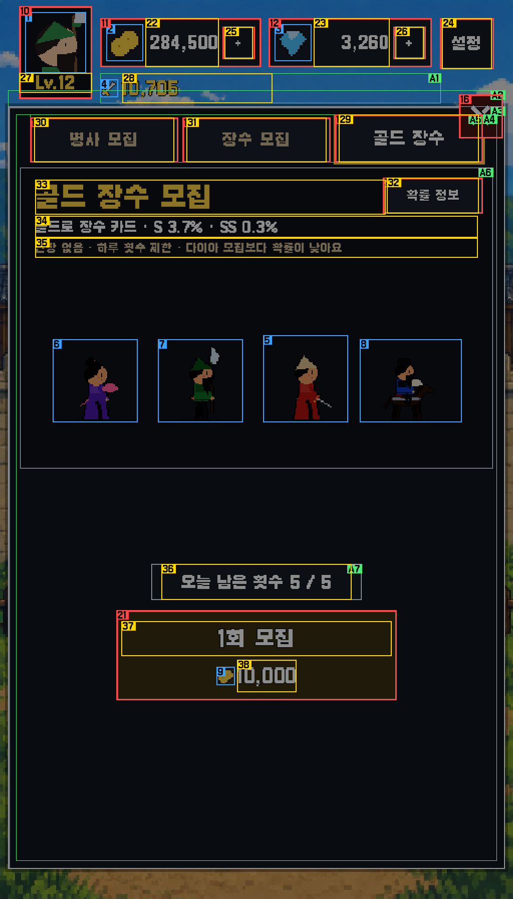

**영역 (컨테이너)**

| A | x, y | 크기 | 노드 |
|---|---|---|---|
| A1 | 200, 146 | 680 × 60 | `screen_layer/Lobby/@Control@25` |
| A2 | 16, 180 | 992 × 1552 | `dialog_layer/@Control@40` |
| A3 | 16, 212 | 992 × 1520 | `dialog_layer/@Control@40/@Control@41` |
| A4 | 32, 228 | 960 × 1488 | `dialog_layer/@Control@40/@Control@42` |
| A5 | 60, 228 | 904 × 96 | `dialog_layer/@Control@40/@Control@42/Recruit/@Control@47` |
| A6 | 40, 334 | 944 × 600 | `dialog_layer/@Control@40/@Control@42/Recruit/@Control@48` |
| A7 | 302, 1124 | 420 × 72 | `dialog_layer/@Control@40/@Control@42/Recruit/@Control@54` |

**점검: 문제 없음**

**자리**

| # | 종류 | x, y | 크기 | 내용 |
|---|---|---|---|---|
| 1 | 그림 | 50, 24 | 122 × 122 | 얼굴 guanyu |
| 2 | 그림 | 212, 48 | 74 × 74 | 아이콘 icon_gold |
| 3 | 그림 | 548, 48 | 74 × 74 | 아이콘 icon_diamond |
| 4 | 그림 | 200, 158 | 36 × 36 | 아이콘 icon_sword |
| 5 | 그림 | 525, 668 | 170 × 174 | 캐릭터 동작 프레임 |
| 6 | 그림 | 105, 676 | 170 × 166 | 캐릭터 동작 프레임 |
| 7 | 그림 | 315, 676 | 170 × 166 | 캐릭터 동작 프레임 |
| 8 | 그림 | 718, 676 | 204 × 166 | 캐릭터 동작 프레임 |
| 9 | 그림 | 432, 1329 | 37 × 37 | 아이콘 icon_gold |
| 10 | 버튼 | 38, 12 | 146 × 185 | frame_portrait |
| 11 | 버튼 | 200, 36 | 321 × 98 | 284,500 |
| 12 | 버튼 | 536, 36 | 326 × 98 | 3,260 |
| 13 | 버튼 | 878, 36 | 108 × 102 | btn_settings |
| 14 | 버튼 | 444, 53 | 65 × 65 | btn_plus |
| 15 | 버튼 | 785, 53 | 65 × 65 | btn_plus |
| 16 | 버튼 | 916, 188 | 88 × 88 | tab_red |
| 17 | 버튼 | 668, 228 | 296 × 96 | 골드 장수 |
| 18 | 버튼 | 60, 234 | 296 × 90 | 병사 모집 |
| 19 | 버튼 | 364, 234 | 296 × 90 | 장수 모집 |
| 20 | 버튼 | 764, 354 | 200 × 72 | 확률 정보 |
| 21 | 버튼 | 232, 1216 | 560 × 180 | 1회 모집 |
| 22 | 글자 | 290, 36 | 147 × 98 | “284,500” |
| 23 | 글자 | 626, 36 | 152 × 98 | “3,260” |
| 24 | 글자 | 882, 36 | 100 × 102 | “설정” |
| 25 | 글자 | 448, 53 | 57 × 65 | “+” |
| 26 | 글자 | 789, 53 | 57 × 65 | “+” |
| 27 | 글자 | 38, 145 | 146 × 40 | “Lv.12” |
| 28 | 글자 | 244, 146 | 300 × 60 | “10,705” |
| 29 | 글자 | 676, 228 | 280 × 96 | “골드 장수” |
| 30 | 글자 | 68, 234 | 280 × 90 | “병사 모집” |
| 31 | 글자 | 372, 234 | 280 × 90 | “장수 모집” |
| 32 | 글자 | 772, 354 | 184 × 72 | “확률 정보” |
| 33 | 글자 | 70, 358 | 700 × 70 | “골드 장수 모집” |
| 34 | 글자 | 70, 430 | 884 × 44 | “골드로 장수 카드 · S 3.7% · SS 0.3%” |
| 35 | 글자 | 70, 474 | 884 × 40 | “천장 없음 · 하루 횟수 제한 · 다이아 모집보다 …” |
| 36 | 글자 | 322, 1124 | 380 × 72 | “오늘 남은 횟수 5 / 5” |
| 37 | 글자 | 242, 1238 | 540 × 70 | “1회 모집” |
| 38 | 글자 | 473, 1315 | 119 × 65 | “10,000” |

판(테두리 틀): `panel_ctrl` 992×1520, `panel_slot` 944×600, `tab_yellow` 560×180, `panel_chip` 326×98, `panel_chip` 321×98, `panel_chip` 420×72, `tab_wood_on` 296×96, `frame_portrait` 146×185, `tab_wood` 296×90, `tab_wood` 200×72, `btn_settings` 108×102, `tab_red` 88×88, `btn_plus` 65×65

## 상점 — 추천 — `14_shop_rec`

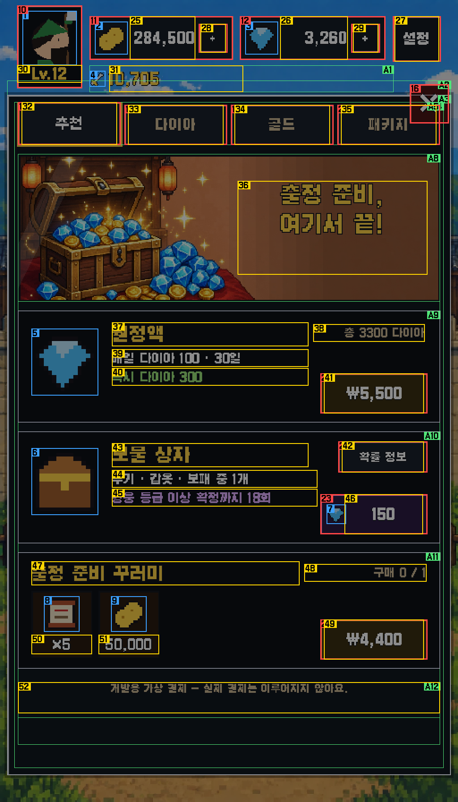

**영역 (컨테이너)**

| A | x, y | 크기 | 노드 |
|---|---|---|---|
| A1 | 200, 146 | 680 × 60 | `screen_layer/Lobby/@Control@25` |
| A2 | 16, 180 | 992 × 1552 | `dialog_layer/@Control@40` |
| A3 | 16, 212 | 992 × 1520 | `dialog_layer/@Control@40/@Control@41` |
| A4 | 32, 228 | 960 × 1488 | `dialog_layer/@Control@40/@Control@42` |
| A5 | 40, 228 | 944 × 96 | `dialog_layer/@Control@40/@Control@42/Shop/@Control@48` |
| A6 | 40, 344 | 944 × 1320 | `dialog_layer/@Control@40/@Control@42/Shop/@ScrollContainer@52` |
| A7 | 40, 344 | 944 × 1260 | `dialog_layer/@Control@40/@Control@42/Shop/@ScrollContainer@52/@Control@51` |
| A8 | 40, 344 | 944 × 330 | `dialog_layer/@Control@40/@Control@42/Shop/@ScrollContainer@52/@Control@51/@Control@53` |
| A9 | 40, 694 | 944 × 250 | `dialog_layer/@Control@40/@Control@42/Shop/@ScrollContainer@52/@Control@51/@BaseButton@54` |
| A10 | 40, 964 | 944 × 250 | `dialog_layer/@Control@40/@Control@42/Shop/@ScrollContainer@52/@Control@51/@BaseButton@56` |
| A11 | 40, 1234 | 944 × 260 | `dialog_layer/@Control@40/@Control@42/Shop/@ScrollContainer@52/@Control@51/@BaseButton@59` |
| A12 | 40, 1524 | 944 × 70 | `dialog_layer/@Control@40/@Control@42/Shop/@ScrollContainer@52/@Control@51/@Control@61` |

**점검: 문제 없음**

**자리**

| # | 종류 | x, y | 크기 | 내용 |
|---|---|---|---|---|
| 1 | 그림 | 50, 24 | 122 × 122 | 얼굴 guanyu |
| 2 | 그림 | 212, 48 | 74 × 74 | 아이콘 icon_gold |
| 3 | 그림 | 548, 48 | 74 × 74 | 아이콘 icon_diamond |
| 4 | 그림 | 200, 158 | 36 × 36 | 아이콘 icon_sword |
| 배경 | 그림 | 45, 349 | 934 × 320 | 배경 shop_banner |
| 5 | 그림 | 70, 734 | 150 × 150 | 아이콘 icon_diamond |
| 6 | 그림 | 70, 1001 | 150 × 150 | 아이콘 icon_chest |
| 7 | 그림 | 730, 1127 | 44 × 44 | 아이콘 icon_diamond |
| 8 | 그림 | 98, 1332 | 80 × 80 | 아이콘 ic_scroll |
| 9 | 그림 | 248, 1332 | 80 × 80 | 아이콘 icon_gold |
| 10 | 버튼 | 38, 12 | 146 × 185 | frame_portrait |
| 11 | 버튼 | 200, 36 | 321 × 98 | 284,500 |
| 12 | 버튼 | 536, 36 | 326 × 98 | 3,260 |
| 13 | 버튼 | 878, 36 | 108 × 102 | btn_settings |
| 14 | 버튼 | 444, 53 | 65 × 65 | btn_plus |
| 15 | 버튼 | 785, 53 | 65 × 65 | btn_plus |
| 16 | 버튼 | 916, 188 | 88 × 88 | tab_red |
| 17 | 버튼 | 40, 228 | 230 × 96 | 추천 |
| 18 | 버튼 | 278, 234 | 230 × 90 | 다이아 |
| 19 | 버튼 | 516, 234 | 230 × 90 | 골드 |
| 20 | 버튼 | 754, 234 | 230 × 90 | 패키지 |
| 21 | 버튼 | 716, 834 | 240 × 90 | ₩5,500 |
| 22 | 버튼 | 756, 986 | 200 × 70 | 확률 정보 |
| 23 | 버튼 | 716, 1104 | 240 × 90 | 150 |
| 24 | 버튼 | 716, 1384 | 240 × 90 | ₩4,400 |
| 25 | 글자 | 290, 36 | 147 × 98 | “284,500” |
| 26 | 글자 | 626, 36 | 152 × 98 | “3,260” |
| 27 | 글자 | 882, 36 | 100 × 102 | “설정” |
| 28 | 글자 | 448, 53 | 57 × 65 | “+” |
| 29 | 글자 | 789, 53 | 57 × 65 | “+” |
| 30 | 글자 | 38, 145 | 146 × 40 | “Lv.12” |
| 31 | 글자 | 244, 146 | 300 × 60 | “10,705” |
| 32 | 글자 | 48, 228 | 214 × 96 | “추천” |
| 33 | 글자 | 286, 234 | 214 × 90 | “다이아” |
| 34 | 글자 | 524, 234 | 214 × 90 | “골드” |
| 35 | 글자 | 762, 234 | 214 × 90 | “패키지” |
| 36 | 글자 | 531, 404 | 425 × 210 | “출정 준비, 여기서 끝!” |
| 37 | 글자 | 250, 720 | 440 × 54 | “월정액” |
| 38 | 글자 | 700, 724 | 250 × 40 | “총 3300 다이아” |
| 39 | 글자 | 250, 780 | 440 × 40 | “매일 다이아 100 · 30일” |
| 40 | 글자 | 250, 822 | 440 × 40 | “즉시 다이아 300” |
| 41 | 글자 | 724, 834 | 224 × 90 | “₩5,500” |
| 42 | 글자 | 764, 986 | 184 × 70 | “확률 정보” |
| 43 | 글자 | 250, 990 | 440 × 54 | “보물 상자” |
| 44 | 글자 | 250, 1050 | 460 × 40 | “무기 · 갑옷 · 보패 중 1개” |
| 45 | 글자 | 250, 1092 | 460 × 40 | “영웅 등급 이상 확정까지 18회” |
| 46 | 글자 | 770, 1104 | 176 × 90 | “150” |
| 47 | 글자 | 70, 1254 | 600 × 54 | “출정 준비 꾸러미” |
| 48 | 글자 | 680, 1260 | 274 × 40 | “구매 0 / 1” |
| 49 | 글자 | 724, 1384 | 224 × 90 | “₩4,400” |
| 50 | 글자 | 70, 1418 | 136 × 44 | “×5” |
| 51 | 글자 | 220, 1418 | 136 × 44 | “50,000” |
| 52 | 글자 | 40, 1524 | 944 × 70 | “개발용 가상 결제 — 실제 결제는 이루어지지 않아요…” |

판(테두리 틀): `panel_ctrl` 992×1520, `panel_slot` 944×260, `panel_slot` 944×250, `panel_chip` 326×98, `panel_chip` 321×98, `frame_portrait` 146×185, `tab_wood_on` 230×96, `tab_yellow` 240×90, `tab_purple` 240×90, `tab_wood` 230×90, `tab_wood` 200×70, `btn_settings` 108×102, `tab_red` 88×88, `btn_plus` 65×65

## 상점 — 다이아 — `15_shop_dia`

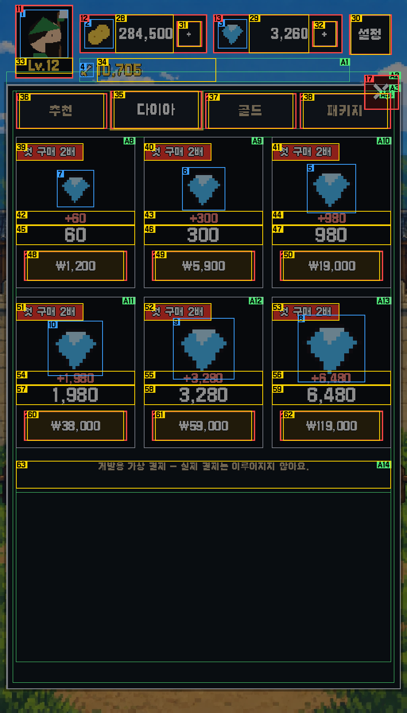

**영역 (컨테이너)**

| A | x, y | 크기 | 노드 |
|---|---|---|---|
| A1 | 200, 146 | 680 × 60 | `screen_layer/Lobby/@Control@25` |
| A2 | 16, 180 | 992 × 1552 | `dialog_layer/@Control@40` |
| A3 | 16, 212 | 992 × 1520 | `dialog_layer/@Control@40/@Control@41` |
| A4 | 32, 228 | 960 × 1488 | `dialog_layer/@Control@40/@Control@42` |
| A5 | 40, 228 | 944 × 96 | `dialog_layer/@Control@40/@Control@42/Shop/@Control@48` |
| A6 | 40, 344 | 944 × 1320 | `dialog_layer/@Control@40/@Control@42/Shop/@ScrollContainer@52` |
| A7 | 40, 344 | 944 × 894 | `dialog_layer/@Control@40/@Control@42/Shop/@ScrollContainer@52/@Control@51` |
| A8 | 40, 344 | 300 × 380 | `dialog_layer/@Control@40/@Control@42/Shop/@ScrollContainer@52/@Control@51/@BaseButton@53` |
| A9 | 362, 344 | 300 × 380 | `dialog_layer/@Control@40/@Control@42/Shop/@ScrollContainer@52/@Control@51/@BaseButton@55` |
| A10 | 684, 344 | 300 × 380 | `dialog_layer/@Control@40/@Control@42/Shop/@ScrollContainer@52/@Control@51/@BaseButton@57` |
| A11 | 40, 746 | 300 × 380 | `dialog_layer/@Control@40/@Control@42/Shop/@ScrollContainer@52/@Control@51/@BaseButton@59` |
| A12 | 362, 746 | 300 × 380 | `dialog_layer/@Control@40/@Control@42/Shop/@ScrollContainer@52/@Control@51/@BaseButton@61` |
| A13 | 684, 746 | 300 × 380 | `dialog_layer/@Control@40/@Control@42/Shop/@ScrollContainer@52/@Control@51/@BaseButton@63` |
| A14 | 40, 1158 | 944 × 70 | `dialog_layer/@Control@40/@Control@42/Shop/@ScrollContainer@52/@Control@51/@Control@65` |

**점검: 문제 없음**

**자리**

| # | 종류 | x, y | 크기 | 내용 |
|---|---|---|---|---|
| 1 | 그림 | 50, 24 | 122 × 122 | 얼굴 guanyu |
| 2 | 그림 | 212, 48 | 74 × 74 | 아이콘 icon_gold |
| 3 | 그림 | 548, 48 | 74 × 74 | 아이콘 icon_diamond |
| 4 | 그림 | 200, 158 | 36 × 36 | 아이콘 icon_sword |
| 5 | 그림 | 772, 412 | 124 × 124 | 아이콘 icon_diamond |
| 6 | 그림 | 458, 420 | 109 × 109 | 아이콘 icon_diamond |
| 7 | 그림 | 143, 427 | 94 × 94 | 아이콘 icon_diamond |
| 8 | 그림 | 749, 791 | 170 × 170 | 아이콘 icon_diamond |
| 9 | 그림 | 435, 799 | 155 × 155 | 아이콘 icon_diamond |
| 10 | 그림 | 120, 806 | 139 × 139 | 아이콘 icon_diamond |
| 11 | 버튼 | 38, 12 | 146 × 185 | frame_portrait |
| 12 | 버튼 | 200, 36 | 321 × 98 | 284,500 |
| 13 | 버튼 | 536, 36 | 326 × 98 | 3,260 |
| 14 | 버튼 | 878, 36 | 108 × 102 | btn_settings |
| 15 | 버튼 | 444, 53 | 65 × 65 | btn_plus |
| 16 | 버튼 | 785, 53 | 65 × 65 | btn_plus |
| 17 | 버튼 | 916, 188 | 88 × 88 | tab_red |
| 18 | 버튼 | 278, 228 | 230 × 96 | 다이아 |
| 19 | 버튼 | 40, 234 | 230 × 90 | 추천 |
| 20 | 버튼 | 516, 234 | 230 × 90 | 골드 |
| 21 | 버튼 | 754, 234 | 230 × 90 | 패키지 |
| 22 | 버튼 | 60, 630 | 260 × 76 | ₩1,200 |
| 23 | 버튼 | 382, 630 | 260 × 76 | ₩5,900 |
| 24 | 버튼 | 704, 630 | 260 × 76 | ₩19,000 |
| 25 | 버튼 | 60, 1032 | 260 × 76 | ₩38,000 |
| 26 | 버튼 | 382, 1032 | 260 × 76 | ₩59,000 |
| 27 | 버튼 | 704, 1032 | 260 × 76 | ₩119,000 |
| 28 | 글자 | 290, 36 | 147 × 98 | “284,500” |
| 29 | 글자 | 626, 36 | 152 × 98 | “3,260” |
| 30 | 글자 | 882, 36 | 100 × 102 | “설정” |
| 31 | 글자 | 448, 53 | 57 × 65 | “+” |
| 32 | 글자 | 789, 53 | 57 × 65 | “+” |
| 33 | 글자 | 38, 145 | 146 × 40 | “Lv.12” |
| 34 | 글자 | 244, 146 | 300 × 60 | “10,705” |
| 35 | 글자 | 286, 228 | 214 × 96 | “다이아” |
| 36 | 글자 | 48, 234 | 214 × 90 | “추천” |
| 37 | 글자 | 524, 234 | 214 × 90 | “골드” |
| 38 | 글자 | 762, 234 | 214 × 90 | “패키지” |
| 39 | 글자 | 40, 360 | 170 × 44 | “첫 구매 2배” |
| 40 | 글자 | 362, 360 | 170 × 44 | “첫 구매 2배” |
| 41 | 글자 | 684, 360 | 170 × 44 | “첫 구매 2배” |
| 42 | 글자 | 40, 530 | 300 × 36 | “+60” |
| 43 | 글자 | 362, 530 | 300 × 36 | “+300” |
| 44 | 글자 | 684, 530 | 300 × 36 | “+980” |
| 45 | 글자 | 40, 566 | 300 × 50 | “60” |
| 46 | 글자 | 362, 566 | 300 × 50 | “300” |
| 47 | 글자 | 684, 566 | 300 × 50 | “980” |
| 48 | 글자 | 68, 630 | 244 × 76 | “₩1,200” |
| 49 | 글자 | 390, 630 | 244 × 76 | “₩5,900” |
| 50 | 글자 | 712, 630 | 244 × 76 | “₩19,000” |
| 51 | 글자 | 40, 762 | 170 × 44 | “첫 구매 2배” |
| 52 | 글자 | 362, 762 | 170 × 44 | “첫 구매 2배” |
| 53 | 글자 | 684, 762 | 170 × 44 | “첫 구매 2배” |
| 54 | 글자 | 40, 932 | 300 × 36 | “+1,980” |
| 55 | 글자 | 362, 932 | 300 × 36 | “+3,280” |
| 56 | 글자 | 684, 932 | 300 × 36 | “+6,480” |
| 57 | 글자 | 40, 968 | 300 × 50 | “1,980” |
| 58 | 글자 | 362, 968 | 300 × 50 | “3,280” |
| 59 | 글자 | 684, 968 | 300 × 50 | “6,480” |
| 60 | 글자 | 68, 1032 | 244 × 76 | “₩38,000” |
| 61 | 글자 | 390, 1032 | 244 × 76 | “₩59,000” |
| 62 | 글자 | 712, 1032 | 244 × 76 | “₩119,000” |
| 63 | 글자 | 40, 1158 | 944 × 70 | “개발용 가상 결제 — 실제 결제는 이루어지지 않아요…” |

판(테두리 틀): `panel_ctrl` 992×1520, `panel_slot` 300×380, `panel_chip` 326×98, `panel_chip` 321×98, `frame_portrait` 146×185, `tab_wood_on` 230×96, `tab_wood` 230×90, `tab_yellow` 260×76, `btn_settings` 108×102, `tab_red` 88×88, `btn_plus` 65×65

## 상점 — 골드 — `16_shop_gold`

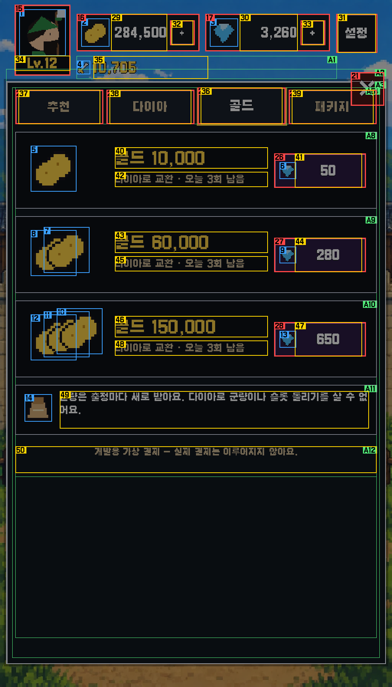

**영역 (컨테이너)**

| A | x, y | 크기 | 노드 |
|---|---|---|---|
| A1 | 200, 146 | 680 × 60 | `screen_layer/Lobby/@Control@25` |
| A2 | 16, 180 | 992 × 1552 | `dialog_layer/@Control@40` |
| A3 | 16, 212 | 992 × 1520 | `dialog_layer/@Control@40/@Control@41` |
| A4 | 32, 228 | 960 × 1488 | `dialog_layer/@Control@40/@Control@42` |
| A5 | 40, 228 | 944 × 96 | `dialog_layer/@Control@40/@Control@42/Shop/@Control@48` |
| A6 | 40, 344 | 944 × 1320 | `dialog_layer/@Control@40/@Control@42/Shop/@ScrollContainer@52` |
| A7 | 40, 344 | 944 × 900 | `dialog_layer/@Control@40/@Control@42/Shop/@ScrollContainer@52/@Control@51` |
| A8 | 40, 344 | 944 × 200 | `dialog_layer/@Control@40/@Control@42/Shop/@ScrollContainer@52/@Control@51/@BaseButton@53` |
| A9 | 40, 564 | 944 × 200 | `dialog_layer/@Control@40/@Control@42/Shop/@ScrollContainer@52/@Control@51/@BaseButton@55` |
| A10 | 40, 784 | 944 × 200 | `dialog_layer/@Control@40/@Control@42/Shop/@ScrollContainer@52/@Control@51/@BaseButton@57` |
| A11 | 40, 1004 | 944 × 130 | `dialog_layer/@Control@40/@Control@42/Shop/@ScrollContainer@52/@Control@51/@Control@59` |
| A12 | 40, 1164 | 944 × 70 | `dialog_layer/@Control@40/@Control@42/Shop/@ScrollContainer@52/@Control@51/@Control@60` |

**점검: 문제 없음**

**자리**

| # | 종류 | x, y | 크기 | 내용 |
|---|---|---|---|---|
| 1 | 그림 | 50, 24 | 122 × 122 | 얼굴 guanyu |
| 2 | 그림 | 212, 48 | 74 × 74 | 아이콘 icon_gold |
| 3 | 그림 | 548, 48 | 74 × 74 | 아이콘 icon_diamond |
| 4 | 그림 | 200, 158 | 36 × 36 | 아이콘 icon_sword |
| 5 | 그림 | 80, 380 | 120 × 120 | 아이콘 icon_gold |
| 6 | 그림 | 730, 423 | 44 × 44 | 아이콘 icon_diamond |
| 7 | 그림 | 114, 592 | 120 × 120 | 아이콘 icon_gold |
| 8 | 그림 | 80, 600 | 120 × 120 | 아이콘 icon_gold |
| 9 | 그림 | 730, 643 | 44 × 44 | 아이콘 icon_diamond |
| 10 | 그림 | 148, 804 | 120 × 120 | 아이콘 icon_gold |
| 11 | 그림 | 114, 812 | 120 × 120 | 아이콘 icon_gold |
| 12 | 그림 | 80, 820 | 120 × 120 | 아이콘 icon_gold |
| 13 | 그림 | 730, 863 | 44 × 44 | 아이콘 icon_diamond |
| 14 | 그림 | 64, 1028 | 72 × 72 | 아이콘 icon_rice |
| 15 | 버튼 | 38, 12 | 146 × 185 | frame_portrait |
| 16 | 버튼 | 200, 36 | 321 × 98 | 284,500 |
| 17 | 버튼 | 536, 36 | 326 × 98 | 3,260 |
| 18 | 버튼 | 878, 36 | 108 × 102 | btn_settings |
| 19 | 버튼 | 444, 53 | 65 × 65 | btn_plus |
| 20 | 버튼 | 785, 53 | 65 × 65 | btn_plus |
| 21 | 버튼 | 916, 188 | 88 × 88 | tab_red |
| 22 | 버튼 | 516, 228 | 230 × 96 | 골드 |
| 23 | 버튼 | 40, 234 | 230 × 90 | 추천 |
| 24 | 버튼 | 278, 234 | 230 × 90 | 다이아 |
| 25 | 버튼 | 754, 234 | 230 × 90 | 패키지 |
| 26 | 버튼 | 716, 400 | 240 × 90 | 50 |
| 27 | 버튼 | 716, 620 | 240 × 90 | 280 |
| 28 | 버튼 | 716, 840 | 240 × 90 | 650 |
| 29 | 글자 | 290, 36 | 147 × 98 | “284,500” |
| 30 | 글자 | 626, 36 | 152 × 98 | “3,260” |
| 31 | 글자 | 882, 36 | 100 × 102 | “설정” |
| 32 | 글자 | 448, 53 | 57 × 65 | “+” |
| 33 | 글자 | 789, 53 | 57 × 65 | “+” |
| 34 | 글자 | 38, 145 | 146 × 40 | “Lv.12” |
| 35 | 글자 | 244, 146 | 300 × 60 | “10,705” |
| 36 | 글자 | 524, 228 | 214 × 96 | “골드” |
| 37 | 글자 | 48, 234 | 214 × 90 | “추천” |
| 38 | 글자 | 286, 234 | 214 × 90 | “다이아” |
| 39 | 글자 | 762, 234 | 214 × 90 | “패키지” |
| 40 | 글자 | 300, 384 | 400 × 56 | “골드 10,000” |
| 41 | 글자 | 770, 400 | 176 × 90 | “50” |
| 42 | 글자 | 300, 448 | 400 × 40 | “다이아로 교환 · 오늘 3회 남음” |
| 43 | 글자 | 300, 604 | 400 × 56 | “골드 60,000” |
| 44 | 글자 | 770, 620 | 176 × 90 | “280” |
| 45 | 글자 | 300, 668 | 400 × 40 | “다이아로 교환 · 오늘 3회 남음” |
| 46 | 글자 | 300, 824 | 400 × 56 | “골드 150,000” |
| 47 | 글자 | 770, 840 | 176 × 90 | “650” |
| 48 | 글자 | 300, 888 | 400 × 40 | “다이아로 교환 · 오늘 3회 남음” |
| 49 | 글자 | 156, 1020 | 808 × 98 | “군량은 출정마다 새로 받아요. 다이아로 군량이나 슬…” |
| 50 | 글자 | 40, 1164 | 944 × 70 | “개발용 가상 결제 — 실제 결제는 이루어지지 않아요…” |

판(테두리 틀): `panel_ctrl` 992×1520, `panel_slot` 944×200, `panel_slot` 944×130, `panel_chip` 326×98, `panel_chip` 321×98, `frame_portrait` 146×185, `tab_wood_on` 230×96, `tab_purple` 240×90, `tab_wood` 230×90, `btn_settings` 108×102, `tab_red` 88×88, `btn_plus` 65×65

## 상점 — 패키지 — `17_shop_pack`

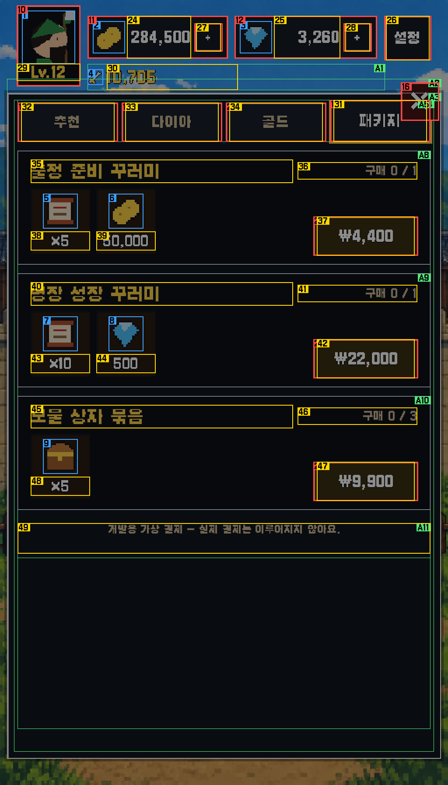

**영역 (컨테이너)**

| A | x, y | 크기 | 노드 |
|---|---|---|---|
| A1 | 200, 146 | 680 × 60 | `screen_layer/Lobby/@Control@25` |
| A2 | 16, 180 | 992 × 1552 | `dialog_layer/@Control@40` |
| A3 | 16, 212 | 992 × 1520 | `dialog_layer/@Control@40/@Control@41` |
| A4 | 32, 228 | 960 × 1488 | `dialog_layer/@Control@40/@Control@42` |
| A5 | 40, 228 | 944 × 96 | `dialog_layer/@Control@40/@Control@42/Shop/@Control@48` |
| A6 | 40, 344 | 944 × 1320 | `dialog_layer/@Control@40/@Control@42/Shop/@ScrollContainer@52` |
| A7 | 40, 344 | 944 × 930 | `dialog_layer/@Control@40/@Control@42/Shop/@ScrollContainer@52/@Control@51` |
| A8 | 40, 344 | 944 × 260 | `dialog_layer/@Control@40/@Control@42/Shop/@ScrollContainer@52/@Control@51/@BaseButton@53` |
| A9 | 40, 624 | 944 × 260 | `dialog_layer/@Control@40/@Control@42/Shop/@ScrollContainer@52/@Control@51/@BaseButton@55` |
| A10 | 40, 904 | 944 × 260 | `dialog_layer/@Control@40/@Control@42/Shop/@ScrollContainer@52/@Control@51/@BaseButton@57` |
| A11 | 40, 1194 | 944 × 70 | `dialog_layer/@Control@40/@Control@42/Shop/@ScrollContainer@52/@Control@51/@Control@59` |

**점검: 문제 없음**

**자리**

| # | 종류 | x, y | 크기 | 내용 |
|---|---|---|---|---|
| 1 | 그림 | 50, 24 | 122 × 122 | 얼굴 guanyu |
| 2 | 그림 | 212, 48 | 74 × 74 | 아이콘 icon_gold |
| 3 | 그림 | 548, 48 | 74 × 74 | 아이콘 icon_diamond |
| 4 | 그림 | 200, 158 | 36 × 36 | 아이콘 icon_sword |
| 5 | 그림 | 98, 442 | 80 × 80 | 아이콘 ic_scroll |
| 6 | 그림 | 248, 442 | 80 × 80 | 아이콘 icon_gold |
| 7 | 그림 | 98, 722 | 80 × 80 | 아이콘 ic_scroll |
| 8 | 그림 | 248, 722 | 80 × 80 | 아이콘 icon_diamond |
| 9 | 그림 | 98, 1002 | 80 × 80 | 아이콘 icon_chest |
| 10 | 버튼 | 38, 12 | 146 × 185 | frame_portrait |
| 11 | 버튼 | 200, 36 | 321 × 98 | 284,500 |
| 12 | 버튼 | 536, 36 | 326 × 98 | 3,260 |
| 13 | 버튼 | 878, 36 | 108 × 102 | btn_settings |
| 14 | 버튼 | 444, 53 | 65 × 65 | btn_plus |
| 15 | 버튼 | 785, 53 | 65 × 65 | btn_plus |
| 16 | 버튼 | 916, 188 | 88 × 88 | tab_red |
| 17 | 버튼 | 754, 228 | 230 × 96 | 패키지 |
| 18 | 버튼 | 40, 234 | 230 × 90 | 추천 |
| 19 | 버튼 | 278, 234 | 230 × 90 | 다이아 |
| 20 | 버튼 | 516, 234 | 230 × 90 | 골드 |
| 21 | 버튼 | 716, 494 | 240 × 90 | ₩4,400 |
| 22 | 버튼 | 716, 774 | 240 × 90 | ₩22,000 |
| 23 | 버튼 | 716, 1054 | 240 × 90 | ₩9,900 |
| 24 | 글자 | 290, 36 | 147 × 98 | “284,500” |
| 25 | 글자 | 626, 36 | 152 × 98 | “3,260” |
| 26 | 글자 | 882, 36 | 100 × 102 | “설정” |
| 27 | 글자 | 448, 53 | 57 × 65 | “+” |
| 28 | 글자 | 789, 53 | 57 × 65 | “+” |
| 29 | 글자 | 38, 145 | 146 × 40 | “Lv.12” |
| 30 | 글자 | 244, 146 | 300 × 60 | “10,705” |
| 31 | 글자 | 762, 228 | 214 × 96 | “패키지” |
| 32 | 글자 | 48, 234 | 214 × 90 | “추천” |
| 33 | 글자 | 286, 234 | 214 × 90 | “다이아” |
| 34 | 글자 | 524, 234 | 214 × 90 | “골드” |
| 35 | 글자 | 70, 364 | 600 × 54 | “출정 준비 꾸러미” |
| 36 | 글자 | 680, 370 | 274 × 40 | “구매 0 / 1” |
| 37 | 글자 | 724, 494 | 224 × 90 | “₩4,400” |
| 38 | 글자 | 70, 528 | 136 × 44 | “×5” |
| 39 | 글자 | 220, 528 | 136 × 44 | “50,000” |
| 40 | 글자 | 70, 644 | 600 × 54 | “명장 성장 꾸러미” |
| 41 | 글자 | 680, 650 | 274 × 40 | “구매 0 / 1” |
| 42 | 글자 | 724, 774 | 224 × 90 | “₩22,000” |
| 43 | 글자 | 70, 808 | 136 × 44 | “×10” |
| 44 | 글자 | 220, 808 | 136 × 44 | “500” |
| 45 | 글자 | 70, 924 | 600 × 54 | “보물 상자 묶음” |
| 46 | 글자 | 680, 930 | 274 × 40 | “구매 0 / 3” |
| 47 | 글자 | 724, 1054 | 224 × 90 | “₩9,900” |
| 48 | 글자 | 70, 1088 | 136 × 44 | “×5” |
| 49 | 글자 | 40, 1194 | 944 × 70 | “개발용 가상 결제 — 실제 결제는 이루어지지 않아요…” |

판(테두리 틀): `panel_ctrl` 992×1520, `panel_slot` 944×260, `panel_chip` 326×98, `panel_chip` 321×98, `frame_portrait` 146×185, `tab_wood_on` 230×96, `tab_yellow` 240×90, `tab_wood` 230×90, `btn_settings` 108×102, `tab_red` 88×88, `btn_plus` 65×65

## 군웅대전 — `18_arena`

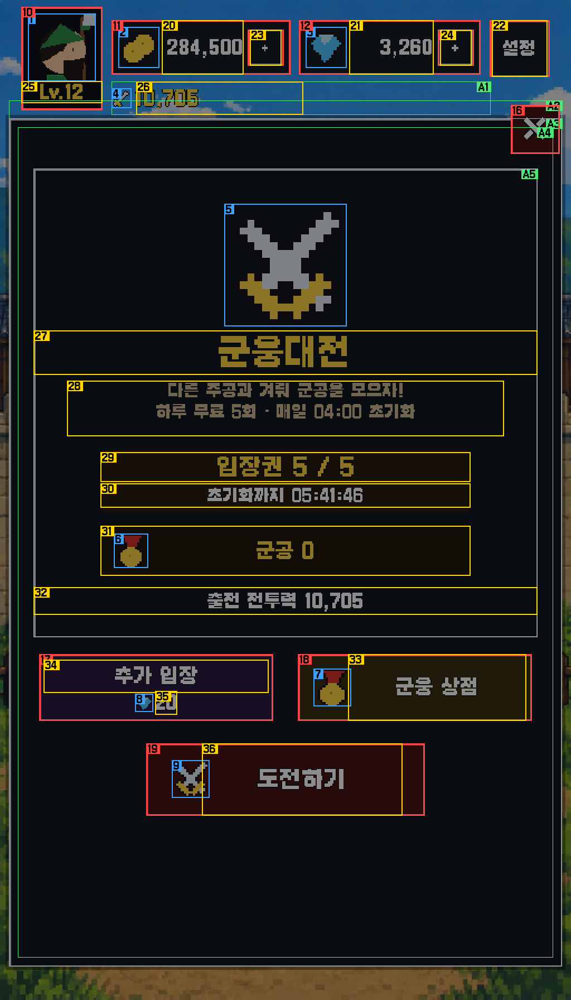

**영역 (컨테이너)**

| A | x, y | 크기 | 노드 |
|---|---|---|---|
| A1 | 200, 146 | 680 × 60 | `screen_layer/Lobby/@Control@25` |
| A2 | 16, 180 | 992 × 1552 | `dialog_layer/@Control@40` |
| A3 | 16, 212 | 992 × 1520 | `dialog_layer/@Control@40/@Control@41` |
| A4 | 32, 228 | 960 × 1488 | `dialog_layer/@Control@40/@Control@42` |
| A5 | 60, 302 | 904 × 840 | `dialog_layer/@Control@40/@Control@42/Arena/@Control@44` |

**점검: 문제 없음**

**자리**

| # | 종류 | x, y | 크기 | 내용 |
|---|---|---|---|---|
| 1 | 그림 | 50, 24 | 122 × 122 | 얼굴 guanyu |
| 2 | 그림 | 212, 48 | 74 × 74 | 아이콘 icon_gold |
| 3 | 그림 | 548, 48 | 74 × 74 | 아이콘 icon_diamond |
| 4 | 그림 | 200, 158 | 36 × 36 | 아이콘 icon_sword |
| 5 | 그림 | 402, 365 | 220 × 220 | 아이콘 icon_swords |
| 6 | 그림 | 204, 956 | 62 × 62 | 아이콘 icon_medal |
| 7 | 그림 | 562, 1198 | 68 × 68 | 아이콘 icon_medal |
| 8 | 그림 | 242, 1243 | 33 × 33 | 아이콘 icon_diamond |
| 9 | 그림 | 308, 1362 | 68 × 68 | 아이콘 icon_swords |
| 10 | 버튼 | 38, 12 | 146 × 185 | frame_portrait |
| 11 | 버튼 | 200, 36 | 321 × 98 | 284,500 |
| 12 | 버튼 | 536, 36 | 326 × 98 | 3,260 |
| 13 | 버튼 | 878, 36 | 108 × 102 | btn_settings |
| 14 | 버튼 | 444, 53 | 65 × 65 | btn_plus |
| 15 | 버튼 | 785, 53 | 65 × 65 | btn_plus |
| 16 | 버튼 | 916, 188 | 88 × 88 | tab_red |
| 17 | 버튼 | 70, 1172 | 420 × 120 | 추가 입장 |
| 18 | 버튼 | 534, 1172 | 420 × 120 | 군웅 상점 |
| 19 | 버튼 | 262, 1332 | 500 × 130 | 도전하기 |
| 20 | 글자 | 290, 36 | 147 × 98 | “284,500” |
| 21 | 글자 | 626, 36 | 152 × 98 | “3,260” |
| 22 | 글자 | 882, 36 | 100 × 102 | “설정” |
| 23 | 글자 | 448, 53 | 57 × 65 | “+” |
| 24 | 글자 | 789, 53 | 57 × 65 | “+” |
| 25 | 글자 | 38, 145 | 146 × 40 | “Lv.12” |
| 26 | 글자 | 244, 146 | 300 × 60 | “10,705” |
| 27 | 글자 | 60, 592 | 904 × 80 | “군웅대전” |
| 28 | 글자 | 120, 682 | 784 × 100 | “다른 주공과 겨뤄 군공을 모으자! 하루 무료 5회 …” |
| 29 | 글자 | 180, 810 | 664 × 54 | “입장권 5 / 5” |
| 30 | 글자 | 180, 866 | 664 × 44 | “초기화까지 05:41:46” |
| 31 | 글자 | 180, 942 | 664 × 90 | “군공 0” |
| 32 | 글자 | 60, 1052 | 904 × 50 | “출전 전투력 10,705” |
| 33 | 글자 | 624, 1172 | 320 × 120 | “군웅 상점” |
| 34 | 글자 | 78, 1182 | 404 × 60 | “추가 입장” |
| 35 | 글자 | 278, 1238 | 40 × 43 | “20” |
| 36 | 글자 | 362, 1332 | 360 × 130 | “도전하기” |

판(테두리 틀): `panel_ctrl` 992×1520, `panel_ctrl` 904×840, `tab_red` 500×130, `tab_yellow` 420×120, `tab_purple` 420×120, `panel_chip` 326×98, `panel_chip` 321×98, `frame_portrait` 146×185, `btn_settings` 108×102, `tab_red` 88×88, `btn_plus` 65×65

## 팝업 — 설정 — `20_pop_settings`

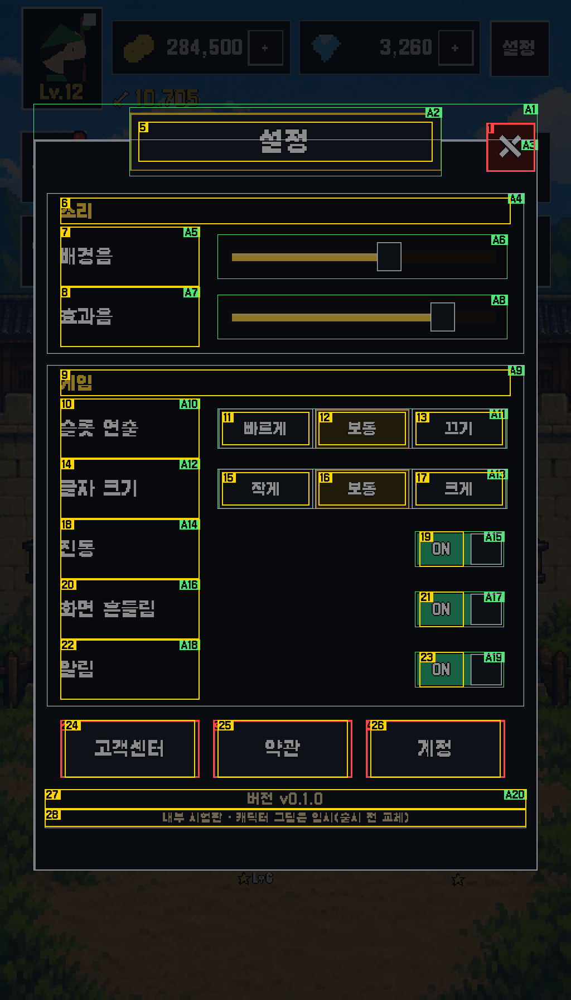

**영역 (컨테이너)**

| A | x, y | 크기 | 노드 |
|---|---|---|---|
| A1 | 60, 186 | 904 × 1374 | `popup_layer/@Control@40/@Control@42` |
| A2 | 232, 192 | 560 × 124 | `popup_layer/@Control@40/@Control@42/@Control@44` |
| A3 | 60, 250 | 904 × 1310 | `popup_layer/@Control@40/@Control@42/@Control@43` |
| A4 | 84, 346 | 856 × 288 | `popup_layer/@Control@40/@Control@42/@Control@46` |
| A5 | 108, 406 | 250 × 108 | `popup_layer/@Control@40/@Control@42/@Control@47` |
| A6 | 390, 420 | 520 × 80 | `popup_layer/@Control@40/@Control@42/@Control@48` |
| A7 | 108, 514 | 250 × 108 | `popup_layer/@Control@40/@Control@42/@Control@49` |
| A8 | 390, 528 | 520 × 80 | `popup_layer/@Control@40/@Control@42/@Control@50` |
| A9 | 84, 654 | 856 × 612 | `popup_layer/@Control@40/@Control@42/@Control@51` |
| A10 | 108, 714 | 250 × 108 | `popup_layer/@Control@40/@Control@42/@Control@52` |
| A11 | 390, 732 | 520 × 72 | `popup_layer/@Control@40/@Control@42/@Control@53` |
| A12 | 108, 822 | 250 × 108 | `popup_layer/@Control@40/@Control@42/@Control@54` |
| A13 | 390, 840 | 520 × 72 | `popup_layer/@Control@40/@Control@42/@Control@55` |
| A14 | 108, 930 | 250 × 108 | `popup_layer/@Control@40/@Control@42/@Control@56` |
| A15 | 744, 952 | 160 × 64 | `popup_layer/@Control@40/@Control@42/@Control@57` |
| A16 | 108, 1038 | 250 × 108 | `popup_layer/@Control@40/@Control@42/@Control@58` |
| A17 | 744, 1060 | 160 × 64 | `popup_layer/@Control@40/@Control@42/@Control@59` |
| A18 | 108, 1146 | 250 × 108 | `popup_layer/@Control@40/@Control@42/@Control@60` |
| A19 | 744, 1168 | 160 × 64 | `popup_layer/@Control@40/@Control@42/@Control@61` |
| A20 | 80, 1414 | 864 × 70 | `popup_layer/@Control@40/@Control@42/@Control@65` |

**점검: 문제 없음**

**자리**

| # | 종류 | x, y | 크기 | 내용 |
|---|---|---|---|---|
| 1 | 버튼 | 872, 220 | 88 × 88 | tab_red |
| 2 | 버튼 | 108, 1290 | 250 × 104 | 고객센터 |
| 3 | 버튼 | 382, 1290 | 250 × 104 | 약관 |
| 4 | 버튼 | 656, 1290 | 250 × 104 | 계정 |
| 5 | 글자 | 248, 218 | 528 × 72 | “설정” |
| 6 | 글자 | 108, 354 | 808 × 48 | “소리” |
| 7 | 글자 | 108, 406 | 250 × 108 | “배경음” |
| 8 | 글자 | 108, 514 | 250 × 108 | “효과음” |
| 9 | 글자 | 108, 662 | 808 × 48 | “게임” |
| 10 | 글자 | 108, 714 | 250 × 108 | “슬롯 연출” |
| 11 | 글자 | 398, 738 | 157 × 60 | “빠르게” |
| 12 | 글자 | 571, 738 | 157 × 60 | “보통” |
| 13 | 글자 | 745, 738 | 157 × 60 | “끄기” |
| 14 | 글자 | 108, 822 | 250 × 108 | “글자 크기” |
| 15 | 글자 | 398, 846 | 157 × 60 | “작게” |
| 16 | 글자 | 571, 846 | 157 × 60 | “보통” |
| 17 | 글자 | 745, 846 | 157 × 60 | “크게” |
| 18 | 글자 | 108, 930 | 250 × 108 | “진동” |
| 19 | 글자 | 752, 952 | 80 × 64 | “ON” |
| 20 | 글자 | 108, 1038 | 250 × 108 | “화면 흔들림” |
| 21 | 글자 | 752, 1060 | 80 × 64 | “ON” |
| 22 | 글자 | 108, 1146 | 250 × 108 | “알림” |
| 23 | 글자 | 752, 1168 | 80 × 64 | “ON” |
| 24 | 글자 | 116, 1290 | 234 × 104 | “고객센터” |
| 25 | 글자 | 390, 1290 | 234 × 104 | “약관” |
| 26 | 글자 | 664, 1290 | 234 × 104 | “계정” |
| 27 | 글자 | 80, 1414 | 864 × 36 | “버전 v0.1.0” |
| 28 | 글자 | 80, 1450 | 864 × 32 | “내부 시험판 · 캐릭터 그림은 임시(출시 전 교체)” |

판(테두리 틀): `panel_ctrl` 904×1310, `panel_slot` 856×612, `panel_slot` 856×288, `tab_wood` 250×104, `btn_small` 169×72, `tab_yellow` 169×72, `tab_red` 88×88, `btn_small` 56×56, `btn_small` 44×52

## 팝업 — 우편 — `21_pop_mail`

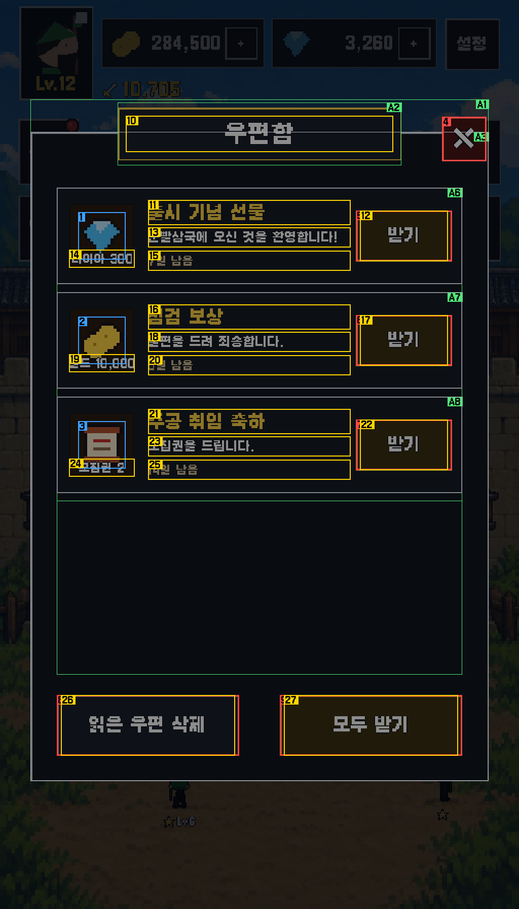

**영역 (컨테이너)**

| A | x, y | 크기 | 노드 |
|---|---|---|---|
| A1 | 60, 196 | 904 × 1344 | `popup_layer/@Control@40/@Control@42` |
| A2 | 232, 202 | 560 × 124 | `popup_layer/@Control@40/@Control@42/@Control@44` |
| A3 | 60, 260 | 904 × 1280 | `popup_layer/@Control@40/@Control@42/@Control@43` |
| A4 | 112, 370 | 800 × 960 | `popup_layer/@Control@40/@Control@42/@ScrollContainer@55` |
| A5 | 112, 370 | 800 × 618 | `popup_layer/@Control@40/@Control@42/@ScrollContainer@55/@Control@48` |
| A6 | 112, 370 | 800 × 190 | `popup_layer/@Control@40/@Control@42/@ScrollContainer@55/@Control@48/@BaseButton@50` |
| A7 | 112, 576 | 800 × 190 | `popup_layer/@Control@40/@Control@42/@ScrollContainer@55/@Control@48/@BaseButton@52` |
| A8 | 112, 782 | 800 × 190 | `popup_layer/@Control@40/@Control@42/@ScrollContainer@55/@Control@48/@BaseButton@54` |

**점검: 문제 없음**

**자리**

| # | 종류 | x, y | 크기 | 내용 |
|---|---|---|---|---|
| 1 | 그림 | 154, 418 | 94 × 94 | 아이콘 icon_diamond |
| 2 | 그림 | 154, 624 | 94 × 94 | 아이콘 icon_gold |
| 3 | 그림 | 154, 830 | 94 × 94 | 아이콘 ic_scroll |
| 4 | 버튼 | 872, 230 | 88 × 88 | tab_red |
| 5 | 버튼 | 702, 415 | 190 × 100 | 받기 |
| 6 | 버튼 | 702, 621 | 190 × 100 | 받기 |
| 7 | 버튼 | 702, 827 | 190 × 100 | 받기 |
| 8 | 버튼 | 112, 1370 | 360 × 120 | 읽은 우편 삭제 |
| 9 | 버튼 | 552, 1370 | 360 × 120 | 모두 받기 |
| 10 | 글자 | 248, 228 | 528 × 72 | “우편함” |
| 11 | 글자 | 292, 394 | 400 × 50 | “출시 기념 선물” |
| 12 | 글자 | 710, 415 | 174 × 100 | “받기” |
| 13 | 글자 | 292, 448 | 400 × 40 | “운빨삼국에 오신 것을 환영합니다!” |
| 14 | 글자 | 136, 492 | 130 × 36 | “다이아 300” |
| 15 | 글자 | 292, 494 | 400 × 40 | “7일 남음” |
| 16 | 글자 | 292, 600 | 400 × 50 | “점검 보상” |
| 17 | 글자 | 710, 621 | 174 × 100 | “받기” |
| 18 | 글자 | 292, 654 | 400 × 40 | “불편을 드려 죄송합니다.” |
| 19 | 글자 | 136, 698 | 130 × 36 | “골드 10,000” |
| 20 | 글자 | 292, 700 | 400 × 40 | “5일 남음” |
| 21 | 글자 | 292, 806 | 400 × 50 | “주공 취임 축하” |
| 22 | 글자 | 710, 827 | 174 × 100 | “받기” |
| 23 | 글자 | 292, 860 | 400 × 40 | “모집권을 드립니다.” |
| 24 | 글자 | 136, 904 | 130 × 36 | “모집권 2” |
| 25 | 글자 | 292, 906 | 400 × 40 | “14일 남음” |
| 26 | 글자 | 120, 1370 | 344 × 120 | “읽은 우편 삭제” |
| 27 | 글자 | 560, 1370 | 344 × 120 | “모두 받기” |

판(테두리 틀): `panel_ctrl` 904×1280, `panel_small` 800×190, `tab_yellow` 360×120, `tab_wood` 360×120, `tab_yellow` 190×100, `tab_red` 88×88

## 팝업 — 임무 — `22_pop_missions`

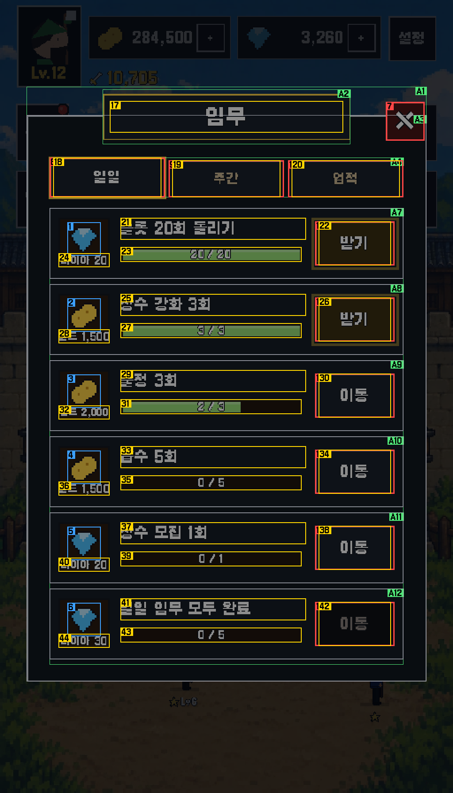

**영역 (컨테이너)**

| A | x, y | 크기 | 노드 |
|---|---|---|---|
| A1 | 60, 196 | 904 × 1344 | `popup_layer/@Control@40/@Control@42` |
| A2 | 232, 202 | 560 × 124 | `popup_layer/@Control@40/@Control@42/@Control@44` |
| A3 | 60, 260 | 904 × 1280 | `popup_layer/@Control@40/@Control@42/@Control@43` |
| A4 | 112, 356 | 800 × 90 | `popup_layer/@Control@40/@Control@42/@Control@49` |
| A5 | 112, 470 | 800 × 1020 | `popup_layer/@Control@40/@Control@42/@ScrollContainer@65` |
| A6 | 112, 470 | 800 × 1032 | `popup_layer/@Control@40/@Control@42/@ScrollContainer@65/@Control@52` |
| A7 | 112, 470 | 800 × 160 | `popup_layer/@Control@40/@Control@42/@ScrollContainer@65/@Control@52/@BaseButton@54` |
| A8 | 112, 642 | 800 × 160 | `popup_layer/@Control@40/@Control@42/@ScrollContainer@65/@Control@52/@BaseButton@56` |
| A9 | 112, 814 | 800 × 160 | `popup_layer/@Control@40/@Control@42/@ScrollContainer@65/@Control@52/@BaseButton@58` |
| A10 | 112, 986 | 800 × 160 | `popup_layer/@Control@40/@Control@42/@ScrollContainer@65/@Control@52/@BaseButton@60` |
| A11 | 112, 1158 | 800 × 160 | `popup_layer/@Control@40/@Control@42/@ScrollContainer@65/@Control@52/@BaseButton@62` |
| A12 | 112, 1330 | 800 × 160 | `popup_layer/@Control@40/@Control@42/@ScrollContainer@65/@Control@52/@BaseButton@64` |

**점검: 문제 없음**

**자리**

| # | 종류 | x, y | 크기 | 내용 |
|---|---|---|---|---|
| 1 | 그림 | 152, 502 | 76 × 76 | 아이콘 icon_diamond |
| 2 | 그림 | 152, 674 | 76 × 76 | 아이콘 icon_gold |
| 3 | 그림 | 152, 846 | 76 × 76 | 아이콘 icon_gold |
| 4 | 그림 | 152, 1018 | 76 × 76 | 아이콘 icon_gold |
| 5 | 그림 | 152, 1190 | 76 × 76 | 아이콘 icon_diamond |
| 6 | 그림 | 152, 1362 | 76 × 76 | 아이콘 icon_diamond |
| 7 | 버튼 | 872, 230 | 88 × 88 | tab_red |
| 8 | 버튼 | 112, 356 | 261 × 90 | 일일 |
| 9 | 버튼 | 381, 362 | 261 × 84 | 주간 |
| 10 | 버튼 | 651, 362 | 261 × 84 | 업적 |
| 11 | 버튼 | 712, 500 | 180 × 100 | 받기 |
| 12 | 버튼 | 712, 672 | 180 × 100 | 받기 |
| 13 | 버튼 | 712, 844 | 180 × 100 | 이동 |
| 14 | 버튼 | 712, 1016 | 180 × 100 | 이동 |
| 15 | 버튼 | 712, 1188 | 180 × 100 | 이동 |
| 16 | 버튼 | 712, 1360 | 180 × 100 | 이동 |
| 17 | 글자 | 248, 228 | 528 × 72 | “임무” |
| 18 | 글자 | 120, 356 | 245 × 90 | “일일” |
| 19 | 글자 | 389, 362 | 245 × 84 | “주간” |
| 20 | 글자 | 659, 362 | 245 × 84 | “업적” |
| 21 | 글자 | 272, 492 | 420 × 50 | “슬롯 20회 돌리기” |
| 22 | 글자 | 720, 500 | 164 × 100 | “받기” |
| 23 | 글자 | 272, 558 | 410 × 34 | “20 / 20” |
| 24 | 글자 | 132, 572 | 116 × 32 | “다이아 20” |
| 25 | 글자 | 272, 664 | 420 × 50 | “장수 강화 3회” |
| 26 | 글자 | 720, 672 | 164 × 100 | “받기” |
| 27 | 글자 | 272, 730 | 410 × 34 | “3 / 3” |
| 28 | 글자 | 132, 744 | 116 × 32 | “골드 1,500” |
| 29 | 글자 | 272, 836 | 420 × 50 | “출정 3회” |
| 30 | 글자 | 720, 844 | 164 × 100 | “이동” |
| 31 | 글자 | 272, 902 | 410 × 34 | “2 / 3” |
| 32 | 글자 | 132, 916 | 116 × 32 | “골드 2,000” |
| 33 | 글자 | 272, 1008 | 420 × 50 | “흡수 5회” |
| 34 | 글자 | 720, 1016 | 164 × 100 | “이동” |
| 35 | 글자 | 272, 1074 | 410 × 34 | “0 / 5” |
| 36 | 글자 | 132, 1088 | 116 × 32 | “골드 1,500” |
| 37 | 글자 | 272, 1180 | 420 × 50 | “장수 모집 1회” |
| 38 | 글자 | 720, 1188 | 164 × 100 | “이동” |
| 39 | 글자 | 272, 1246 | 410 × 34 | “0 / 1” |
| 40 | 글자 | 132, 1260 | 116 × 32 | “다이아 20” |
| 41 | 글자 | 272, 1352 | 420 × 50 | “일일 임무 모두 완료” |
| 42 | 글자 | 720, 1360 | 164 × 100 | “이동” |
| 43 | 글자 | 272, 1418 | 410 × 34 | “0 / 5” |
| 44 | 글자 | 132, 1432 | 116 × 32 | “다이아 30” |

판(테두리 틀): `panel_ctrl` 904×1280, `panel_small` 800×160, `tab_wood_on` 261×90, `tab_wood` 261×84, `tab_yellow` 180×100, `tab_wood` 180×100, `tab_red` 88×88

## 팝업 — 주공 정보 — `24_pop_profile`

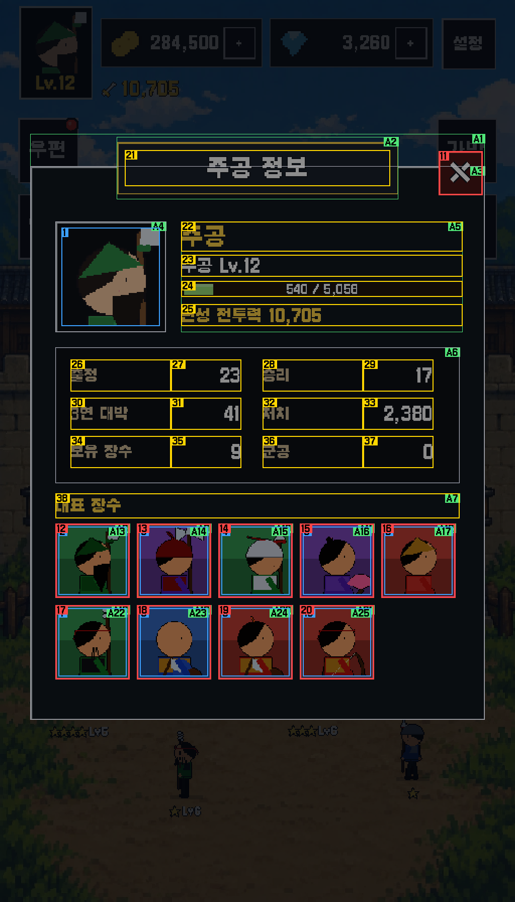

**영역 (컨테이너)**

| A | x, y | 크기 | 노드 |
|---|---|---|---|
| A1 | 60, 266 | 904 × 1164 | `popup_layer/@Control@40/@Control@42` |
| A2 | 232, 272 | 560 × 124 | `popup_layer/@Control@40/@Control@42/@Control@44` |
| A3 | 60, 330 | 904 × 1100 | `popup_layer/@Control@40/@Control@42/@Control@43` |
| A4 | 110, 440 | 220 × 220 | `popup_layer/@Control@40/@Control@42/@BaseButton@46` |
| A5 | 360, 440 | 560 × 220 | `popup_layer/@Control@40/@Control@42/@Control@47` |
| A6 | 110, 690 | 804 × 270 | `popup_layer/@Control@40/@Control@42/@Control@48` |
| A7 | 110, 980 | 804 × 50 | `popup_layer/@Control@40/@Control@42/@Control@49` |
| A8 | 110, 1040 | 148 × 148 | `popup_layer/@Control@40/@Control@42/@BaseButton@54/@Control@53` |
| A9 | 272, 1040 | 148 × 148 | `popup_layer/@Control@40/@Control@42/@BaseButton@59/@Control@58` |
| A10 | 434, 1040 | 148 × 148 | `popup_layer/@Control@40/@Control@42/@BaseButton@64/@Control@63` |
| A11 | 596, 1040 | 148 × 148 | `popup_layer/@Control@40/@Control@42/@BaseButton@69/@Control@68` |
| A12 | 758, 1040 | 148 × 148 | `popup_layer/@Control@40/@Control@42/@BaseButton@74/@Control@73` |
| A13 | 116, 1046 | 136 × 136 | `popup_layer/@Control@40/@Control@42/@BaseButton@54/@Control@53/@Control@51` |
| A14 | 278, 1046 | 136 × 136 | `popup_layer/@Control@40/@Control@42/@BaseButton@59/@Control@58/@Control@56` |
| A15 | 440, 1046 | 136 × 136 | `popup_layer/@Control@40/@Control@42/@BaseButton@64/@Control@63/@Control@61` |
| A16 | 602, 1046 | 136 × 136 | `popup_layer/@Control@40/@Control@42/@BaseButton@69/@Control@68/@Control@66` |
| A17 | 764, 1046 | 136 × 136 | `popup_layer/@Control@40/@Control@42/@BaseButton@74/@Control@73/@Control@71` |
| A18 | 110, 1202 | 148 × 148 | `popup_layer/@Control@40/@Control@42/@BaseButton@79/@Control@78` |
| A19 | 272, 1202 | 148 × 148 | `popup_layer/@Control@40/@Control@42/@BaseButton@84/@Control@83` |
| A20 | 434, 1202 | 148 × 148 | `popup_layer/@Control@40/@Control@42/@BaseButton@89/@Control@88` |
| A21 | 596, 1202 | 148 × 148 | `popup_layer/@Control@40/@Control@42/@BaseButton@94/@Control@93` |
| A22 | 116, 1208 | 136 × 136 | `popup_layer/@Control@40/@Control@42/@BaseButton@79/@Control@78/@Control@76` |
| A23 | 278, 1208 | 136 × 136 | `popup_layer/@Control@40/@Control@42/@BaseButton@84/@Control@83/@Control@81` |
| A24 | 440, 1208 | 136 × 136 | `popup_layer/@Control@40/@Control@42/@BaseButton@89/@Control@88/@Control@86` |
| A25 | 602, 1208 | 136 × 136 | `popup_layer/@Control@40/@Control@42/@BaseButton@94/@Control@93/@Control@91` |

**점검: 문제 없음**

**자리**

| # | 종류 | x, y | 크기 | 내용 |
|---|---|---|---|---|
| 1 | 그림 | 122, 452 | 196 × 196 | 얼굴 guanyu |
| 2 | 그림 | 116, 1046 | 136 × 136 | 초상 guanyu |
| 3 | 그림 | 278, 1046 | 136 × 136 | 초상 lvbu |
| 4 | 그림 | 440, 1046 | 136 × 136 | 초상 zhaoyun |
| 5 | 그림 | 602, 1046 | 136 × 136 | 초상 diaochan |
| 6 | 그림 | 764, 1046 | 136 × 136 | 초상 zhouyu |
| 7 | 그림 | 116, 1208 | 136 × 136 | 초상 zhangfei |
| 8 | 그림 | 278, 1208 | 136 × 136 | 초상 xuchu |
| 9 | 그림 | 440, 1208 | 136 × 136 | 초상 ganning |
| 10 | 그림 | 602, 1208 | 136 × 136 | 초상 taishici |
| 11 | 버튼 | 872, 300 | 88 × 88 | tab_red |
| 12 | 버튼 | 110, 1040 | 148 × 148 |  |
| 13 | 버튼 | 272, 1040 | 148 × 148 |  |
| 14 | 버튼 | 434, 1040 | 148 × 148 |  |
| 15 | 버튼 | 596, 1040 | 148 × 148 |  |
| 16 | 버튼 | 758, 1040 | 148 × 148 |  |
| 17 | 버튼 | 110, 1202 | 148 × 148 |  |
| 18 | 버튼 | 272, 1202 | 148 × 148 |  |
| 19 | 버튼 | 434, 1202 | 148 × 148 |  |
| 20 | 버튼 | 596, 1202 | 148 × 148 |  |
| 21 | 글자 | 248, 298 | 528 × 72 | “주공 정보” |
| 22 | 글자 | 360, 440 | 560 × 60 | “주공” |
| 23 | 글자 | 360, 506 | 560 × 44 | “주공 Lv.12” |
| 24 | 글자 | 360, 558 | 560 × 32 | “540 / 5,058” |
| 25 | 글자 | 360, 604 | 560 × 44 | “편성 전투력 10,705” |
| 26 | 글자 | 140, 714 | 200 × 64 | “출정” |
| 27 | 글자 | 340, 714 | 140 × 64 | “23” |
| 28 | 글자 | 522, 714 | 200 × 64 | “승리” |
| 29 | 글자 | 722, 714 | 140 × 64 | “17” |
| 30 | 글자 | 140, 790 | 200 × 64 | “3연 대박” |
| 31 | 글자 | 340, 790 | 140 × 64 | “41” |
| 32 | 글자 | 522, 790 | 200 × 64 | “처치” |
| 33 | 글자 | 722, 790 | 140 × 64 | “2,380” |
| 34 | 글자 | 140, 866 | 200 × 64 | “보유 장수” |
| 35 | 글자 | 340, 866 | 140 × 64 | “9” |
| 36 | 글자 | 522, 866 | 200 × 64 | “군공” |
| 37 | 글자 | 722, 866 | 140 × 64 | “0” |
| 38 | 글자 | 110, 980 | 804 × 50 | “대표 장수” |

판(테두리 틀): `panel_ctrl` 904×1100, `panel_slot` 804×270, `frame_portrait` 220×220, `tab_red` 88×88

## 팝업 — 군웅 상점 — `25_pop_arena_shop`

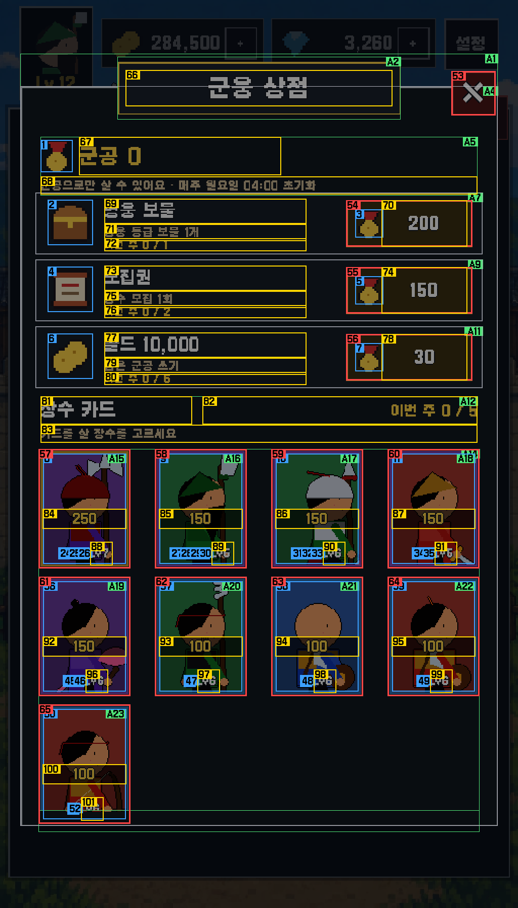

**영역 (컨테이너)**

| A | x, y | 크기 | 노드 |
|---|---|---|---|
| A1 | 40, 106 | 944 × 1524 | `popup_layer/@Control@48/@Control@50` |
| A2 | 232, 112 | 560 × 124 | `popup_layer/@Control@48/@Control@50/@Control@52` |
| A3 | 40, 170 | 944 × 1460 | `popup_layer/@Control@48/@Control@50/@Control@51` |
| A4 | 40, 170 | 944 × 1460 | `popup_layer/@Control@48/@Control@50/@Control@54` |
| A5 | 80, 270 | 864 × 116 | `popup_layer/@Control@48/@Control@50/@Control@54/@Control@55` |
| A6 | 70, 380 | 884 × 122 | `popup_layer/@Control@48/@Control@50/@Control@54/@BaseButton@58` |
| A7 | 70, 380 | 884 × 122 | `popup_layer/@Control@48/@Control@50/@Control@54/@BaseButton@58/@Control@56` |
| A8 | 70, 512 | 884 × 122 | `popup_layer/@Control@48/@Control@50/@Control@54/@BaseButton@61` |
| A9 | 70, 512 | 884 × 122 | `popup_layer/@Control@48/@Control@50/@Control@54/@BaseButton@61/@Control@59` |
| A10 | 70, 644 | 884 × 122 | `popup_layer/@Control@48/@Control@50/@Control@54/@BaseButton@64` |
| A11 | 70, 644 | 884 × 122 | `popup_layer/@Control@48/@Control@50/@Control@54/@BaseButton@64/@Control@62` |
| A12 | 80, 782 | 864 × 92 | `popup_layer/@Control@48/@Control@50/@Control@54/@Control@65` |
| A13 | 76, 886 | 872 × 714 | `popup_layer/@Control@48/@Control@50/@Control@54/@ScrollContainer@69` |
| A14 | 76, 886 | 872 × 756 | `popup_layer/@Control@48/@Control@50/@Control@54/@ScrollContainer@69/@Control@68` |
| A15 | 85, 895 | 164 × 218 | `popup_layer/@Control@48/@Control@50/@Control@54/@ScrollContainer@69/@Control@68/@BaseButton@73/@Control@71` |
| A16 | 315, 895 | 164 × 218 | `popup_layer/@Control@48/@Control@50/@Control@54/@ScrollContainer@69/@Control@68/@BaseButton@77/@Control@75` |
| A17 | 545, 895 | 164 × 218 | `popup_layer/@Control@48/@Control@50/@Control@54/@ScrollContainer@69/@Control@68/@BaseButton@81/@Control@79` |
| A18 | 775, 895 | 164 × 218 | `popup_layer/@Control@48/@Control@50/@Control@54/@ScrollContainer@69/@Control@68/@BaseButton@85/@Control@83` |
| A19 | 85, 1147 | 164 × 218 | `popup_layer/@Control@48/@Control@50/@Control@54/@ScrollContainer@69/@Control@68/@BaseButton@89/@Control@87` |
| A20 | 315, 1147 | 164 × 218 | `popup_layer/@Control@48/@Control@50/@Control@54/@ScrollContainer@69/@Control@68/@BaseButton@93/@Control@91` |
| A21 | 545, 1147 | 164 × 218 | `popup_layer/@Control@48/@Control@50/@Control@54/@ScrollContainer@69/@Control@68/@BaseButton@97/@Control@95` |
| A22 | 775, 1147 | 164 × 218 | `popup_layer/@Control@48/@Control@50/@Control@54/@ScrollContainer@69/@Control@68/@BaseButton@101/@Control@99` |
| A23 | 85, 1399 | 164 × 218 | `popup_layer/@Control@48/@Control@50/@Control@54/@ScrollContainer@69/@Control@68/@BaseButton@105/@Control@103` |

**점검: 문제 없음**

**자리**

| # | 종류 | x, y | 크기 | 내용 |
|---|---|---|---|---|
| 1 | 그림 | 80, 276 | 64 × 64 | 아이콘 icon_medal |
| 2 | 그림 | 94, 394 | 90 × 90 | 아이콘 icon_chest |
| 3 | 그림 | 702, 413 | 56 × 56 | 아이콘 icon_medal |
| 4 | 그림 | 94, 526 | 90 × 90 | 아이콘 ic_scroll |
| 5 | 그림 | 702, 545 | 56 × 56 | 아이콘 icon_medal |
| 6 | 그림 | 94, 658 | 90 × 90 | 아이콘 icon_gold |
| 7 | 그림 | 702, 677 | 56 × 56 | 아이콘 icon_medal |
| 8 | 그림 | 85, 895 | 164 × 218 | 초상 lvbu |
| 9 | 그림 | 315, 895 | 164 × 218 | 초상 guanyu |
| 10 | 그림 | 545, 895 | 164 × 218 | 초상 zhaoyun |
| 11 | 그림 | 775, 895 | 164 × 218 | 초상 zhouyu |
| 12 | 그림 | 115, 1080 | 24 × 24 | 아이콘 ic_star |
| 13 | 그림 | 133, 1080 | 24 × 24 | 아이콘 ic_star |
| 14 | 그림 | 152, 1080 | 24 × 24 | 아이콘 ic_star |
| 15 | 그림 | 335, 1080 | 24 × 24 | 아이콘 ic_star |
| 16 | 그림 | 354, 1080 | 24 × 24 | 아이콘 ic_star |
| 17 | 그림 | 373, 1080 | 24 × 24 | 아이콘 ic_star |
| 18 | 그림 | 391, 1080 | 24 × 24 | 아이콘 ic_star |
| 19 | 그림 | 575, 1080 | 24 × 24 | 아이콘 ic_star |
| 20 | 그림 | 593, 1080 | 24 × 24 | 아이콘 ic_star |
| 21 | 그림 | 612, 1080 | 24 × 24 | 아이콘 ic_star |
| 22 | 그림 | 814, 1080 | 24 × 24 | 아이콘 ic_star |
| 23 | 그림 | 833, 1080 | 24 × 24 | 아이콘 ic_star |
| 24 | 그림 | 117, 1082 | 20 × 20 | 아이콘 ic_star |
| 25 | 그림 | 135, 1082 | 20 × 20 | 아이콘 ic_star |
| 26 | 그림 | 154, 1082 | 20 × 20 | 아이콘 ic_star |
| 27 | 그림 | 337, 1082 | 20 × 20 | 아이콘 ic_star |
| 28 | 그림 | 356, 1082 | 20 × 20 | 아이콘 ic_star |
| 29 | 그림 | 375, 1082 | 20 × 20 | 아이콘 ic_star |
| 30 | 그림 | 393, 1082 | 20 × 20 | 아이콘 ic_star |
| 31 | 그림 | 577, 1082 | 20 × 20 | 아이콘 ic_star |
| 32 | 그림 | 595, 1082 | 20 × 20 | 아이콘 ic_star |
| 33 | 그림 | 614, 1082 | 20 × 20 | 아이콘 ic_star |
| 34 | 그림 | 816, 1082 | 20 × 20 | 아이콘 ic_star |
| 35 | 그림 | 835, 1082 | 20 × 20 | 아이콘 ic_star |
| 36 | 그림 | 85, 1147 | 164 × 218 | 초상 diaochan |
| 37 | 그림 | 315, 1147 | 164 × 218 | 초상 zhangfei |
| 38 | 그림 | 545, 1147 | 164 × 218 | 초상 xuchu |
| 39 | 그림 | 775, 1147 | 164 × 218 | 초상 ganning |
| 40 | 그림 | 124, 1332 | 24 × 24 | 아이콘 ic_star |
| 41 | 그림 | 143, 1332 | 24 × 24 | 아이콘 ic_star |
| 42 | 그림 | 363, 1332 | 24 × 24 | 아이콘 ic_star |
| 43 | 그림 | 593, 1332 | 24 × 24 | 아이콘 ic_star |
| 44 | 그림 | 823, 1332 | 24 × 24 | 아이콘 ic_star |
| 45 | 그림 | 126, 1334 | 20 × 20 | 아이콘 ic_star |
| 46 | 그림 | 145, 1334 | 20 × 20 | 아이콘 ic_star |
| 47 | 그림 | 365, 1334 | 20 × 20 | 아이콘 ic_star |
| 48 | 그림 | 595, 1334 | 20 × 20 | 아이콘 ic_star |
| 49 | 그림 | 825, 1334 | 20 × 20 | 아이콘 ic_star |
| 50 | 그림 | 85, 1399 | 164 × 218 | 초상 taishici |
| 51 | 그림 | 133, 1584 | 24 × 24 | 아이콘 ic_star |
| 52 | 그림 | 135, 1586 | 20 × 20 | 아이콘 ic_star |
| 53 | 버튼 | 892, 140 | 88 × 88 | tab_red |
| 54 | 버튼 | 684, 395 | 250 × 92 | 200 |
| 55 | 버튼 | 684, 527 | 250 × 92 | 150 |
| 56 | 버튼 | 684, 659 | 250 × 92 | 30 |
| 57 | 버튼 | 76, 886 | 182 × 236 |  |
| 58 | 버튼 | 306, 886 | 182 × 236 |  |
| 59 | 버튼 | 536, 886 | 182 × 236 |  |
| 60 | 버튼 | 766, 886 | 182 × 236 |  |
| 61 | 버튼 | 76, 1138 | 182 × 236 |  |
| 62 | 버튼 | 306, 1138 | 182 × 236 |  |
| 63 | 버튼 | 536, 1138 | 182 × 236 |  |
| 64 | 버튼 | 766, 1138 | 182 × 236 |  |
| 65 | 버튼 | 76, 1390 | 182 × 236 |  |
| 66 | 글자 | 248, 138 | 528 × 72 | “군웅 상점” |
| 67 | 글자 | 156, 270 | 400 × 76 | “군공 0” |
| 68 | 글자 | 80, 348 | 864 × 36 | “군공으로만 살 수 있어요 · 매주 월요일 04:00…” |
| 69 | 글자 | 206, 392 | 400 × 50 | “영웅 보물” |
| 70 | 글자 | 754, 395 | 170 × 92 | “200” |
| 71 | 글자 | 206, 442 | 400 × 34 | “영웅 등급 보물 1개” |
| 72 | 글자 | 206, 470 | 400 × 26 | “이번 주 0 / 1” |
| 73 | 글자 | 206, 524 | 400 × 50 | “모집권” |
| 74 | 글자 | 754, 527 | 170 × 92 | “150” |
| 75 | 글자 | 206, 574 | 400 × 34 | “장수 모집 1회” |
| 76 | 글자 | 206, 602 | 400 × 26 | “이번 주 0 / 2” |
| 77 | 글자 | 206, 656 | 400 × 50 | “골드 10,000” |
| 78 | 글자 | 754, 659 | 170 × 92 | “30” |
| 79 | 글자 | 206, 706 | 400 × 34 | “남은 군공 쓰기” |
| 80 | 글자 | 206, 734 | 400 × 26 | “이번 주 0 / 5” |
| 81 | 글자 | 80, 782 | 300 × 56 | “장수 카드” |
| 82 | 글자 | 400, 782 | 544 × 56 | “이번 주 0 / 5” |
| 83 | 글자 | 80, 838 | 864 × 36 | “카드를 살 장수를 고르세요” |
| 84 | 글자 | 84, 1004 | 166 × 40 | “250” |
| 85 | 글자 | 314, 1004 | 166 × 40 | “150” |
| 86 | 글자 | 544, 1004 | 166 × 40 | “150” |
| 87 | 글자 | 774, 1004 | 166 × 40 | “150” |
| 88 | 글자 | 178, 1069 | 45 × 47 | “Lv7” |
| 89 | 글자 | 418, 1069 | 45 × 47 | “Lv5” |
| 90 | 글자 | 638, 1069 | 45 × 47 | “Lv6” |
| 91 | 글자 | 859, 1069 | 45 × 47 | “Lv5” |
| 92 | 글자 | 84, 1256 | 166 × 40 | “150” |
| 93 | 글자 | 314, 1256 | 166 × 40 | “100” |
| 94 | 글자 | 544, 1256 | 166 × 40 | “100” |
| 95 | 글자 | 774, 1256 | 166 × 40 | “100” |
| 96 | 글자 | 169, 1321 | 45 × 47 | “Lv6” |
| 97 | 글자 | 390, 1321 | 45 × 47 | “Lv6” |
| 98 | 글자 | 620, 1321 | 45 × 47 | “Lv6” |
| 99 | 글자 | 850, 1321 | 45 × 47 | “Lv6” |
| 100 | 글자 | 84, 1508 | 166 × 40 | “100” |
| 101 | 글자 | 160, 1573 | 45 × 47 | “Lv6” |

판(테두리 틀): `panel_ctrl` 944×1460, `panel_small` 884×122, `tab_yellow` 250×92, `tab_red` 88×88

## 팝업 — 확률(장수) — `26_pop_odds_hero`

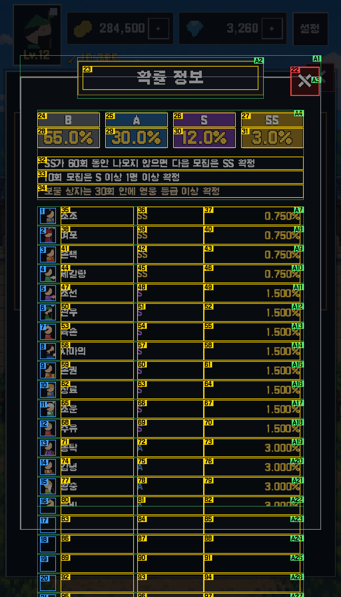

**영역 (컨테이너)**

| A | x, y | 크기 | 노드 |
|---|---|---|---|
| A1 | 60, 166 | 904 × 1424 | `popup_layer/@Control@62/@Control@64` |
| A2 | 232, 172 | 560 × 124 | `popup_layer/@Control@62/@Control@64/@Control@66` |
| A3 | 60, 230 | 904 × 1360 | `popup_layer/@Control@62/@Control@64/@Control@65` |
| A4 | 112, 330 | 800 × 270 | `popup_layer/@Control@62/@Control@64/@Control@68` |
| A5 | 112, 620 | 800 × 900 | `popup_layer/@Control@62/@Control@64/@ScrollContainer@104` |
| A6 | 112, 620 | 800 × 1856 | `popup_layer/@Control@62/@Control@64/@ScrollContainer@104/@Control@71` |
| A7 | 112, 620 | 800 × 56 | `popup_layer/@Control@62/@Control@64/@ScrollContainer@104/@Control@71/@Control@72` |
| A8 | 112, 678 | 800 × 56 | `popup_layer/@Control@62/@Control@64/@ScrollContainer@104/@Control@71/@Control@73` |
| A9 | 112, 736 | 800 × 56 | `popup_layer/@Control@62/@Control@64/@ScrollContainer@104/@Control@71/@Control@74` |
| A10 | 112, 794 | 800 × 56 | `popup_layer/@Control@62/@Control@64/@ScrollContainer@104/@Control@71/@Control@75` |
| A11 | 112, 852 | 800 × 56 | `popup_layer/@Control@62/@Control@64/@ScrollContainer@104/@Control@71/@Control@76` |
| A12 | 112, 910 | 800 × 56 | `popup_layer/@Control@62/@Control@64/@ScrollContainer@104/@Control@71/@Control@77` |
| A13 | 112, 968 | 800 × 56 | `popup_layer/@Control@62/@Control@64/@ScrollContainer@104/@Control@71/@Control@78` |
| A14 | 112, 1026 | 800 × 56 | `popup_layer/@Control@62/@Control@64/@ScrollContainer@104/@Control@71/@Control@79` |
| A15 | 112, 1084 | 800 × 56 | `popup_layer/@Control@62/@Control@64/@ScrollContainer@104/@Control@71/@Control@80` |
| A16 | 112, 1142 | 800 × 56 | `popup_layer/@Control@62/@Control@64/@ScrollContainer@104/@Control@71/@Control@81` |
| A17 | 112, 1200 | 800 × 56 | `popup_layer/@Control@62/@Control@64/@ScrollContainer@104/@Control@71/@Control@82` |
| A18 | 112, 1258 | 800 × 56 | `popup_layer/@Control@62/@Control@64/@ScrollContainer@104/@Control@71/@Control@83` |
| A19 | 112, 1316 | 800 × 56 | `popup_layer/@Control@62/@Control@64/@ScrollContainer@104/@Control@71/@Control@84` |
| A20 | 112, 1374 | 800 × 56 | `popup_layer/@Control@62/@Control@64/@ScrollContainer@104/@Control@71/@Control@85` |
| A21 | 112, 1432 | 800 × 56 | `popup_layer/@Control@62/@Control@64/@ScrollContainer@104/@Control@71/@Control@86` |
| A22 | 112, 1490 | 800 × 56 | `popup_layer/@Control@62/@Control@64/@ScrollContainer@104/@Control@71/@Control@87` |
| A23 | 112, 1548 | 800 × 56 | `popup_layer/@Control@62/@Control@64/@ScrollContainer@104/@Control@71/@Control@88` |
| A24 | 112, 1606 | 800 × 56 | `popup_layer/@Control@62/@Control@64/@ScrollContainer@104/@Control@71/@Control@89` |
| A25 | 112, 1664 | 800 × 56 | `popup_layer/@Control@62/@Control@64/@ScrollContainer@104/@Control@71/@Control@90` |
| A26 | 112, 1722 | 800 × 56 | `popup_layer/@Control@62/@Control@64/@ScrollContainer@104/@Control@71/@Control@91` |
| A27 | 112, 1780 | 800 × 56 | `popup_layer/@Control@62/@Control@64/@ScrollContainer@104/@Control@71/@Control@92` |

**점검: 문제 없음**

**자리**

| # | 종류 | x, y | 크기 | 내용 |
|---|---|---|---|---|
| 1 | 그림 | 120, 624 | 48 × 48 | 초상 caocao |
| 2 | 그림 | 120, 682 | 48 × 48 | 초상 lvbu |
| 3 | 그림 | 120, 740 | 48 × 48 | 초상 sunce |
| 4 | 그림 | 120, 798 | 48 × 48 | 초상 zhugeliang |
| 5 | 그림 | 120, 856 | 48 × 48 | 초상 diaochan |
| 6 | 그림 | 120, 914 | 48 × 48 | 초상 guanyu |
| 7 | 그림 | 120, 972 | 48 × 48 | 초상 luxun |
| 8 | 그림 | 120, 1030 | 48 × 48 | 초상 simayi |
| 9 | 그림 | 120, 1088 | 48 × 48 | 초상 sunquan |
| 10 | 그림 | 120, 1146 | 48 × 48 | 초상 zhangliao |
| 11 | 그림 | 120, 1204 | 48 × 48 | 초상 zhaoyun |
| 12 | 그림 | 120, 1262 | 48 × 48 | 초상 zhouyu |
| 13 | 그림 | 120, 1320 | 48 × 48 | 초상 dongzhuo |
| 14 | 그림 | 120, 1378 | 48 × 48 | 초상 ganning |
| 15 | 그림 | 120, 1436 | 48 × 48 | 초상 huangzhong |
| 16 | 그림 | 120, 1494 | 48 × 48 | 초상 liubei |
| 17 | 그림 | 120, 1552 | 48 × 48 | 초상 taishici |
| 18 | 그림 | 120, 1610 | 48 × 48 | 초상 xiahoudun |
| 19 | 그림 | 120, 1668 | 48 × 48 | 초상 xiahouyuan |
| 20 | 그림 | 120, 1726 | 48 × 48 | 초상 xuchu |
| 21 | 그림 | 120, 1784 | 48 × 48 | 초상 yuanshao |
| 22 | 버튼 | 872, 200 | 88 × 88 | tab_red |
| 23 | 글자 | 248, 198 | 528 × 72 | “확률 정보” |
| 24 | 글자 | 112, 338 | 188 × 44 | “B” |
| 25 | 글자 | 316, 338 | 188 × 44 | “A” |
| 26 | 글자 | 520, 338 | 188 × 44 | “S” |
| 27 | 글자 | 724, 338 | 188 × 44 | “SS” |
| 28 | 글자 | 112, 384 | 188 × 60 | “55.0%” |
| 29 | 글자 | 316, 384 | 188 × 60 | “30.0%” |
| 30 | 글자 | 520, 384 | 188 × 60 | “12.0%” |
| 31 | 글자 | 724, 384 | 188 × 60 | “3.0%” |
| 32 | 글자 | 112, 470 | 800 × 40 | “· SS가 60회 동안 나오지 않으면 다음 모집은 …” |
| 33 | 글자 | 112, 512 | 800 × 40 | “· 10회 모집은 S 이상 1명 이상 확정” |
| 34 | 글자 | 112, 554 | 800 × 40 | “· 보물 상자는 30회 안에 영웅 등급 이상 확정” |
| 35 | 글자 | 182, 620 | 220 × 56 | “조조” |
| 36 | 글자 | 412, 620 | 200 × 56 | “SS” |
| 37 | 글자 | 612, 620 | 290 × 56 | “0.750%” |
| 38 | 글자 | 182, 678 | 220 × 56 | “여포” |
| 39 | 글자 | 412, 678 | 200 × 56 | “SS” |
| 40 | 글자 | 612, 678 | 290 × 56 | “0.750%” |
| 41 | 글자 | 182, 736 | 220 × 56 | “손책” |
| 42 | 글자 | 412, 736 | 200 × 56 | “SS” |
| 43 | 글자 | 612, 736 | 290 × 56 | “0.750%” |
| 44 | 글자 | 182, 794 | 220 × 56 | “제갈량” |
| 45 | 글자 | 412, 794 | 200 × 56 | “SS” |
| 46 | 글자 | 612, 794 | 290 × 56 | “0.750%” |
| 47 | 글자 | 182, 852 | 220 × 56 | “초선” |
| 48 | 글자 | 412, 852 | 200 × 56 | “S” |
| 49 | 글자 | 612, 852 | 290 × 56 | “1.500%” |
| 50 | 글자 | 182, 910 | 220 × 56 | “관우” |
| 51 | 글자 | 412, 910 | 200 × 56 | “S” |
| 52 | 글자 | 612, 910 | 290 × 56 | “1.500%” |
| 53 | 글자 | 182, 968 | 220 × 56 | “육손” |
| 54 | 글자 | 412, 968 | 200 × 56 | “S” |
| 55 | 글자 | 612, 968 | 290 × 56 | “1.500%” |
| 56 | 글자 | 182, 1026 | 220 × 56 | “사마의” |
| 57 | 글자 | 412, 1026 | 200 × 56 | “S” |
| 58 | 글자 | 612, 1026 | 290 × 56 | “1.500%” |
| 59 | 글자 | 182, 1084 | 220 × 56 | “손권” |
| 60 | 글자 | 412, 1084 | 200 × 56 | “S” |
| 61 | 글자 | 612, 1084 | 290 × 56 | “1.500%” |
| 62 | 글자 | 182, 1142 | 220 × 56 | “장료” |
| 63 | 글자 | 412, 1142 | 200 × 56 | “S” |
| 64 | 글자 | 612, 1142 | 290 × 56 | “1.500%” |
| 65 | 글자 | 182, 1200 | 220 × 56 | “조운” |
| 66 | 글자 | 412, 1200 | 200 × 56 | “S” |
| 67 | 글자 | 612, 1200 | 290 × 56 | “1.500%” |
| 68 | 글자 | 182, 1258 | 220 × 56 | “주유” |
| 69 | 글자 | 412, 1258 | 200 × 56 | “S” |
| 70 | 글자 | 612, 1258 | 290 × 56 | “1.500%” |
| 71 | 글자 | 182, 1316 | 220 × 56 | “동탁” |
| 72 | 글자 | 412, 1316 | 200 × 56 | “A” |
| 73 | 글자 | 612, 1316 | 290 × 56 | “3.000%” |
| 74 | 글자 | 182, 1374 | 220 × 56 | “감녕” |
| 75 | 글자 | 412, 1374 | 200 × 56 | “A” |
| 76 | 글자 | 612, 1374 | 290 × 56 | “3.000%” |
| 77 | 글자 | 182, 1432 | 220 × 56 | “황충” |
| 78 | 글자 | 412, 1432 | 200 × 56 | “A” |
| 79 | 글자 | 612, 1432 | 290 × 56 | “3.000%” |
| 80 | 글자 | 182, 1490 | 220 × 56 | “유비” |
| 81 | 글자 | 412, 1490 | 200 × 56 | “A” |
| 82 | 글자 | 612, 1490 | 290 × 56 | “3.000%” |
| 83 | 글자 | 182, 1548 | 220 × 56 | “태사자” |
| 84 | 글자 | 412, 1548 | 200 × 56 | “A” |
| 85 | 글자 | 612, 1548 | 290 × 56 | “3.000%” |
| 86 | 글자 | 182, 1606 | 220 × 56 | “하후돈” |
| 87 | 글자 | 412, 1606 | 200 × 56 | “A” |
| 88 | 글자 | 612, 1606 | 290 × 56 | “3.000%” |
| 89 | 글자 | 182, 1664 | 220 × 56 | “하후연” |
| 90 | 글자 | 412, 1664 | 200 × 56 | “A” |
| 91 | 글자 | 612, 1664 | 290 × 56 | “3.000%” |
| 92 | 글자 | 182, 1722 | 220 × 56 | “허저” |
| 93 | 글자 | 412, 1722 | 200 × 56 | “A” |
| 94 | 글자 | 612, 1722 | 290 × 56 | “3.000%” |
| 95 | 글자 | 182, 1780 | 220 × 56 | “원소” |
| 96 | 글자 | 412, 1780 | 200 × 56 | “A” |
| 97 | 글자 | 612, 1780 | 290 × 56 | “3.000%” |

판(테두리 틀): `panel_ctrl` 904×1360, `tab_red` 88×88

## 팝업 — 확률(골드 장수) — `26b_pop_odds_gold`

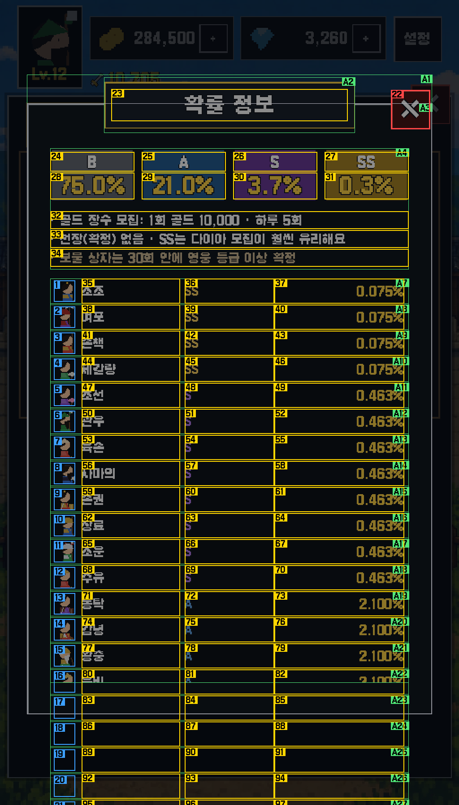

**영역 (컨테이너)**

| A | x, y | 크기 | 노드 |
|---|---|---|---|
| A1 | 60, 166 | 904 × 1424 | `popup_layer/@Control@62/@Control@64` |
| A2 | 232, 172 | 560 × 124 | `popup_layer/@Control@62/@Control@64/@Control@66` |
| A3 | 60, 230 | 904 × 1360 | `popup_layer/@Control@62/@Control@64/@Control@65` |
| A4 | 112, 330 | 800 × 270 | `popup_layer/@Control@62/@Control@64/@Control@68` |
| A5 | 112, 620 | 800 × 900 | `popup_layer/@Control@62/@Control@64/@ScrollContainer@104` |
| A6 | 112, 620 | 800 × 1856 | `popup_layer/@Control@62/@Control@64/@ScrollContainer@104/@Control@71` |
| A7 | 112, 620 | 800 × 56 | `popup_layer/@Control@62/@Control@64/@ScrollContainer@104/@Control@71/@Control@72` |
| A8 | 112, 678 | 800 × 56 | `popup_layer/@Control@62/@Control@64/@ScrollContainer@104/@Control@71/@Control@73` |
| A9 | 112, 736 | 800 × 56 | `popup_layer/@Control@62/@Control@64/@ScrollContainer@104/@Control@71/@Control@74` |
| A10 | 112, 794 | 800 × 56 | `popup_layer/@Control@62/@Control@64/@ScrollContainer@104/@Control@71/@Control@75` |
| A11 | 112, 852 | 800 × 56 | `popup_layer/@Control@62/@Control@64/@ScrollContainer@104/@Control@71/@Control@76` |
| A12 | 112, 910 | 800 × 56 | `popup_layer/@Control@62/@Control@64/@ScrollContainer@104/@Control@71/@Control@77` |
| A13 | 112, 968 | 800 × 56 | `popup_layer/@Control@62/@Control@64/@ScrollContainer@104/@Control@71/@Control@78` |
| A14 | 112, 1026 | 800 × 56 | `popup_layer/@Control@62/@Control@64/@ScrollContainer@104/@Control@71/@Control@79` |
| A15 | 112, 1084 | 800 × 56 | `popup_layer/@Control@62/@Control@64/@ScrollContainer@104/@Control@71/@Control@80` |
| A16 | 112, 1142 | 800 × 56 | `popup_layer/@Control@62/@Control@64/@ScrollContainer@104/@Control@71/@Control@81` |
| A17 | 112, 1200 | 800 × 56 | `popup_layer/@Control@62/@Control@64/@ScrollContainer@104/@Control@71/@Control@82` |
| A18 | 112, 1258 | 800 × 56 | `popup_layer/@Control@62/@Control@64/@ScrollContainer@104/@Control@71/@Control@83` |
| A19 | 112, 1316 | 800 × 56 | `popup_layer/@Control@62/@Control@64/@ScrollContainer@104/@Control@71/@Control@84` |
| A20 | 112, 1374 | 800 × 56 | `popup_layer/@Control@62/@Control@64/@ScrollContainer@104/@Control@71/@Control@85` |
| A21 | 112, 1432 | 800 × 56 | `popup_layer/@Control@62/@Control@64/@ScrollContainer@104/@Control@71/@Control@86` |
| A22 | 112, 1490 | 800 × 56 | `popup_layer/@Control@62/@Control@64/@ScrollContainer@104/@Control@71/@Control@87` |
| A23 | 112, 1548 | 800 × 56 | `popup_layer/@Control@62/@Control@64/@ScrollContainer@104/@Control@71/@Control@88` |
| A24 | 112, 1606 | 800 × 56 | `popup_layer/@Control@62/@Control@64/@ScrollContainer@104/@Control@71/@Control@89` |
| A25 | 112, 1664 | 800 × 56 | `popup_layer/@Control@62/@Control@64/@ScrollContainer@104/@Control@71/@Control@90` |
| A26 | 112, 1722 | 800 × 56 | `popup_layer/@Control@62/@Control@64/@ScrollContainer@104/@Control@71/@Control@91` |
| A27 | 112, 1780 | 800 × 56 | `popup_layer/@Control@62/@Control@64/@ScrollContainer@104/@Control@71/@Control@92` |

**점검: 문제 없음**

**자리**

| # | 종류 | x, y | 크기 | 내용 |
|---|---|---|---|---|
| 1 | 그림 | 120, 624 | 48 × 48 | 초상 caocao |
| 2 | 그림 | 120, 682 | 48 × 48 | 초상 lvbu |
| 3 | 그림 | 120, 740 | 48 × 48 | 초상 sunce |
| 4 | 그림 | 120, 798 | 48 × 48 | 초상 zhugeliang |
| 5 | 그림 | 120, 856 | 48 × 48 | 초상 diaochan |
| 6 | 그림 | 120, 914 | 48 × 48 | 초상 guanyu |
| 7 | 그림 | 120, 972 | 48 × 48 | 초상 luxun |
| 8 | 그림 | 120, 1030 | 48 × 48 | 초상 simayi |
| 9 | 그림 | 120, 1088 | 48 × 48 | 초상 sunquan |
| 10 | 그림 | 120, 1146 | 48 × 48 | 초상 zhangliao |
| 11 | 그림 | 120, 1204 | 48 × 48 | 초상 zhaoyun |
| 12 | 그림 | 120, 1262 | 48 × 48 | 초상 zhouyu |
| 13 | 그림 | 120, 1320 | 48 × 48 | 초상 dongzhuo |
| 14 | 그림 | 120, 1378 | 48 × 48 | 초상 ganning |
| 15 | 그림 | 120, 1436 | 48 × 48 | 초상 huangzhong |
| 16 | 그림 | 120, 1494 | 48 × 48 | 초상 liubei |
| 17 | 그림 | 120, 1552 | 48 × 48 | 초상 taishici |
| 18 | 그림 | 120, 1610 | 48 × 48 | 초상 xiahoudun |
| 19 | 그림 | 120, 1668 | 48 × 48 | 초상 xiahouyuan |
| 20 | 그림 | 120, 1726 | 48 × 48 | 초상 xuchu |
| 21 | 그림 | 120, 1784 | 48 × 48 | 초상 yuanshao |
| 22 | 버튼 | 872, 200 | 88 × 88 | tab_red |
| 23 | 글자 | 248, 198 | 528 × 72 | “확률 정보” |
| 24 | 글자 | 112, 338 | 188 × 44 | “B” |
| 25 | 글자 | 316, 338 | 188 × 44 | “A” |
| 26 | 글자 | 520, 338 | 188 × 44 | “S” |
| 27 | 글자 | 724, 338 | 188 × 44 | “SS” |
| 28 | 글자 | 112, 384 | 188 × 60 | “75.0%” |
| 29 | 글자 | 316, 384 | 188 × 60 | “21.0%” |
| 30 | 글자 | 520, 384 | 188 × 60 | “3.7%” |
| 31 | 글자 | 724, 384 | 188 × 60 | “0.3%” |
| 32 | 글자 | 112, 470 | 800 × 40 | “· 골드 장수 모집: 1회 골드 10,000 · 하…” |
| 33 | 글자 | 112, 512 | 800 × 40 | “· 천장(확정) 없음 · SS는 다이아 모집이 훨씬…” |
| 34 | 글자 | 112, 554 | 800 × 40 | “· 보물 상자는 30회 안에 영웅 등급 이상 확정” |
| 35 | 글자 | 182, 620 | 220 × 56 | “조조” |
| 36 | 글자 | 412, 620 | 200 × 56 | “SS” |
| 37 | 글자 | 612, 620 | 290 × 56 | “0.075%” |
| 38 | 글자 | 182, 678 | 220 × 56 | “여포” |
| 39 | 글자 | 412, 678 | 200 × 56 | “SS” |
| 40 | 글자 | 612, 678 | 290 × 56 | “0.075%” |
| 41 | 글자 | 182, 736 | 220 × 56 | “손책” |
| 42 | 글자 | 412, 736 | 200 × 56 | “SS” |
| 43 | 글자 | 612, 736 | 290 × 56 | “0.075%” |
| 44 | 글자 | 182, 794 | 220 × 56 | “제갈량” |
| 45 | 글자 | 412, 794 | 200 × 56 | “SS” |
| 46 | 글자 | 612, 794 | 290 × 56 | “0.075%” |
| 47 | 글자 | 182, 852 | 220 × 56 | “초선” |
| 48 | 글자 | 412, 852 | 200 × 56 | “S” |
| 49 | 글자 | 612, 852 | 290 × 56 | “0.463%” |
| 50 | 글자 | 182, 910 | 220 × 56 | “관우” |
| 51 | 글자 | 412, 910 | 200 × 56 | “S” |
| 52 | 글자 | 612, 910 | 290 × 56 | “0.463%” |
| 53 | 글자 | 182, 968 | 220 × 56 | “육손” |
| 54 | 글자 | 412, 968 | 200 × 56 | “S” |
| 55 | 글자 | 612, 968 | 290 × 56 | “0.463%” |
| 56 | 글자 | 182, 1026 | 220 × 56 | “사마의” |
| 57 | 글자 | 412, 1026 | 200 × 56 | “S” |
| 58 | 글자 | 612, 1026 | 290 × 56 | “0.463%” |
| 59 | 글자 | 182, 1084 | 220 × 56 | “손권” |
| 60 | 글자 | 412, 1084 | 200 × 56 | “S” |
| 61 | 글자 | 612, 1084 | 290 × 56 | “0.463%” |
| 62 | 글자 | 182, 1142 | 220 × 56 | “장료” |
| 63 | 글자 | 412, 1142 | 200 × 56 | “S” |
| 64 | 글자 | 612, 1142 | 290 × 56 | “0.463%” |
| 65 | 글자 | 182, 1200 | 220 × 56 | “조운” |
| 66 | 글자 | 412, 1200 | 200 × 56 | “S” |
| 67 | 글자 | 612, 1200 | 290 × 56 | “0.463%” |
| 68 | 글자 | 182, 1258 | 220 × 56 | “주유” |
| 69 | 글자 | 412, 1258 | 200 × 56 | “S” |
| 70 | 글자 | 612, 1258 | 290 × 56 | “0.463%” |
| 71 | 글자 | 182, 1316 | 220 × 56 | “동탁” |
| 72 | 글자 | 412, 1316 | 200 × 56 | “A” |
| 73 | 글자 | 612, 1316 | 290 × 56 | “2.100%” |
| 74 | 글자 | 182, 1374 | 220 × 56 | “감녕” |
| 75 | 글자 | 412, 1374 | 200 × 56 | “A” |
| 76 | 글자 | 612, 1374 | 290 × 56 | “2.100%” |
| 77 | 글자 | 182, 1432 | 220 × 56 | “황충” |
| 78 | 글자 | 412, 1432 | 200 × 56 | “A” |
| 79 | 글자 | 612, 1432 | 290 × 56 | “2.100%” |
| 80 | 글자 | 182, 1490 | 220 × 56 | “유비” |
| 81 | 글자 | 412, 1490 | 200 × 56 | “A” |
| 82 | 글자 | 612, 1490 | 290 × 56 | “2.100%” |
| 83 | 글자 | 182, 1548 | 220 × 56 | “태사자” |
| 84 | 글자 | 412, 1548 | 200 × 56 | “A” |
| 85 | 글자 | 612, 1548 | 290 × 56 | “2.100%” |
| 86 | 글자 | 182, 1606 | 220 × 56 | “하후돈” |
| 87 | 글자 | 412, 1606 | 200 × 56 | “A” |
| 88 | 글자 | 612, 1606 | 290 × 56 | “2.100%” |
| 89 | 글자 | 182, 1664 | 220 × 56 | “하후연” |
| 90 | 글자 | 412, 1664 | 200 × 56 | “A” |
| 91 | 글자 | 612, 1664 | 290 × 56 | “2.100%” |
| 92 | 글자 | 182, 1722 | 220 × 56 | “허저” |
| 93 | 글자 | 412, 1722 | 200 × 56 | “A” |
| 94 | 글자 | 612, 1722 | 290 × 56 | “2.100%” |
| 95 | 글자 | 182, 1780 | 220 × 56 | “원소” |
| 96 | 글자 | 412, 1780 | 200 × 56 | “A” |
| 97 | 글자 | 612, 1780 | 290 × 56 | “2.100%” |

판(테두리 틀): `panel_ctrl` 904×1360, `tab_red` 88×88

## 팝업 — 확률(병사) — `27_pop_odds_soldier`

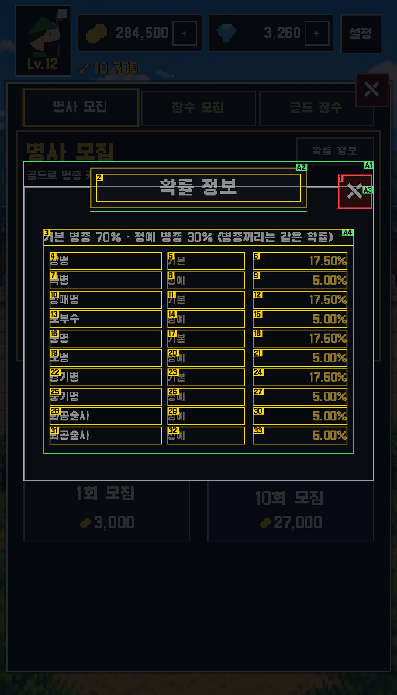

**영역 (컨테이너)**

| A | x, y | 크기 | 노드 |
|---|---|---|---|
| A1 | 60, 416 | 904 × 824 | `popup_layer/@Control@62/@Control@64` |
| A2 | 232, 422 | 560 × 124 | `popup_layer/@Control@62/@Control@64/@Control@66` |
| A3 | 60, 480 | 904 × 760 | `popup_layer/@Control@62/@Control@64/@Control@65` |
| A4 | 112, 590 | 800 × 580 | `popup_layer/@Control@62/@Control@64/@Control@68` |

**점검: 문제 없음**

**자리**

| # | 종류 | x, y | 크기 | 내용 |
|---|---|---|---|---|
| 1 | 버튼 | 872, 450 | 88 × 88 | tab_red |
| 2 | 글자 | 248, 448 | 528 × 72 | “확률 정보” |
| 3 | 글자 | 112, 590 | 800 × 44 | “기본 병종 70% · 정예 병종 30% (병종끼리는…” |
| 4 | 글자 | 128, 650 | 290 × 46 | “창병” |
| 5 | 글자 | 432, 650 | 200 × 46 | “기본” |
| 6 | 글자 | 652, 650 | 244 × 46 | “17.50%” |
| 7 | 글자 | 128, 700 | 290 × 46 | “극병” |
| 8 | 글자 | 432, 700 | 200 × 46 | “정예” |
| 9 | 글자 | 652, 700 | 244 × 46 | “5.00%” |
| 10 | 글자 | 128, 750 | 290 × 46 | “방패병” |
| 11 | 글자 | 432, 750 | 200 × 46 | “기본” |
| 12 | 글자 | 652, 750 | 244 × 46 | “17.50%” |
| 13 | 글자 | 128, 800 | 290 × 46 | “도부수” |
| 14 | 글자 | 432, 800 | 200 × 46 | “정예” |
| 15 | 글자 | 652, 800 | 244 × 46 | “5.00%” |
| 16 | 글자 | 128, 850 | 290 × 46 | “궁병” |
| 17 | 글자 | 432, 850 | 200 × 46 | “기본” |
| 18 | 글자 | 652, 850 | 244 × 46 | “17.50%” |
| 19 | 글자 | 128, 900 | 290 × 46 | “노병” |
| 20 | 글자 | 432, 900 | 200 × 46 | “정예” |
| 21 | 글자 | 652, 900 | 244 × 46 | “5.00%” |
| 22 | 글자 | 128, 950 | 290 × 46 | “경기병” |
| 23 | 글자 | 432, 950 | 200 × 46 | “기본” |
| 24 | 글자 | 652, 950 | 244 × 46 | “17.50%” |
| 25 | 글자 | 128, 1000 | 290 × 46 | “중기병” |
| 26 | 글자 | 432, 1000 | 200 × 46 | “정예” |
| 27 | 글자 | 652, 1000 | 244 × 46 | “5.00%” |
| 28 | 글자 | 128, 1050 | 290 × 46 | “화공술사” |
| 29 | 글자 | 432, 1050 | 200 × 46 | “정예” |
| 30 | 글자 | 652, 1050 | 244 × 46 | “5.00%” |
| 31 | 글자 | 128, 1100 | 290 × 46 | “뇌공술사” |
| 32 | 글자 | 432, 1100 | 200 × 46 | “정예” |
| 33 | 글자 | 652, 1100 | 244 × 46 | “5.00%” |

판(테두리 틀): `panel_ctrl` 904×760, `tab_red` 88×88

## 팝업 — 확률(보물 상자) — `28_pop_odds_box`

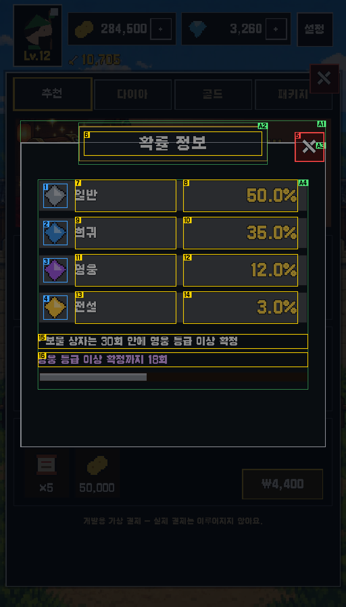

**영역 (컨테이너)**

| A | x, y | 크기 | 노드 |
|---|---|---|---|
| A1 | 60, 356 | 904 × 964 | `popup_layer/@Control@62/@Control@64` |
| A2 | 232, 362 | 560 × 124 | `popup_layer/@Control@62/@Control@64/@Control@66` |
| A3 | 60, 420 | 904 × 900 | `popup_layer/@Control@62/@Control@64/@Control@65` |
| A4 | 112, 530 | 800 × 620 | `popup_layer/@Control@62/@Control@64/@Control@68` |

**점검: 문제 없음**

**자리**

| # | 종류 | x, y | 크기 | 내용 |
|---|---|---|---|---|
| 1 | 그림 | 128, 542 | 72 × 72 | 아이콘 rarity_common |
| 2 | 그림 | 128, 652 | 72 × 72 | 아이콘 rarity_rare |
| 3 | 그림 | 128, 762 | 72 × 72 | 아이콘 rarity_epic |
| 4 | 그림 | 128, 872 | 72 × 72 | 아이콘 rarity_legend |
| 5 | 버튼 | 872, 390 | 88 × 88 | tab_red |
| 6 | 글자 | 248, 388 | 528 × 72 | “확률 정보” |
| 7 | 글자 | 222, 530 | 300 × 96 | “일반” |
| 8 | 글자 | 542, 530 | 340 × 96 | “50.0%” |
| 9 | 글자 | 222, 640 | 300 × 96 | “희귀” |
| 10 | 글자 | 542, 640 | 340 × 96 | “35.0%” |
| 11 | 글자 | 222, 750 | 300 × 96 | “영웅” |
| 12 | 글자 | 542, 750 | 340 × 96 | “12.0%” |
| 13 | 글자 | 222, 860 | 300 × 96 | “전설” |
| 14 | 글자 | 542, 860 | 340 × 96 | “3.0%” |
| 15 | 글자 | 112, 986 | 800 × 44 | “· 보물 상자는 30회 안에 영웅 등급 이상 확정” |
| 16 | 글자 | 112, 1040 | 800 × 44 | “영웅 등급 이상 확정까지 18회” |

판(테두리 틀): `panel_ctrl` 904×900, `tab_red` 88×88

## 팝업 — 확인 — `29_pop_confirm`

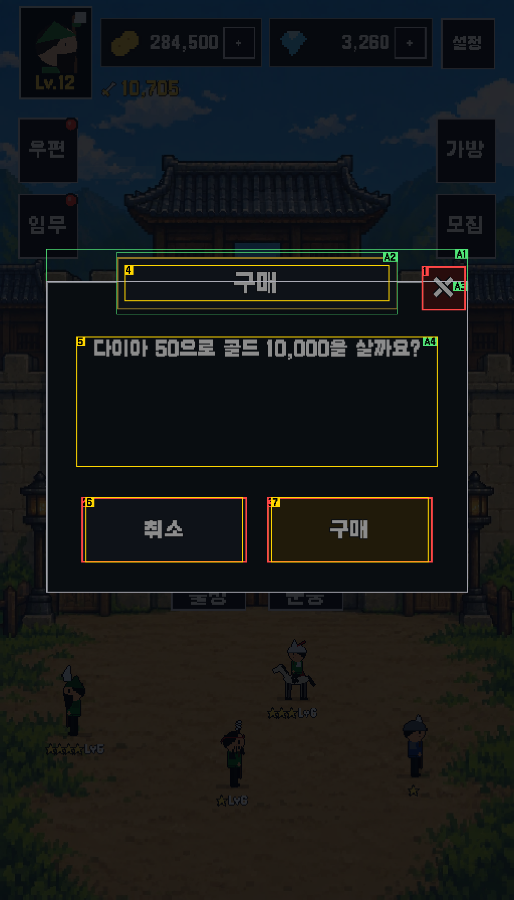

**영역 (컨테이너)**

| A | x, y | 크기 | 노드 |
|---|---|---|---|
| A1 | 92, 496 | 840 × 684 | `popup_layer/@Control@40/@Control@42` |
| A2 | 232, 502 | 560 × 124 | `popup_layer/@Control@40/@Control@42/@Control@44` |
| A3 | 92, 560 | 840 × 620 | `popup_layer/@Control@40/@Control@42/@Control@43` |
| A4 | 152, 670 | 720 × 260 | `popup_layer/@Control@40/@Control@42/@Control@46` |

**점검: 문제 없음**

**자리**

| # | 종류 | x, y | 크기 | 내용 |
|---|---|---|---|---|
| 1 | 버튼 | 840, 530 | 88 × 88 | tab_red |
| 2 | 버튼 | 162, 990 | 330 × 130 | 취소 |
| 3 | 버튼 | 532, 990 | 330 × 130 | 구매 |
| 4 | 글자 | 248, 528 | 528 × 72 | “구매” |
| 5 | 글자 | 152, 670 | 720 × 260 | “다이아 50으로 골드 10,000을 살까요?” |
| 6 | 글자 | 170, 990 | 314 × 130 | “취소” |
| 7 | 글자 | 540, 990 | 314 × 130 | “구매” |

판(테두리 틀): `panel_ctrl` 840×620, `tab_yellow` 330×130, `tab_wood` 330×130, `tab_red` 88×88

## 팝업 — 구매 — `30_pop_purchase`

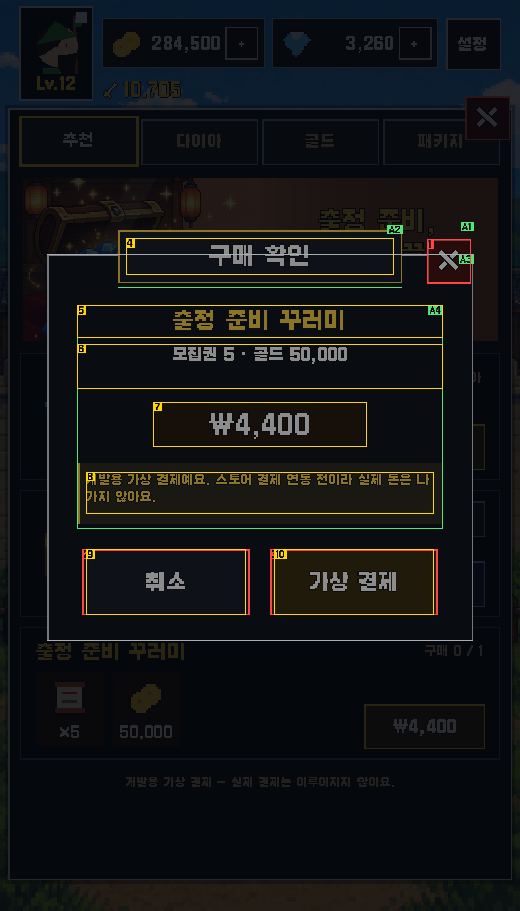

**영역 (컨테이너)**

| A | x, y | 크기 | 노드 |
|---|---|---|---|
| A1 | 92, 436 | 840 × 824 | `popup_layer/@Control@62/@Control@64` |
| A2 | 232, 442 | 560 × 124 | `popup_layer/@Control@62/@Control@64/@Control@66` |
| A3 | 92, 500 | 840 × 760 | `popup_layer/@Control@62/@Control@64/@Control@65` |
| A4 | 152, 600 | 720 × 440 | `popup_layer/@Control@62/@Control@64/@Control@68` |

**점검: 문제 없음**

**자리**

| # | 종류 | x, y | 크기 | 내용 |
|---|---|---|---|---|
| 1 | 버튼 | 840, 470 | 88 × 88 | tab_red |
| 2 | 버튼 | 162, 1080 | 330 × 130 | 취소 |
| 3 | 버튼 | 532, 1080 | 330 × 130 | 가상 결제 |
| 4 | 글자 | 248, 468 | 528 × 72 | “구매 확인” |
| 5 | 글자 | 152, 600 | 720 × 64 | “출정 준비 꾸러미” |
| 6 | 글자 | 152, 676 | 720 × 90 | “모집권 5 · 골드 50,000” |
| 7 | 글자 | 302, 790 | 420 × 90 | “₩4,400” |
| 8 | 글자 | 170, 928 | 684 × 84 | “개발용 가상 결제예요. 스토어 결제 연동 전이라 실…” |
| 9 | 글자 | 170, 1080 | 314 × 130 | “취소” |
| 10 | 글자 | 540, 1080 | 314 × 130 | “가상 결제” |

판(테두리 틀): `panel_ctrl` 840×760, `tab_yellow` 330×130, `tab_wood` 330×130, `tab_red` 88×88

## 팝업 — 보상 — `31_pop_reward`

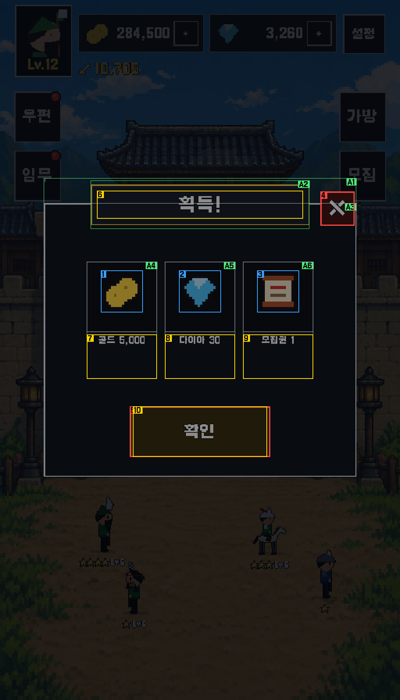

**영역 (컨테이너)**

| A | x, y | 크기 | 노드 |
|---|---|---|---|
| A1 | 112, 456 | 800 × 764 | `popup_layer/@Control@40/@Control@42` |
| A2 | 232, 462 | 560 × 124 | `popup_layer/@Control@40/@Control@42/@Control@44` |
| A3 | 112, 520 | 800 × 700 | `popup_layer/@Control@40/@Control@42/@Control@43` |
| A4 | 222, 670 | 180 × 300 | `popup_layer/@Control@40/@Control@42/@Control@46` |
| A5 | 422, 670 | 180 × 300 | `popup_layer/@Control@40/@Control@42/@Control@47` |
| A6 | 622, 670 | 180 × 300 | `popup_layer/@Control@40/@Control@42/@Control@48` |

**점검: 문제 없음**

**자리**

| # | 종류 | x, y | 크기 | 내용 |
|---|---|---|---|---|
| 1 | 그림 | 258, 692 | 108 × 108 | 아이콘 icon_gold |
| 2 | 그림 | 458, 692 | 108 × 108 | 아이콘 icon_diamond |
| 3 | 그림 | 658, 692 | 108 × 108 | 아이콘 ic_scroll |
| 4 | 버튼 | 820, 490 | 88 × 88 | tab_red |
| 5 | 버튼 | 332, 1040 | 360 × 130 | 확인 |
| 6 | 글자 | 248, 488 | 528 × 72 | “획득!” |
| 7 | 글자 | 222, 856 | 180 × 114 | “골드 5,000” |
| 8 | 글자 | 422, 856 | 180 × 114 | “다이아 30” |
| 9 | 글자 | 622, 856 | 180 × 114 | “모집권 1” |
| 10 | 글자 | 340, 1040 | 344 × 130 | “확인” |

판(테두리 틀): `panel_ctrl` 800×700, `tab_yellow` 360×130, `panel_slot` 180×180, `tab_red` 88×88

## 팝업 — 모집 결과 1회 — `32_pop_recruit_result`

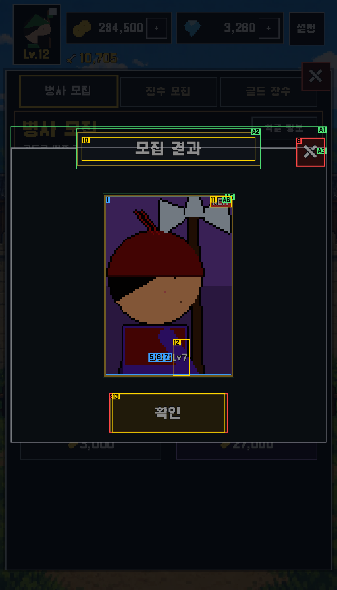

**영역 (컨테이너)**

| A | x, y | 크기 | 노드 |
|---|---|---|---|
| A1 | 32, 384 | 960 × 960 | `popup_layer/@Control@62/@Control@64` |
| A2 | 232, 390 | 560 × 124 | `popup_layer/@Control@62/@Control@64/@Control@66` |
| A3 | 32, 448 | 960 × 896 | `popup_layer/@Control@62/@Control@64/@Control@65` |
| A4 | 312, 588 | 400 × 560 | `popup_layer/@Control@62/@Control@64/@Control@74` |
| A5 | 312, 588 | 400 × 560 | `popup_layer/@Control@62/@Control@64/@Control@74/@BaseButton@71` |
| A6 | 321, 597 | 382 × 542 | `popup_layer/@Control@62/@Control@64/@Control@74/@BaseButton@71/@Control@69` |

**점검: 문제 없음**

**자리**

| # | 종류 | x, y | 크기 | 내용 |
|---|---|---|---|---|
| 1 | 그림 | 321, 597 | 382 × 542 | 큰 그림 lvbu |
| 2 | 그림 | 451, 1072 | 28 × 28 | 아이콘 ic_star |
| 3 | 그림 | 473, 1072 | 28 × 28 | 아이콘 ic_star |
| 4 | 그림 | 495, 1072 | 28 × 28 | 아이콘 ic_star |
| 5 | 그림 | 453, 1074 | 24 × 24 | 아이콘 ic_star |
| 6 | 그림 | 475, 1074 | 24 × 24 | 아이콘 ic_star |
| 7 | 그림 | 497, 1074 | 24 × 24 | 아이콘 ic_star |
| 8 | 버튼 | 900, 418 | 88 × 88 | tab_red |
| 9 | 버튼 | 332, 1194 | 360 × 120 | 확인 |
| 10 | 글자 | 248, 416 | 528 × 72 | “모집 결과” |
| 11 | 글자 | 638, 596 | 66 × 34 | “NEW” |
| 12 | 글자 | 525, 1030 | 52 × 112 | “Lv7” |
| 13 | 글자 | 340, 1194 | 344 × 120 | “확인” |

판(테두리 틀): `panel_ctrl` 960×896, `tab_yellow` 360×120, `tab_red` 88×88

## 팝업 — 모집 결과 10회 — `33_pop_recruit_ten`

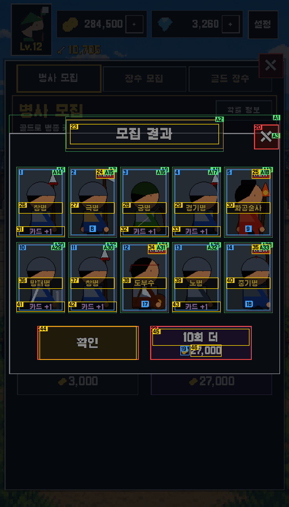

**영역 (컨테이너)**

| A | x, y | 크기 | 노드 |
|---|---|---|---|
| A1 | 32, 406 | 960 × 916 | `popup_layer/@Control@62/@Control@64` |
| A2 | 232, 412 | 560 × 124 | `popup_layer/@Control@62/@Control@64/@Control@66` |
| A3 | 32, 470 | 960 × 852 | `popup_layer/@Control@62/@Control@64/@Control@65` |
| A4 | 58, 590 | 172 × 250 | `popup_layer/@Control@62/@Control@64/@Control@74` |
| A5 | 58, 590 | 172 × 250 | `popup_layer/@Control@62/@Control@64/@Control@74/@BaseButton@71` |
| A6 | 242, 590 | 172 × 250 | `popup_layer/@Control@62/@Control@64/@Control@81` |
| A7 | 242, 590 | 172 × 250 | `popup_layer/@Control@62/@Control@64/@Control@81/@BaseButton@78` |
| A8 | 426, 590 | 172 × 250 | `popup_layer/@Control@62/@Control@64/@Control@88` |
| A9 | 426, 590 | 172 × 250 | `popup_layer/@Control@62/@Control@64/@Control@88/@BaseButton@85` |
| A10 | 610, 590 | 172 × 250 | `popup_layer/@Control@62/@Control@64/@Control@95` |
| A11 | 610, 590 | 172 × 250 | `popup_layer/@Control@62/@Control@64/@Control@95/@BaseButton@92` |
| A12 | 794, 590 | 172 × 250 | `popup_layer/@Control@62/@Control@64/@Control@102` |
| A13 | 794, 590 | 172 × 250 | `popup_layer/@Control@62/@Control@64/@Control@102/@BaseButton@99` |
| A14 | 67, 599 | 154 × 232 | `popup_layer/@Control@62/@Control@64/@Control@74/@BaseButton@71/@Control@69` |
| A15 | 251, 599 | 154 × 232 | `popup_layer/@Control@62/@Control@64/@Control@81/@BaseButton@78/@Control@76` |
| A16 | 435, 599 | 154 × 232 | `popup_layer/@Control@62/@Control@64/@Control@88/@BaseButton@85/@Control@83` |
| A17 | 619, 599 | 154 × 232 | `popup_layer/@Control@62/@Control@64/@Control@95/@BaseButton@92/@Control@90` |
| A18 | 803, 599 | 154 × 232 | `popup_layer/@Control@62/@Control@64/@Control@102/@BaseButton@99/@Control@97` |
| A19 | 58, 856 | 172 × 250 | `popup_layer/@Control@62/@Control@64/@Control@109` |
| A20 | 58, 856 | 172 × 250 | `popup_layer/@Control@62/@Control@64/@Control@109/@BaseButton@106` |
| A21 | 242, 856 | 172 × 250 | `popup_layer/@Control@62/@Control@64/@Control@116` |
| A22 | 242, 856 | 172 × 250 | `popup_layer/@Control@62/@Control@64/@Control@116/@BaseButton@113` |
| A23 | 426, 856 | 172 × 250 | `popup_layer/@Control@62/@Control@64/@Control@123` |
| A24 | 426, 856 | 172 × 250 | `popup_layer/@Control@62/@Control@64/@Control@123/@BaseButton@120` |
| A25 | 610, 856 | 172 × 250 | `popup_layer/@Control@62/@Control@64/@Control@130` |
| A26 | 610, 856 | 172 × 250 | `popup_layer/@Control@62/@Control@64/@Control@130/@BaseButton@127` |
| A27 | 794, 856 | 172 × 250 | `popup_layer/@Control@62/@Control@64/@Control@137` |
| A28 | 794, 856 | 172 × 250 | `popup_layer/@Control@62/@Control@64/@Control@137/@BaseButton@134` |
| A29 | 67, 865 | 154 × 232 | `popup_layer/@Control@62/@Control@64/@Control@109/@BaseButton@106/@Control@104` |
| A30 | 251, 865 | 154 × 232 | `popup_layer/@Control@62/@Control@64/@Control@116/@BaseButton@113/@Control@111` |
| A31 | 435, 865 | 154 × 232 | `popup_layer/@Control@62/@Control@64/@Control@123/@BaseButton@120/@Control@118` |
| A32 | 619, 865 | 154 × 232 | `popup_layer/@Control@62/@Control@64/@Control@130/@BaseButton@127/@Control@125` |
| A33 | 803, 865 | 154 × 232 | `popup_layer/@Control@62/@Control@64/@Control@137/@BaseButton@134/@Control@132` |

**점검: 문제 없음**

**자리**

| # | 종류 | x, y | 크기 | 내용 |
|---|---|---|---|---|
| 1 | 그림 | 67, 599 | 154 × 232 | 초상 spear |
| 2 | 그림 | 251, 599 | 154 × 232 | 초상 halberd |
| 3 | 그림 | 435, 599 | 154 × 232 | 초상 archer |
| 4 | 그림 | 619, 599 | 154 × 232 | 초상 rider |
| 5 | 그림 | 803, 599 | 154 × 232 | 초상 fire |
| 6 | 그림 | 317, 797 | 23 × 23 | 아이콘 ic_star |
| 7 | 그림 | 869, 797 | 23 × 23 | 아이콘 ic_star |
| 8 | 그림 | 319, 799 | 19 × 19 | 아이콘 ic_star |
| 9 | 그림 | 871, 799 | 19 × 19 | 아이콘 ic_star |
| 10 | 그림 | 67, 865 | 154 × 232 | 초상 shield |
| 11 | 그림 | 251, 865 | 154 × 232 | 초상 spear |
| 12 | 그림 | 435, 865 | 154 × 232 | 초상 axe |
| 13 | 그림 | 619, 865 | 154 × 232 | 초상 crossbow |
| 14 | 그림 | 803, 865 | 154 × 232 | 초상 heavy |
| 15 | 그림 | 501, 1063 | 23 × 23 | 아이콘 ic_star |
| 16 | 그림 | 869, 1063 | 23 × 23 | 아이콘 ic_star |
| 17 | 그림 | 503, 1065 | 19 × 19 | 아이콘 ic_star |
| 18 | 그림 | 871, 1065 | 19 × 19 | 아이콘 ic_star |
| 19 | 그림 | 639, 1223 | 33 × 33 | 아이콘 icon_gold |
| 20 | 버튼 | 900, 440 | 88 × 88 | tab_red |
| 21 | 버튼 | 132, 1152 | 360 × 120 | 확인 |
| 22 | 버튼 | 532, 1152 | 360 × 120 | 10회 더 |
| 23 | 글자 | 248, 438 | 528 × 72 | “모집 결과” |
| 24 | 글자 | 340, 598 | 66 × 34 | “NEW” |
| 25 | 글자 | 892, 598 | 66 × 34 | “NEW” |
| 26 | 글자 | 66, 715 | 156 × 40 | “창병” |
| 27 | 글자 | 250, 715 | 156 × 40 | “극병” |
| 28 | 글자 | 434, 715 | 156 × 40 | “궁병” |
| 29 | 글자 | 618, 715 | 156 × 40 | “경기병” |
| 30 | 글자 | 802, 715 | 156 × 40 | “화공술사” |
| 31 | 글자 | 58, 800 | 172 × 36 | “카드 +1” |
| 32 | 글자 | 426, 800 | 172 × 36 | “카드 +1” |
| 33 | 글자 | 610, 800 | 172 × 36 | “카드 +1” |
| 34 | 글자 | 524, 864 | 66 × 34 | “NEW” |
| 35 | 글자 | 892, 864 | 66 × 34 | “NEW” |
| 36 | 글자 | 66, 981 | 156 × 40 | “방패병” |
| 37 | 글자 | 250, 981 | 156 × 40 | “창병” |
| 38 | 글자 | 434, 981 | 156 × 40 | “도부수” |
| 39 | 글자 | 618, 981 | 156 × 40 | “노병” |
| 40 | 글자 | 802, 981 | 156 × 40 | “중기병” |
| 41 | 글자 | 58, 1066 | 172 × 36 | “카드 +1” |
| 42 | 글자 | 242, 1066 | 172 × 36 | “카드 +1” |
| 43 | 글자 | 610, 1066 | 172 × 36 | “카드 +1” |
| 44 | 글자 | 140, 1152 | 344 × 120 | “확인” |
| 45 | 글자 | 540, 1162 | 344 × 60 | “10회 더” |
| 46 | 글자 | 675, 1218 | 110 × 43 | “27,000” |

판(테두리 틀): `panel_ctrl` 960×852, `tab_yellow` 360×120, `tab_purple` 360×120, `tab_red` 88×88

## 팝업 — 일시정지 — `34_pop_pause`

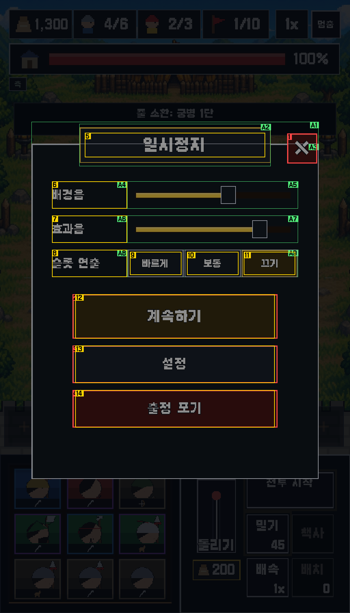

**영역 (컨테이너)**

| A | x, y | 크기 | 노드 |
|---|---|---|---|
| A1 | 92, 356 | 840 × 1044 | `popup_layer/@Control@37/@Control@39` |
| A2 | 232, 362 | 560 × 124 | `popup_layer/@Control@37/@Control@39/@Control@41` |
| A3 | 92, 420 | 840 × 980 | `popup_layer/@Control@37/@Control@39/@Control@40` |
| A4 | 152, 530 | 220 × 80 | `popup_layer/@Control@37/@Control@39/@Control@43` |
| A5 | 372, 530 | 500 × 80 | `popup_layer/@Control@37/@Control@39/@Control@44` |
| A6 | 152, 630 | 220 × 80 | `popup_layer/@Control@37/@Control@39/@Control@45` |
| A7 | 372, 630 | 500 × 80 | `popup_layer/@Control@37/@Control@39/@Control@46` |
| A8 | 152, 730 | 220 × 80 | `popup_layer/@Control@37/@Control@39/@Control@47` |
| A9 | 372, 730 | 500 × 80 | `popup_layer/@Control@37/@Control@39/@Control@48` |

**점검: 문제 없음**

**자리**

| # | 종류 | x, y | 크기 | 내용 |
|---|---|---|---|---|
| 1 | 버튼 | 840, 390 | 88 × 88 | tab_red |
| 2 | 버튼 | 212, 860 | 600 × 130 | 계속하기 |
| 3 | 버튼 | 212, 1010 | 600 × 110 | 설정 |
| 4 | 버튼 | 212, 1140 | 600 × 110 | 출정 포기 |
| 5 | 글자 | 248, 388 | 528 × 72 | “일시정지” |
| 6 | 글자 | 152, 530 | 220 × 80 | “배경음” |
| 7 | 글자 | 152, 630 | 220 × 80 | “효과음” |
| 8 | 글자 | 152, 730 | 220 × 80 | “슬롯 연출” |
| 9 | 글자 | 380, 736 | 151 × 68 | “빠르게” |
| 10 | 글자 | 547, 736 | 151 × 68 | “보통” |
| 11 | 글자 | 713, 736 | 151 × 68 | “끄기” |
| 12 | 글자 | 220, 860 | 584 × 130 | “계속하기” |
| 13 | 글자 | 220, 1010 | 584 × 110 | “설정” |
| 14 | 글자 | 220, 1140 | 584 × 110 | “출정 포기” |

판(테두리 틀): `panel_ctrl` 840×980, `tab_yellow` 600×130, `tab_wood` 600×110, `tab_red` 600×110, `tab_yellow` 163×80, `btn_small` 163×80, `tab_red` 88×88, `btn_small` 44×52

## 팝업 — 웨이브 승리 — `35_pop_wave_clear`

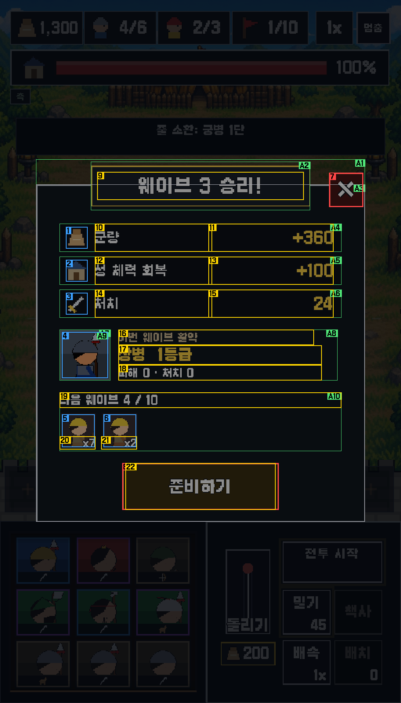

**영역 (컨테이너)**

| A | x, y | 크기 | 노드 |
|---|---|---|---|
| A1 | 92, 406 | 840 × 924 | `popup_layer/@Control@37/@Control@39` |
| A2 | 232, 412 | 560 × 124 | `popup_layer/@Control@37/@Control@39/@Control@41` |
| A3 | 92, 470 | 840 × 860 | `popup_layer/@Control@37/@Control@39/@Control@40` |
| A4 | 152, 570 | 720 × 72 | `popup_layer/@Control@37/@Control@39/@Control@43` |
| A5 | 152, 654 | 720 × 72 | `popup_layer/@Control@37/@Control@39/@Control@44` |
| A6 | 152, 738 | 720 × 72 | `popup_layer/@Control@37/@Control@39/@Control@45` |
| A7 | 152, 840 | 130 × 130 | `popup_layer/@Control@37/@Control@39/@Control@49` |
| A8 | 302, 840 | 560 × 130 | `popup_layer/@Control@37/@Control@39/@Control@50` |
| A9 | 158, 846 | 118 × 118 | `popup_layer/@Control@37/@Control@39/@Control@49/@Control@47` |
| A10 | 152, 1000 | 720 × 150 | `popup_layer/@Control@37/@Control@39/@Control@51` |

**점검: 문제 없음**

**자리**

| # | 종류 | x, y | 크기 | 내용 |
|---|---|---|---|---|
| 1 | 그림 | 168, 578 | 56 × 56 | 아이콘 icon_rice |
| 2 | 그림 | 168, 662 | 56 × 56 | 아이콘 icon_castle |
| 3 | 그림 | 168, 746 | 56 × 56 | 아이콘 ic_sword |
| 4 | 그림 | 158, 846 | 118 × 118 | 초상 spear |
| 5 | 그림 | 158, 1056 | 84 × 84 | 초상 enemy_mob |
| 6 | 그림 | 264, 1056 | 84 × 84 | 초상 enemy_sword |
| 7 | 버튼 | 840, 440 | 88 × 88 | tab_red |
| 8 | 버튼 | 312, 1180 | 400 × 120 | 준비하기 |
| 9 | 글자 | 248, 438 | 528 × 72 | “웨이브 3 승리!” |
| 10 | 글자 | 242, 570 | 300 × 72 | “군량” |
| 11 | 글자 | 532, 570 | 320 × 72 | “+360” |
| 12 | 글자 | 242, 654 | 300 × 72 | “성 체력 회복” |
| 13 | 글자 | 532, 654 | 320 × 72 | “+100” |
| 14 | 글자 | 242, 738 | 300 × 72 | “처치” |
| 15 | 글자 | 532, 738 | 320 × 72 | “24” |
| 16 | 글자 | 302, 840 | 500 × 40 | “이번 웨이브 활약” |
| 17 | 글자 | 302, 880 | 520 × 50 | “창병  1등급” |
| 18 | 글자 | 302, 930 | 520 × 40 | “피해 0 · 처치 0” |
| 19 | 글자 | 152, 1000 | 720 × 40 | “다음 웨이브 4 / 10” |
| 20 | 글자 | 152, 1112 | 92 × 34 | “x7” |
| 21 | 글자 | 258, 1112 | 92 × 34 | “x2” |
| 22 | 글자 | 320, 1180 | 384 × 120 | “준비하기” |

판(테두리 틀): `panel_ctrl` 840×860, `tab_yellow` 400×120, `tab_red` 88×88

## 팝업 — 흡수(특성 선택) — `36_pop_absorb`

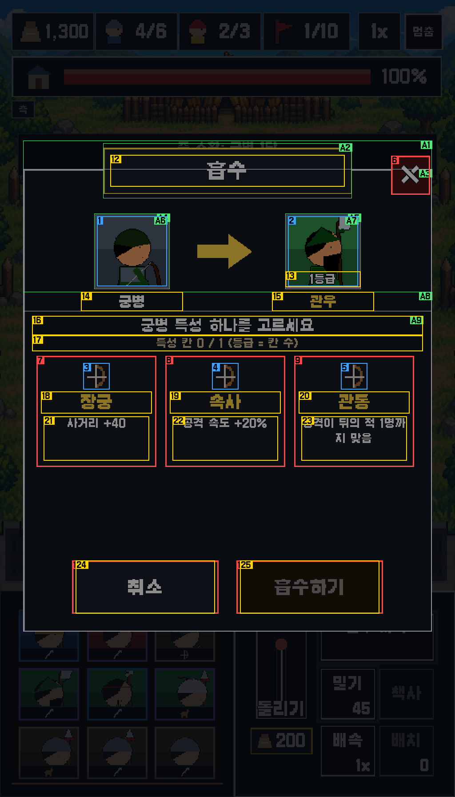

**영역 (컨테이너)**

| A | x, y | 크기 | 노드 |
|---|---|---|---|
| A1 | 52, 316 | 920 × 1104 | `popup_layer/@Control@37/@Control@39` |
| A2 | 232, 322 | 560 × 124 | `popup_layer/@Control@37/@Control@39/@Control@41` |
| A3 | 52, 380 | 920 × 1040 | `popup_layer/@Control@37/@Control@39/@Control@40` |
| A4 | 212, 480 | 170 × 170 | `popup_layer/@Control@37/@Control@39/@Control@46` |
| A5 | 642, 480 | 170 × 170 | `popup_layer/@Control@37/@Control@39/@Control@50` |
| A6 | 218, 486 | 158 × 158 | `popup_layer/@Control@37/@Control@39/@Control@46/@Control@44` |
| A7 | 648, 486 | 158 × 158 | `popup_layer/@Control@37/@Control@39/@Control@50/@Control@48` |
| A8 | 52, 656 | 920 × 44 | `popup_layer/@Control@37/@Control@39/@Control@52` |
| A9 | 72, 710 | 880 × 80 | `popup_layer/@Control@37/@Control@39/@Control@53` |

**점검: 문제 없음**

**자리**

| # | 종류 | x, y | 크기 | 내용 |
|---|---|---|---|---|
| 1 | 그림 | 218, 486 | 158 × 158 | 초상 archer |
| 2 | 그림 | 648, 486 | 158 × 158 | 초상 guanyu |
| 3 | 그림 | 187, 816 | 60 × 60 | 아이콘 class_arc |
| 4 | 그림 | 477, 816 | 60 × 60 | 아이콘 class_arc |
| 5 | 그림 | 767, 816 | 60 × 60 | 아이콘 class_arc |
| 6 | 버튼 | 880, 350 | 88 × 88 | tab_red |
| 7 | 버튼 | 82, 800 | 270 × 250 | panel_small |
| 8 | 버튼 | 372, 800 | 270 × 250 | panel_small |
| 9 | 버튼 | 662, 800 | 270 × 250 | panel_small |
| 10 | 버튼 | 162, 1260 | 330 × 120 | 취소 |
| 11 | 버튼 | 532, 1260 | 330 × 120 | 흡수하기 |
| 12 | 글자 | 248, 348 | 528 × 72 | “흡수” |
| 13 | 글자 | 642, 610 | 170 × 36 | “1등급” |
| 14 | 글자 | 182, 656 | 230 × 44 | “궁병” |
| 15 | 글자 | 612, 656 | 230 × 44 | “관우” |
| 16 | 글자 | 72, 710 | 880 × 44 | “궁병 특성 하나를 고르세요” |
| 17 | 글자 | 72, 754 | 880 × 36 | “특성 칸 0 / 1 (등급 = 칸 수)” |
| 18 | 글자 | 92, 880 | 250 × 50 | “장궁” |
| 19 | 글자 | 382, 880 | 250 × 50 | “속사” |
| 20 | 글자 | 672, 880 | 250 × 50 | “관통” |
| 21 | 글자 | 98, 936 | 238 × 100 | “사거리 +40” |
| 22 | 글자 | 388, 936 | 238 × 100 | “공격 속도 +20%” |
| 23 | 글자 | 678, 936 | 238 × 100 | “공격이 뒤의 적 1명까지 맞음” |
| 24 | 글자 | 170, 1260 | 314 × 120 | “취소” |
| 25 | 글자 | 540, 1260 | 314 × 120 | “흡수하기” |

판(테두리 틀): `panel_ctrl` 920×1040, `panel_small` 270×250, `tab_yellow` 330×120, `tab_wood` 330×120, `tab_red` 88×88

## 팝업 — 결과 승리 — `37_pop_result_win`

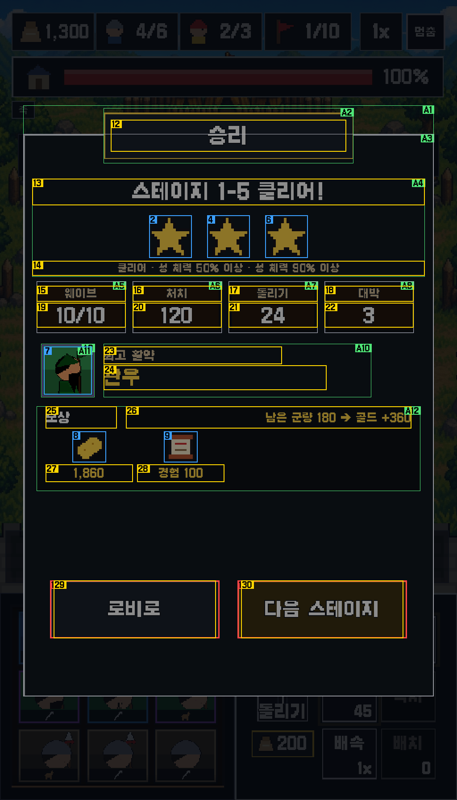

**영역 (컨테이너)**

| A | x, y | 크기 | 노드 |
|---|---|---|---|
| A1 | 52, 236 | 920 × 1324 | `popup_layer/@Control@37/@Control@39` |
| A2 | 232, 242 | 560 × 124 | `popup_layer/@Control@37/@Control@39/@Control@41` |
| A3 | 52, 300 | 920 × 1260 | `popup_layer/@Control@37/@Control@39/@Control@40` |
| A4 | 72, 400 | 880 × 220 | `popup_layer/@Control@37/@Control@39/@Control@42` |
| A5 | 82, 630 | 200 × 116 | `popup_layer/@Control@37/@Control@39/@Control@43` |
| A6 | 297, 630 | 200 × 116 | `popup_layer/@Control@37/@Control@39/@Control@44` |
| A7 | 512, 630 | 200 × 116 | `popup_layer/@Control@37/@Control@39/@Control@45` |
| A8 | 727, 630 | 200 × 116 | `popup_layer/@Control@37/@Control@39/@Control@46` |
| A9 | 92, 770 | 120 × 120 | `popup_layer/@Control@37/@Control@39/@Control@50` |
| A10 | 232, 770 | 600 × 120 | `popup_layer/@Control@37/@Control@39/@Control@51` |
| A11 | 98, 776 | 108 × 108 | `popup_layer/@Control@37/@Control@39/@Control@50/@Control@48` |
| A12 | 82, 910 | 860 × 190 | `popup_layer/@Control@37/@Control@39/@Control@52` |

**점검: 문제 없음**

**자리**

| # | 종류 | x, y | 크기 | 내용 |
|---|---|---|---|---|
| 1 | 그림 | 334, 482 | 96 × 96 | 아이콘 ic_star_off |
| 2 | 그림 | 334, 482 | 96 × 96 | 아이콘 ic_star |
| 3 | 그림 | 464, 482 | 96 × 96 | 아이콘 ic_star_off |
| 4 | 그림 | 464, 482 | 96 × 96 | 아이콘 ic_star |
| 5 | 그림 | 594, 482 | 96 × 96 | 아이콘 ic_star_off |
| 6 | 그림 | 594, 482 | 96 × 96 | 아이콘 ic_star |
| 7 | 그림 | 98, 776 | 108 × 108 | 초상 guanyu |
| 8 | 그림 | 162, 966 | 76 × 70 | 아이콘 icon_gold |
| 9 | 그림 | 367, 966 | 76 × 70 | 아이콘 ic_scroll |
| 10 | 버튼 | 112, 1300 | 380 × 130 | 로비로 |
| 11 | 버튼 | 532, 1300 | 380 × 130 | 다음 스테이지 |
| 12 | 글자 | 248, 268 | 528 × 72 | “승리” |
| 13 | 글자 | 72, 400 | 880 × 60 | “스테이지 1-5 클리어!” |
| 14 | 글자 | 72, 584 | 880 × 34 | “클리어 · 성 체력 50% 이상 · 성 체력 90%…” |
| 15 | 글자 | 82, 640 | 200 × 36 | “웨이브” |
| 16 | 글자 | 297, 640 | 200 × 36 | “처치” |
| 17 | 글자 | 512, 640 | 200 × 36 | “돌리기” |
| 18 | 글자 | 727, 640 | 200 × 36 | “대박” |
| 19 | 글자 | 82, 678 | 200 × 56 | “10/10” |
| 20 | 글자 | 297, 678 | 200 × 56 | “120” |
| 21 | 글자 | 512, 678 | 200 × 56 | “24” |
| 22 | 글자 | 727, 678 | 200 × 56 | “3” |
| 23 | 글자 | 232, 776 | 400 × 40 | “최고 활약” |
| 24 | 글자 | 232, 818 | 500 × 56 | “관우” |
| 25 | 글자 | 102, 910 | 160 × 50 | “보상” |
| 26 | 글자 | 282, 910 | 640 × 50 | “남은 군량 180 → 골드 +360” |
| 27 | 글자 | 102, 1040 | 196 × 40 | “1,860” |
| 28 | 글자 | 307, 1040 | 196 × 40 | “경험 100” |
| 29 | 글자 | 120, 1300 | 364 × 130 | “로비로” |
| 30 | 글자 | 540, 1300 | 364 × 130 | “다음 스테이지” |

판(테두리 틀): `panel_ctrl` 920×1260, `tab_yellow` 380×130, `tab_wood` 380×130, `panel_slot` 200×116

## 팝업 — 결과 패배 — `38_pop_result_lose`

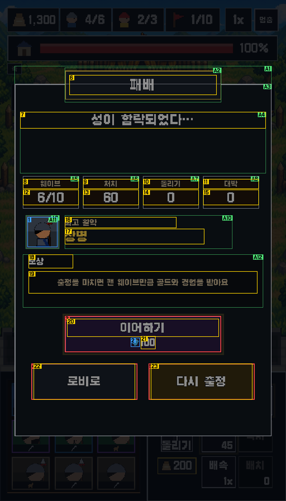

**영역 (컨테이너)**

| A | x, y | 크기 | 노드 |
|---|---|---|---|
| A1 | 52, 236 | 920 × 1324 | `popup_layer/@Control@37/@Control@39` |
| A2 | 232, 242 | 560 × 124 | `popup_layer/@Control@37/@Control@39/@Control@41` |
| A3 | 52, 300 | 920 × 1260 | `popup_layer/@Control@37/@Control@39/@Control@40` |
| A4 | 72, 400 | 880 × 220 | `popup_layer/@Control@37/@Control@39/@Control@42` |
| A5 | 82, 630 | 200 × 116 | `popup_layer/@Control@37/@Control@39/@Control@43` |
| A6 | 297, 630 | 200 × 116 | `popup_layer/@Control@37/@Control@39/@Control@44` |
| A7 | 512, 630 | 200 × 116 | `popup_layer/@Control@37/@Control@39/@Control@45` |
| A8 | 727, 630 | 200 × 116 | `popup_layer/@Control@37/@Control@39/@Control@46` |
| A9 | 92, 770 | 120 × 120 | `popup_layer/@Control@37/@Control@39/@Control@50` |
| A10 | 232, 770 | 600 × 120 | `popup_layer/@Control@37/@Control@39/@Control@51` |
| A11 | 98, 776 | 108 × 108 | `popup_layer/@Control@37/@Control@39/@Control@50/@Control@48` |
| A12 | 82, 910 | 860 × 190 | `popup_layer/@Control@37/@Control@39/@Control@52` |

**점검: 문제 없음**

**자리**

| # | 종류 | x, y | 크기 | 내용 |
|---|---|---|---|---|
| 1 | 그림 | 98, 776 | 108 × 108 | 초상 spear |
| 2 | 그림 | 468, 1208 | 33 × 33 | 아이콘 icon_diamond |
| 3 | 버튼 | 232, 1130 | 560 × 130 | 이어하기 |
| 4 | 버튼 | 112, 1300 | 380 × 130 | 로비로 |
| 5 | 버튼 | 532, 1300 | 380 × 130 | 다시 출정 |
| 6 | 글자 | 248, 268 | 528 × 72 | “패배” |
| 7 | 글자 | 72, 400 | 880 × 60 | “성이 함락되었다…” |
| 8 | 글자 | 82, 640 | 200 × 36 | “웨이브” |
| 9 | 글자 | 297, 640 | 200 × 36 | “처치” |
| 10 | 글자 | 512, 640 | 200 × 36 | “돌리기” |
| 11 | 글자 | 727, 640 | 200 × 36 | “대박” |
| 12 | 글자 | 82, 678 | 200 × 56 | “6/10” |
| 13 | 글자 | 297, 678 | 200 × 56 | “60” |
| 14 | 글자 | 512, 678 | 200 × 56 | “0” |
| 15 | 글자 | 727, 678 | 200 × 56 | “0” |
| 16 | 글자 | 232, 776 | 400 × 40 | “최고 활약” |
| 17 | 글자 | 232, 818 | 500 × 56 | “창병” |
| 18 | 글자 | 102, 910 | 160 × 50 | “보상” |
| 19 | 글자 | 102, 970 | 820 × 80 | “출정을 마치면 깬 웨이브만큼 골드와 경험을 받아요” |
| 20 | 글자 | 240, 1140 | 544 × 65 | “이어하기” |
| 21 | 글자 | 504, 1202 | 53 × 47 | “100” |
| 22 | 글자 | 120, 1300 | 364 × 130 | “로비로” |
| 23 | 글자 | 540, 1300 | 364 × 130 | “다시 출정” |

판(테두리 틀): `panel_ctrl` 920×1260, `tab_purple` 560×130, `tab_wood` 380×130, `tab_yellow` 380×130, `panel_slot` 200×116

## 튜토리얼 — 로비 — `39_tutorial_lobby`

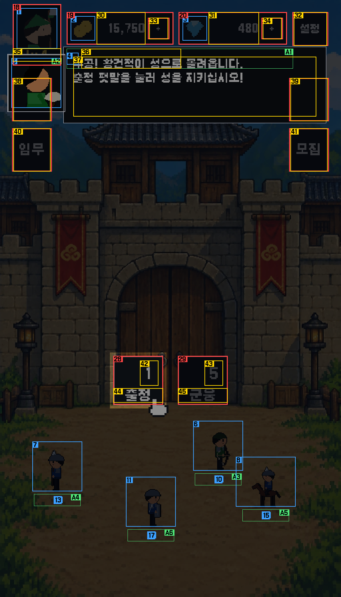

**영역 (컨테이너)**

| A | x, y | 크기 | 노드 |
|---|---|---|---|
| A1 | 200, 146 | 680 × 60 | `screen_layer/Lobby/@Control@25` |
| A2 | 34, 174 | 150 × 150 | `overlay_layer/@Control@40/@Control@41` |
| A3 | 585, 1421 | 140 × 36 | `screen_layer/Lobby/@Control@35` |
| A4 | 102, 1483 | 140 × 36 | `screen_layer/Lobby/@Control@29` |
| A5 | 728, 1529 | 140 × 36 | `screen_layer/Lobby/@Control@38` |
| A6 | 383, 1589 | 140 × 36 | `screen_layer/Lobby/@Control@32` |

**점검: 문제 없음**

**자리**

| # | 종류 | x, y | 크기 | 내용 |
|---|---|---|---|---|
| 배경 | 그림 | 0, 0 | 1024 × 1792 | 배경 lobby_bg |
| 1 | 그림 | 50, 24 | 122 × 122 | 얼굴 guanyu |
| 2 | 그림 | 212, 48 | 74 × 74 | 아이콘 icon_gold |
| 3 | 그림 | 548, 48 | 74 × 74 | 아이콘 icon_diamond |
| 4 | 그림 | 200, 158 | 36 × 36 | 아이콘 icon_sword |
| 5 | 그림 | 34, 174 | 150 × 150 | 초상 zhugeliang |
| 6 | 그림 | 580, 1263 | 150 × 150 | 캐릭터 동작 프레임 |
| 7 | 그림 | 97, 1325 | 150 × 150 | 캐릭터 동작 프레임 |
| 8 | 그림 | 708, 1371 | 180 × 150 | 캐릭터 동작 프레임 |
| 9 | 그림 | 644, 1427 | 24 × 24 | 아이콘 ic_star |
| 10 | 그림 | 646, 1429 | 20 × 20 | 아이콘 ic_star |
| 11 | 그림 | 378, 1431 | 150 × 150 | 캐릭터 동작 프레임 |
| 12 | 그림 | 161, 1489 | 24 × 24 | 아이콘 ic_star |
| 13 | 그림 | 163, 1491 | 20 × 20 | 아이콘 ic_star |
| 14 | 그림 | 786, 1535 | 24 × 24 | 아이콘 ic_star |
| 15 | 그림 | 788, 1537 | 20 × 20 | 아이콘 ic_star |
| 16 | 그림 | 442, 1595 | 24 × 24 | 아이콘 ic_star |
| 17 | 그림 | 444, 1597 | 20 × 20 | 아이콘 ic_star |
| 18 | 버튼 | 38, 12 | 146 × 185 | frame_portrait |
| 19 | 버튼 | 200, 36 | 321 × 98 | 15,750 |
| 20 | 버튼 | 536, 36 | 326 × 98 | 480 |
| 21 | 버튼 | 878, 36 | 108 × 102 | btn_settings |
| 22 | 버튼 | 444, 53 | 65 × 65 | btn_plus |
| 23 | 버튼 | 785, 53 | 65 × 65 | btn_plus |
| 24 | 버튼 | 36, 234 | 120 × 130 | btn_mail |
| 25 | 버튼 | 868, 234 | 120 × 130 | btn_bag |
| 26 | 버튼 | 36, 385 | 120 × 130 | btn_mission |
| 27 | 버튼 | 868, 385 | 120 × 130 | btn_recruit |
| 28 | 버튼 | 340, 1068 | 150 × 147 | sign_battle |
| 29 | 버튼 | 534, 1068 | 150 × 147 | btn_arena |
| 30 | 글자 | 290, 36 | 147 × 98 | “15,750” |
| 31 | 글자 | 626, 36 | 152 × 98 | “480” |
| 32 | 글자 | 882, 36 | 100 × 102 | “설정” |
| 33 | 글자 | 448, 53 | 57 × 65 | “+” |
| 34 | 글자 | 789, 53 | 57 × 65 | “+” |
| 35 | 글자 | 38, 145 | 146 × 40 | “Lv.4” |
| 36 | 글자 | 244, 146 | 300 × 60 | “0” |
| 37 | 글자 | 220, 170 | 730 × 180 | “주공! 황건적이 성으로 몰려옵니다. 출정 팻말을 눌…” |
| 38 | 글자 | 40, 234 | 112 × 130 | “우편” |
| 39 | 글자 | 872, 234 | 112 × 130 | “가방” |
| 40 | 글자 | 40, 385 | 112 × 130 | “임무” |
| 41 | 글자 | 872, 385 | 112 × 130 | “모집” |
| 42 | 글자 | 420, 1082 | 56 × 76 | “1” |
| 43 | 글자 | 614, 1082 | 56 × 76 | “5” |
| 44 | 글자 | 340, 1165 | 150 × 44 | “출정” |
| 45 | 글자 | 534, 1165 | 150 × 44 | “군웅” |

판(테두리 틀): `panel_slot` 790×230, `panel_chip` 326×98, `panel_chip` 321×98, `frame_portrait` 174×174, `frame_portrait` 146×185, `sign_battle` 150×147, `btn_arena` 150×147, `btn_recruit` 120×130, `btn_bag` 120×130, `btn_mission` 120×130, `btn_mail` 120×130, `btn_settings` 108×102, `btn_plus` 65×65

## 튜토리얼 — 전투 — `40_tutorial_battle`

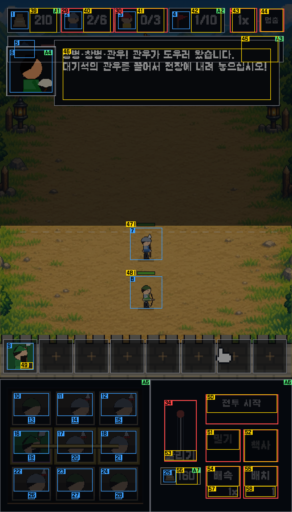

**영역 (컨테이너)**

| A | x, y | 크기 | 노드 |
|---|---|---|---|
| A1 | 26, 28 | 186 × 86 | `screen_layer/Battle/@BaseButton@27` |
| A2 | 592, 28 | 196 × 86 | `screen_layer/Battle/@BaseButton@30` |
| A3 | 26, 126 | 968 × 92 | `screen_layer/Battle/@Control@33` |
| A4 | 34, 174 | 150 × 150 | `overlay_layer/@Control@51/@Control@52` |
| A5 | 0, 1328 | 526 × 464 | `screen_layer/Battle/@Control@18` |
| A6 | 526, 1328 | 498 × 464 | `screen_layer/Battle/@Control@19` |
| A7 | 563, 1636 | 140 × 60 | `screen_layer/Battle/@Control@20` |

**점검: 문제 없음**

**자리**

| # | 종류 | x, y | 크기 | 내용 |
|---|---|---|---|---|
| 배경 | 그림 | 0, 0 | 1024 × 1200 | 배경 battle_field |
| 1 | 그림 | 38, 40 | 62 × 62 | 아이콘 icon_rice |
| 2 | 그림 | 226, 40 | 62 × 62 | 아이콘 icon_soldier |
| 3 | 그림 | 414, 40 | 62 × 62 | 아이콘 icon_hero |
| 4 | 그림 | 604, 40 | 62 × 62 | 아이콘 icon_flag |
| 5 | 그림 | 50, 140 | 72 × 63 | 아이콘 icon_castle |
| 6 | 그림 | 34, 174 | 150 × 150 | 초상 zhugeliang |
| 7 | 그림 | 456, 797 | 113 × 113 | 캐릭터 동작 프레임 |
| 8 | 그림 | 456, 967 | 113 × 113 | 캐릭터 동작 프레임 |
| 9 | 그림 | 24, 1200 | 94 × 94 | 초상 guanyu |
| 10 | 그림 | 48, 1376 | 124 × 80 | 초상 reel_cell |
| 11 | 그림 | 201, 1376 | 124 × 80 | 초상 reel_cell |
| 12 | 그림 | 354, 1376 | 124 × 80 | 초상 reel_cell |
| 13 | 그림 | 98, 1459 | 24 × 24 | 아이콘 class_arc |
| 14 | 그림 | 251, 1459 | 24 × 24 | 아이콘 class_cav |
| 15 | 그림 | 404, 1459 | 24 × 24 | 아이콘 class_cav |
| 16 | 그림 | 48, 1508 | 124 × 80 | 초상 reel_cell |
| 17 | 그림 | 201, 1508 | 124 × 80 | 초상 reel_cell |
| 18 | 그림 | 354, 1508 | 124 × 80 | 초상 reel_cell |
| 19 | 그림 | 98, 1591 | 24 × 24 | 아이콘 class_inf |
| 20 | 그림 | 251, 1591 | 24 × 24 | 아이콘 class_inf |
| 21 | 그림 | 404, 1591 | 24 × 24 | 아이콘 class_inf |
| 22 | 그림 | 48, 1640 | 124 × 80 | 초상 reel_cell |
| 23 | 그림 | 201, 1640 | 124 × 80 | 초상 reel_cell |
| 24 | 그림 | 354, 1640 | 124 × 80 | 초상 reel_cell |
| 25 | 그림 | 573, 1644 | 44 × 44 | 아이콘 icon_rice |
| 26 | 그림 | 98, 1723 | 24 × 24 | 아이콘 class_cav |
| 27 | 그림 | 251, 1723 | 24 × 24 | 아이콘 class_arc |
| 28 | 그림 | 404, 1723 | 24 × 24 | 아이콘 class_arc |
| 29 | 버튼 | 214, 28 | 186 × 86 | 2/6 |
| 30 | 버튼 | 402, 28 | 186 × 86 | 0/3 |
| 31 | 버튼 | 806, 28 | 96 × 86 | 1x |
| 32 | 버튼 | 910, 30 | 87 × 82 | btn_pause |
| 33 | 버튼 | 721, 1380 | 255 × 105 | btn_battle |
| 34 | 버튼 | 576, 1400 | 114 × 216 | lever |
| 35 | 버튼 | 721, 1503 | 123 × 114 | btn_nudge |
| 36 | 버튼 | 853, 1503 | 123 × 114 | btn_advisor |
| 37 | 버튼 | 721, 1631 | 123 × 114 | btn_speed |
| 38 | 버튼 | 853, 1631 | 123 × 114 | btn_bench |
| 39 | 글자 | 104, 28 | 96 × 86 | “210” |
| 40 | 글자 | 292, 28 | 96 × 86 | “2/6” |
| 41 | 글자 | 480, 28 | 96 × 86 | “0/3” |
| 42 | 글자 | 670, 28 | 106 × 86 | “1/10” |
| 43 | 글자 | 814, 28 | 80 × 86 | “1x” |
| 44 | 글자 | 914, 30 | 79 × 82 | “멈춤” |
| 45 | 글자 | 846, 126 | 130 × 92 | “100%” |
| 46 | 글자 | 220, 170 | 730 × 180 | “창병·창병·관우! 관우가 도우러 왔습니다. 대기석의…” |
| 47 | 글자 | 442, 775 | 34 × 20 | “1단” |
| 48 | 글자 | 442, 945 | 34 × 20 | “1단” |
| 49 | 글자 | 72, 1268 | 44 × 24 | “1단” |
| 50 | 글자 | 725, 1380 | 247 × 65 | “전투 시작” |
| 51 | 글자 | 725, 1503 | 115 × 71 | “밀기” |
| 52 | 글자 | 857, 1503 | 115 × 114 | “책사” |
| 53 | 글자 | 576, 1576 | 114 × 36 | “돌리기” |
| 54 | 글자 | 725, 1631 | 115 × 71 | “배속” |
| 55 | 글자 | 857, 1631 | 115 × 71 | “배치” |
| 56 | 글자 | 617, 1636 | 76 × 60 | “160” |
| 57 | 글자 | 729, 1701 | 105 × 38 | “1x” |
| 58 | 글자 | 861, 1701 | 105 × 38 | “1” |

판(테두리 틀): `panel_slot` 526×464, `panel_ctrl` 498×464, `panel_slot` 790×230, `panel_wide` 968×92, `frame_portrait` 174×174, `btn_battle` 255×105, `lever` 114×216, `panel_small` 196×86, `panel_small` 186×86, `btn_advisor` 123×114, `btn_bench` 123×114, `btn_speed` 123×114, `btn_nudge` 123×114, `tile` 118×118 …

## 튜토리얼 — 한 칸 밀기 — `40b_tutorial_nudge`

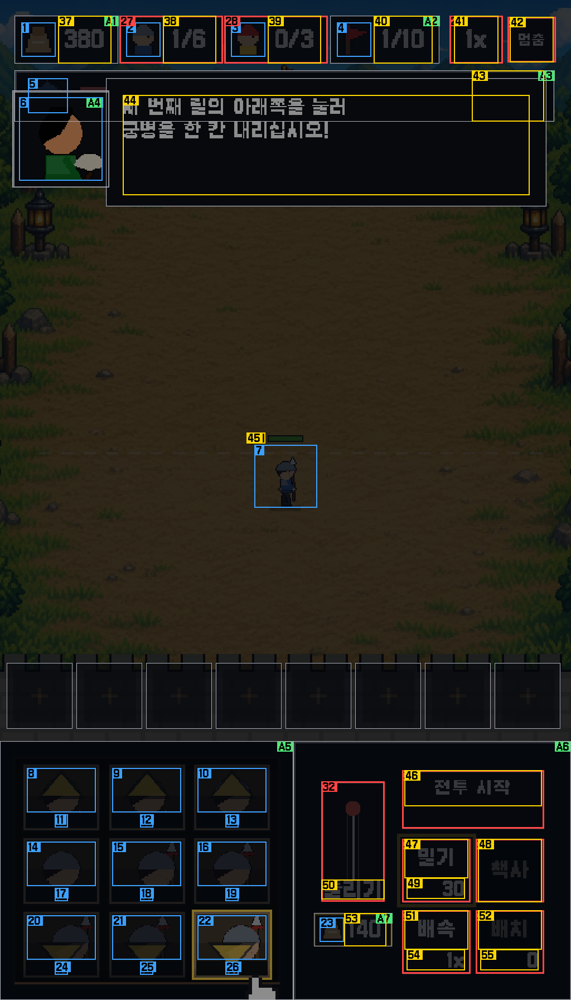

**영역 (컨테이너)**

| A | x, y | 크기 | 노드 |
|---|---|---|---|
| A1 | 26, 28 | 186 × 86 | `screen_layer/Battle/@BaseButton@27` |
| A2 | 592, 28 | 196 × 86 | `screen_layer/Battle/@BaseButton@30` |
| A3 | 26, 126 | 968 × 92 | `screen_layer/Battle/@Control@33` |
| A4 | 34, 174 | 150 × 150 | `overlay_layer/@Control@45/@Control@46` |
| A5 | 0, 1328 | 526 × 464 | `screen_layer/Battle/@Control@18` |
| A6 | 526, 1328 | 498 × 464 | `screen_layer/Battle/@Control@19` |
| A7 | 563, 1636 | 140 × 60 | `screen_layer/Battle/@Control@20` |

**점검: 문제 없음**

**자리**

| # | 종류 | x, y | 크기 | 내용 |
|---|---|---|---|---|
| 배경 | 그림 | 0, 0 | 1024 × 1200 | 배경 battle_field |
| 1 | 그림 | 38, 40 | 62 × 62 | 아이콘 icon_rice |
| 2 | 그림 | 226, 40 | 62 × 62 | 아이콘 icon_soldier |
| 3 | 그림 | 414, 40 | 62 × 62 | 아이콘 icon_hero |
| 4 | 그림 | 604, 40 | 62 × 62 | 아이콘 icon_flag |
| 5 | 그림 | 50, 140 | 72 × 63 | 아이콘 icon_castle |
| 6 | 그림 | 34, 174 | 150 × 150 | 초상 zhugeliang |
| 7 | 그림 | 456, 797 | 113 × 113 | 캐릭터 동작 프레임 |
| 8 | 그림 | 48, 1376 | 124 × 80 | 초상 reel_cell |
| 9 | 그림 | 201, 1376 | 124 × 80 | 초상 reel_cell |
| 10 | 그림 | 354, 1376 | 124 × 80 | 초상 reel_cell |
| 11 | 그림 | 98, 1459 | 24 × 24 | 아이콘 class_arc |
| 12 | 그림 | 251, 1459 | 24 × 24 | 아이콘 class_arc |
| 13 | 그림 | 404, 1459 | 24 × 24 | 아이콘 class_inf |
| 14 | 그림 | 48, 1508 | 124 × 80 | 초상 reel_cell |
| 15 | 그림 | 201, 1508 | 124 × 80 | 초상 reel_cell |
| 16 | 그림 | 354, 1508 | 124 × 80 | 초상 reel_cell |
| 17 | 그림 | 98, 1591 | 24 × 24 | 아이콘 class_inf |
| 18 | 그림 | 251, 1591 | 24 × 24 | 아이콘 class_cav |
| 19 | 그림 | 404, 1591 | 24 × 24 | 아이콘 class_inf |
| 20 | 그림 | 48, 1640 | 124 × 80 | 초상 reel_cell |
| 21 | 그림 | 201, 1640 | 124 × 80 | 초상 reel_cell |
| 22 | 그림 | 354, 1640 | 124 × 80 | 초상 reel_cell |
| 23 | 그림 | 573, 1644 | 44 × 44 | 아이콘 icon_rice |
| 24 | 그림 | 98, 1723 | 24 × 24 | 아이콘 class_cav |
| 25 | 그림 | 251, 1723 | 24 × 24 | 아이콘 class_inf |
| 26 | 그림 | 404, 1723 | 24 × 24 | 아이콘 class_cav |
| 27 | 버튼 | 214, 28 | 186 × 86 | 1/6 |
| 28 | 버튼 | 402, 28 | 186 × 86 | 0/3 |
| 29 | 버튼 | 806, 28 | 96 × 86 | 1x |
| 30 | 버튼 | 910, 30 | 87 × 82 | btn_pause |
| 31 | 버튼 | 721, 1380 | 255 × 105 | btn_battle |
| 32 | 버튼 | 576, 1400 | 114 × 216 | lever |
| 33 | 버튼 | 721, 1503 | 123 × 114 | btn_nudge |
| 34 | 버튼 | 853, 1503 | 123 × 114 | btn_advisor |
| 35 | 버튼 | 721, 1631 | 123 × 114 | btn_speed |
| 36 | 버튼 | 853, 1631 | 123 × 114 | btn_bench |
| 37 | 글자 | 104, 28 | 96 × 86 | “380” |
| 38 | 글자 | 292, 28 | 96 × 86 | “1/6” |
| 39 | 글자 | 480, 28 | 96 × 86 | “0/3” |
| 40 | 글자 | 670, 28 | 106 × 86 | “1/10” |
| 41 | 글자 | 814, 28 | 80 × 86 | “1x” |
| 42 | 글자 | 914, 30 | 79 × 82 | “멈춤” |
| 43 | 글자 | 846, 126 | 130 × 92 | “100%” |
| 44 | 글자 | 220, 170 | 730 × 180 | “세 번째 릴의 아래쪽을 눌러 궁병을 한 칸 내리십시…” |
| 45 | 글자 | 442, 775 | 34 × 20 | “1단” |
| 46 | 글자 | 725, 1380 | 247 × 65 | “전투 시작” |
| 47 | 글자 | 725, 1503 | 115 × 71 | “밀기” |
| 48 | 글자 | 857, 1503 | 115 × 114 | “책사” |
| 49 | 글자 | 729, 1573 | 105 × 38 | “30” |
| 50 | 글자 | 576, 1576 | 114 × 36 | “돌리기” |
| 51 | 글자 | 725, 1631 | 115 × 71 | “배속” |
| 52 | 글자 | 857, 1631 | 115 × 71 | “배치” |
| 53 | 글자 | 617, 1636 | 76 × 60 | “140” |
| 54 | 글자 | 729, 1701 | 105 × 38 | “1x” |
| 55 | 글자 | 861, 1701 | 105 × 38 | “0” |

판(테두리 틀): `panel_slot` 526×464, `panel_ctrl` 498×464, `panel_slot` 790×230, `panel_wide` 968×92, `frame_portrait` 174×174, `btn_battle` 255×105, `lever` 114×216, `panel_small` 196×86, `panel_small` 186×86, `btn_advisor` 123×114, `btn_bench` 123×114, `btn_speed` 123×114, `btn_nudge` 123×114, `tile` 118×118 …
